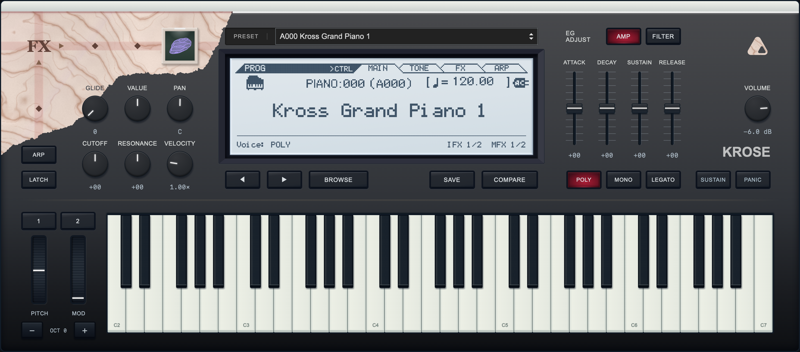
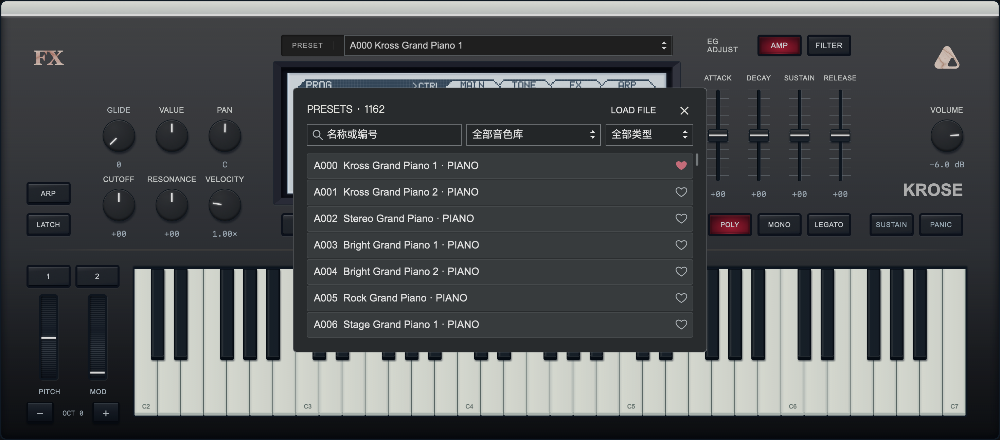
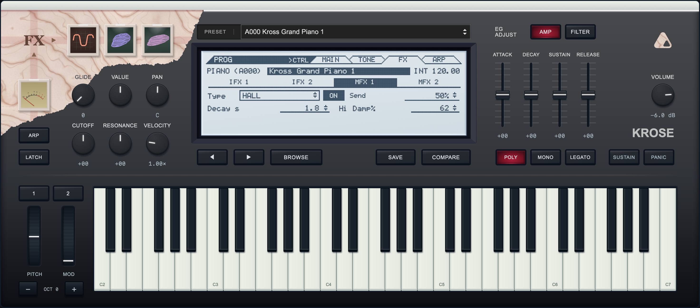

# Krose

[中文](README.zh-CN.md)

An iPlug2 sample instrument reconstructing KROSS 2 sounds, with macOS Universal and Windows x64 VST3 and standalone builds. The catalog contains 1,161 factory, GM and expansion Programs plus the compatible Concert entry. The scalable native editor and preset browser share the product catalog and original category order.



| Preset browser | FX editor |
| --- | --- |
| [](docs/screenshots/krose-browser.webp) | [](docs/screenshots/krose-fx.webp) |

The native editor uses IGraphics/NanoVG. Samples load per selected Program on a background thread, with a shared recent cache and pinned samples for existing voices. Playback continues during loading. See [sample loading and effects optimization](docs/SAMPLES.md) for measured memory use and switching behavior.

KeyLab Essential mk3 integration provides preset and parameter display, RGB FX buttons and mapped controls in standalone Krose, Ableton Live and FL Studio. Default builds include the scripts and extension templates in `Resources/Controllers`. See [controller setup](docs/CONTROLLERS.md) for installation and verification status. Window size and standalone buffer settings are under `CTRL → UI` and `CTRL → AUDIO`.

Original firmware and research code live in [krose-source](https://github.com/shiftz300/krose-source). Frozen runtime assets, fixtures and native editor resources remain here; normal builds do not use the research workspace.

## License

Original Krose code and documentation are licensed under [Apache-2.0](LICENSE). Manufacturer samples, Program data, firmware-derived tables, LCD resources and other third-party material are excluded from this grant. Third-party code and fonts retain their upstream licenses. See [licensing scope](docs/LICENSING.md), [NOTICE](NOTICE) and [third-party notices](licenses/THIRD_PARTY.txt). Inclusion in a repository or binary does not establish permission to redistribute excluded resources.

## Build

Requires CMake 3.25+, Ninja, macOS Command Line Tools and the local frozen sample bundles. Firmware and large sample packs are not included in Git.

The plugin runtime does not use Python. Python 3 remains a development dependency for SDK preparation, UI asset tools, validation and packaging; CI also uses these scripts. Once dependencies and frozen assets are available, ordinary CMake builds do not invoke the research tools.

```sh
python3 tools/bootstrap_plugin.py
cmake --preset plugin
cmake --build --preset plugin
ctest --preset plugin
```

Release builds enable LTO and automatically trained PGO by default. Use Clang/clang-cl with matching llvm-profdata; set `KROSE_ENABLE_PGO=OFF` to opt out. See [release configuration](docs/RELEASE.md) for toolchain and per-architecture rules.

Use the `engine` preset for headless engine/tools builds and `sanitize` for ASan/UBSan. Bundles are written to `build/plugin/out/`. Run the native editor check with:

```sh
build/plugin/test-vst3-host build/plugin/out/Krose.vst3 --editor
```

[CI and installers](docs/RELEASE.md) · [Project structure](docs/PROJECT_LAYOUT.md) · [Audio architecture and limits](docs/ARCHITECTURE.md) · [Native UI](docs/NATIVE_UI.md) · [Resource gaps](https://github.com/shiftz300/krose-source/blob/main/research/docs/architecture/RESOURCE_GAPS.md) · [Research handoff](https://github.com/shiftz300/krose-source/blob/main/research/docs/REVERSE_HANDOFF.md)
