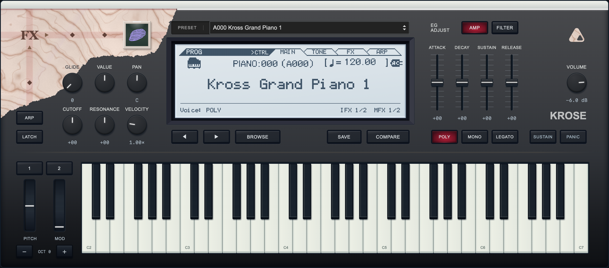
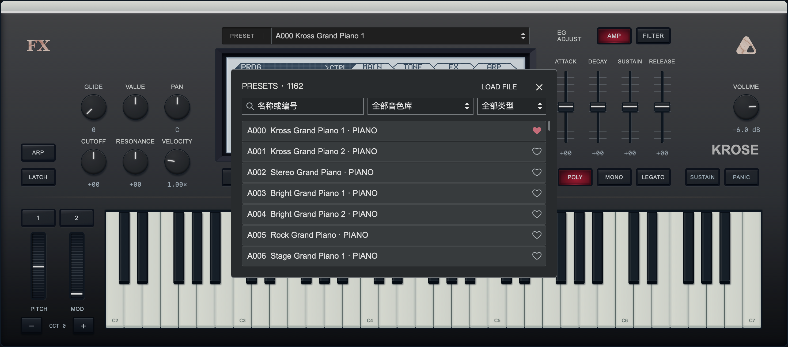
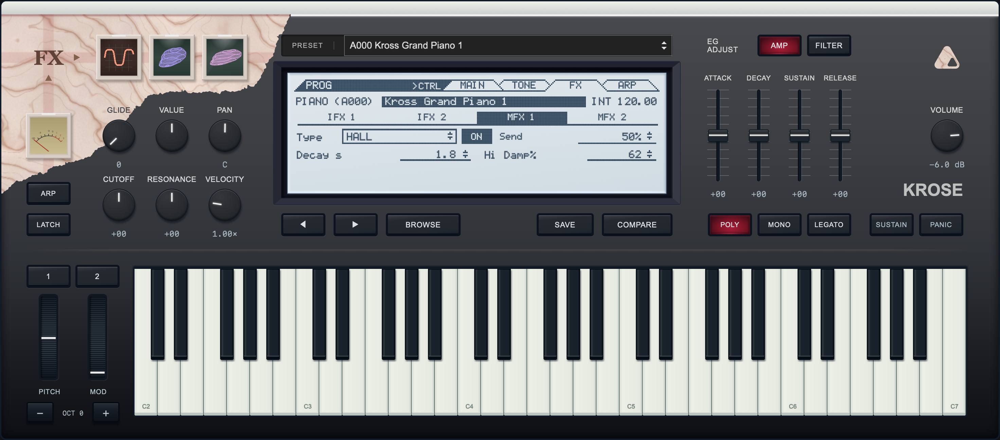

# Krose

[English](README.md)

基于 iPlug2 的 KROSS 2 采样乐器，提供 macOS arm64 VST3 和独立程序。当前接入 1,161 个出厂／GM／扩展 Program，另保留 Concert 兼容入口；原厂分类顺序与固定尺寸界面共用同一套目录和源码。



| 音色浏览 | FX 编辑 |
| --- | --- |
| [](docs/screenshots/krose-browser.webp) | [](docs/screenshots/krose-fx.webp) |

原生界面使用 IGraphics／NanoVG。采样按当前音色在后台加载，近期缓存与仍在发声的旧音符共享采样；切换期间保留播放。机制、内存实测和效果优化见 [采样加载](docs/SAMPLES.md)。

原始固件和研究代码独立保存于 [krose-source](https://github.com/shiftz300/krose-source)。产品保留冻结运行资源、测试夹具及原生界面资源；普通构建不依赖研究目录。

## 许可证

Krose 的原创代码和原创文档采用 [Apache-2.0](LICENSE)。原厂采样、Program 数据、固件派生表、LCD 资源及其他第三方内容不在此授权范围内；第三方代码和字体保留各自许可证。具体边界见[授权范围说明](docs/LICENSING.md)、[NOTICE](NOTICE) 和[第三方声明](licenses/THIRD_PARTY.txt)。内容进入仓库或二进制不代表已取得原厂资源的再分发权。

## 构建

需要 CMake 3.25+、Ninja、macOS Command Line Tools 和本地冻结采样包。固件及大型采样包不随 Git 仓库提供。

插件运行时不使用 Python。Python 3 仍用于 SDK 准备、界面素材工具、校验和打包，CI 也会调用这些脚本。依赖和冻结资源就绪后，普通 CMake 构建不调用研究工具。

```sh
python3 tools/bootstrap_plugin.py
cmake --preset plugin
cmake --build --preset plugin
ctest --preset plugin
```

Release 默认开启 LTO 和自动 PGO；首次构建会先运行核心训练程序。可通过 `-DKROSE_ENABLE_PGO=OFF` 关闭；详细工具链和多架构规则见[发行配置](docs/RELEASE.md)。

不构建 GUI 时使用 `engine` preset；内存检查使用 `sanitize` preset。产物位于 `build/plugin/out/`。原生窗口检查：

```sh
build/plugin/test-vst3-host build/plugin/out/Krose.vst3 --editor
```

[目录与模块边界](docs/PROJECT_LAYOUT.md) · [音频架构与已知限制](docs/ARCHITECTURE.md) · [原生界面](docs/NATIVE_UI.md) · [剩余资源复核](https://github.com/shiftz300/krose-source/blob/main/research/docs/architecture/RESOURCE_GAPS.md) · [研究交接](https://github.com/shiftz300/krose-source/blob/main/research/docs/REVERSE_HANDOFF.md)
