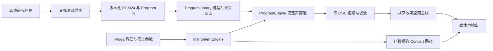

# 原生共享采样与 Program 引擎

2026-11-01。本轮是可运行的首批接入，不是整机 TG/DSP 模拟器。仍使用 iPlug2，插件保留在项目构建目录，不复制或安装。

## 当前最合适的结构

每个插件实例选择一个 Program；不同实例复用同一份只读采样。资源加载、参数编译、实时声部处理、界面各自独立。原有 Concert 保留为兼容路径，新板载音色进入通用引擎。



- `ProgramLibrary`：只在加载阶段进行文件 I/O、PCM24→float 转换和锁操作。库内采样按 ID 去重，单声道只存一份，立体声引用两份采样。进程内以规范路径、弱引用缓存复用；最后一个实例释放后可回收。
- `InstrumentProgram`：保存稳定的来源 ID、原始控制参数与区域引用。加载时将音高/力度/OSC 选择编译成查找表；发声时无需搜索文件或解析 JSON。
- `ProgramEngine`：128 个 OSC 声部、32 个短淡出尾声、2048 个事件的固定容量。音频路径不分配、不加载、不获取采样库锁；声部持有库中对象指针，避免逐音符共享引用计数。
- `InstrumentEngine`：兼容迁移入口，负责旧 Concert 与新 Program 路由。切换到/离开 Concert 有短过渡；工厂 Program 间已有声部保留原 Program 指针，新音符使用新配置。
- 效果放在返回总线上，避免每个声部各建混响。新 Program 当前共用一条近似空间总线；不会对六个 Program 同时渲染，也不会套用 Concert 的原 EQ。
- 界面只修改参数。Program 菜单和控件禁用状态在 `OnParamChangeUI` 更新，不在实时处理时操作界面。

实时线程的分工依据：[VST3 处理说明](https://steinbergmedia.github.io/vst3_dev_portal/pages/Technical%2BDocumentation/API%2BDocumentation/Index.html)、[iPlug2 线程与界面说明](https://github.com/iPlug2/iPlug2/wiki/Understanding-UI-DSP-communication)。本地所用 iPlug2 版本仍以 `cmake/dependencies.json` 为准。

## 首批接入

| Program | 名称 | 路径 |
| --- | --- | --- |
| 原有 | Concert SE Grand，Concert / Warm / Wide | 原接受引擎，测试输出与迁移前路径逐样本一致 |
| A000 | Kross Grand Piano 1 | 原 OSC 与力度槽、共享立体声采样、包络和滤波控制 |
| A061 | Celesta | 原单 OSC 采样及包络 |
| B097 | DWGS Bells 1 | 双 OSC 采样、原包络与释音参数 |
| C001 | Stereo Strings 1 | 双 OSC、立体声区域及包络 |
| F042 | Basic Kit 1 | 每键选样、力度槽、调音、反向、声像与独占组 |
| F036 | Jazz Kit | 每键选样，含刷鼓等原始键位 |

Program 选择参数追加到原五个参数之后，原参数 ID 和三个 Concert 变体的位置保留。当前七个选择位置固定，不能重新排序；后续扩大宿主枚举范围前，需单独处理旧自动化归一化值的兼容。资源中使用 A000 等稳定 ID，不把显示名称当作资源标识。

首批选择保存在 `research/config/native-starter.json`，导出器为 `research/tools/export_factory_bank.py`；包与来源 SHA 清单位于 `assets/factory-starter/`。普通 CMake 不运行 Python，也不读取研究目录。

## 已验证与已知近似

- 原生引擎测试 4/4、包含编译后 VST3 的测试 5/5、ASan/UBSan 4/4、官方 VST3 validator 47/47 通过。
- 验证共享对象身份、真实音色发声、力度边界、跨块 MIDI、四种采样率下块划分一致、鼓 one-shot/独占组、Program 切换与状态恢复；处理期间零 C++ `new`。
- 新包含 357 个单声道采样、418 个区域，磁盘 PCM24 包约 54.52 MiB；加载后共享 float PCM 约 72.62 MiB。不是每个 Program 或每个插件实例各占这一份。
- 为保持旧声音，Concert 仍持有其独立旧格式采样；两套 PCM 合计约 203 MiB 进程共享，另加每实例声部和效果状态。进一步节省内存时应把 Concert 迁入统一采样模型，同时用已有音频回归保护。
- 本机 48 kHz、128 帧、64 个起始音符、空间量 20%、1000 次处理的旋律 Program P99 约 181–314 µs，单块预算 2667 µs。四个旋律 Program 结束时仍有 64 或 128 个 OSC 声部；鼓声会自然结束，不能拿它们较低的中位耗时当作持续满负载指标。此结果不含 Live、界面和声卡调度。

原控制数学现可接收不同 Program，但并未逐个音色执行新的原 ARM 全链路对照。当前限制：

1. 每个 OSC 采用首个匹配的力度槽；重叠层和交叉淡化尚未实现。
2. 复用原包络、键盘跟踪、Mixer 与滤波控制模型；外部调制轮、完整 LFO、Pitch EG/OSC 调音、所有动态 AMS 路由未接齐。已有控制表不代表任意 Program 的所有行为都已覆盖。
3. 滤波控制字到 Hz/Q 仍为主机近似；线性采样插值与短循环交叉淡化也属于主机方案。
4. 鼓组采用自然 one-shot，鼓 level 到增益为近似；特殊 start-offset、鼓包络/滤波及原效果未完整实现。独占组遵循资源中的原编号，不凭 GM 键号推断。
5. 新 Program 的 Space 是共享近似混响，不是原 IFX/MFX 链。Tone 变体只作用于旧 Concert，选择工厂 Program 后界面会禁用它。

## 后续结构取舍

先扩大数据驱动的音色覆盖，再按需要增加 DSP 模块。当前库仅约 73 MiB float PCM，共享常驻内存已足够直接；这轮不增加磁盘流播或实时压缩解码。

扩到大库时，保留“索引/Program 小元数据”和“共享采样载荷”的分离，按乐器家族分包；后台只加载需要的包、编译活跃 Program，再把不可变快照交给音频线程。快照退役需等待旧声部结束，不能在回调里删除大采样对象。全库预编译全部音高×力度表会增加内存，因此应限制活跃 Program 缓存。

进一步优化优先级是统一 Concert 数据格式、活跃效果总线与声部调度，再根据剖析结果优化插值/SIMD。运行时不需要以插件实例复制整库，也不需要为每个预置派生一个 C++ 类。

## 构建与试听

```sh
cmake -S . -B build/plugin -G Ninja -DCMAKE_BUILD_TYPE=Release -DIPLUG_DEPLOY_PLUGINS=OFF
cmake --build build/plugin -j 6
ctest --test-dir build/plugin --output-on-failure
build/plugin/render-program build/plugin/generated/Factory.samples A061 build/Celesta.wav
```

本轮六份试听位于 `build/previews/native-programs/`；构建后的 `Krose.app`、`Krose.vst3` 位于 `build/plugin/out/`。加载界面检查确认 Program 菜单含全部七项，选择工厂音色时 Concert 变体控件禁用；没有以界面检查代替 Live 实际宿主验收。
