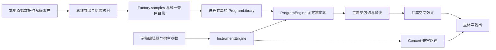

# 原生采样与 Program 引擎

2026-11-04。原生插件现包含 768 个出厂 Program、265 个 GM Program、128 个扩展 Program，以及保留的 Concert SE Grand 入口，共 1,162 项。全部原始 Program 均进入同一个数据驱动引擎。完整目录见 `assets/program-library/FactoryPrograms.json`。

## 数据与实时处理



`ProgramLibrary` 在加载阶段校验文件、转换 PCM24、建立 OSC／键号／力度槽索引。4,920 段单声道采样按来源去重；立体声区域引用两段采样。加载后的对象只读，同一进程中的插件实例通过规范资源路径共用它。音频线程没有文件 I/O、JSON 解析、锁或动态分配。

每个 Program 保留 2,140 字节原始参数。索引为 2 OSC × 128 键 × 4 槽，每项一个区域索引。完整库有 42,980 个区域；索引总计约 4.5 MiB，无需建立全库的 128 力度表。PCM24 文件为 391,461,343 字节，加载后 PCM float 约 489 MiB，另有元数据和独立 Concert 资源。

`ProgramEngine` 使用 128 个声部、32 个抢占淡出声部和 2,048 个 MIDI 事件的固定容量。选样遵循原始键区、OSC 力度区、四槽阈值及相邻层交叉淡化；线性、原曲线表和双层全幅模式分别处理。音高选样使用原始八度、移调和 Pitch Slope。GM 的低音区鼓键重映射、立体声配对和独占组来自已有逆向结果。

在工厂／GM／扩展音色之间切换时，已发声的音符持有原 Program，后续音符使用新 Program。切换到或离开 Concert 使用短过渡。Concert 的原有声音基线单独保留。

## 目录与兼容

原有索引 0–6 保持原顺序：Concert、A000、A061、B097、C001、F042、F036。其余出厂、GM、扩展音色依次追加。音色名、分类图标、浏览器和宿主列表从同一份导出目录生成。BROWSE 支持名称／编号搜索、音色库和类别筛选；点击条目选择音色，Tab 键可依次导航按钮。

浏览分类严格按原厂 Voice Name List 顺序：PIANO → E.PIANO → ORGAN → BELL → STRINGS → BRASS → SYNTH LEAD → SYNTH PAD → GUITAR → BASS → DRUM/SFX。出厂与 GM 音色在各类别中共用原厂分类编号排序；扩展音色随后按原库文件顺序排列。PRESET、BROWSE 和上一项／下一项共用 `FactoryBrowser.json` 的显示顺序，宿主索引保持固定。原表重复标注 G016 的两项通过音色名称区分，GM Tubular Bells 归入 BELL，GM Santur 归入 GUITAR。

旧工程中的 Program 数值索引保持可读。Program 的枚举范围已经扩大，旧测试版工程若保存了归一化 Program 自动化曲线，需要重新指定曲线中的音色；普通保存的状态不受此项影响。

完整资源包统一存放于 `assets/program-library/`，旧默认缓存自动迁移。构建只读取冻结数据，不运行固件或研究脚本。采样包保留本地，源码仓库记录目录、来源和哈希。

## 已验证与限制

产品测试读取冻结的独立证据：8,900 条原 CPU 声部记录和 8,944 个选样场景，检查采样 ID、立体声侧、力度权重、选样音高及空键区。所有 1,161 个原始 Program 逐项渲染，要求输出有限且有声。另检查跨块 MIDI、延音、独占组、抢占、实时零分配、旧状态恢复和 Concert 输出一致性。

完整目录的收录与声音还原程度分别记录：滤波控制字到 Hz/Q、插值、循环拼接、鼓增益和空间效果仍采用主机实现。完整 LFO／动态 AMS、Pitch EG、OSC 微调、鼓 start-offset 及原 IFX/MFX 算法仍有未接入部分。详细功能阶段见 `IMPLEMENTATION.md`。

缺失采样已显示在浏览器中。Nu Pop／Nu DISCO 的共享鼓组编号已经原导入器验证，详见 [资源复核](../research/docs/architecture/RESOURCE_GAPS.md)。

| Program | 具体情况 |
| --- | --- |
| EXPCM004:043 · Electric Beats Kit | MIDI 45 的第二层、83 的第一层、96 的两层引用缺失的逻辑 bank 6。现有层继续播放，缺失层保留为空。 |


因此，1,161 项均可选择并产生声音；上述鼓组的全部键位和原硬件效果还原尚未完成。

## 构建与更新

```sh
python3 research/tools/export_full_bank.py
python3 research/tools/export_program_checks.py
cmake --build build/plugin -j 6
ctest --test-dir build/plugin --output-on-failure
build/plugin/test-vst3-host build/plugin/out/Krose.vst3 --editor
```

前两步只在更新本地研究数据时执行。日常构建使用既有冻结包。`export_factory_bank.py` 作为旧命令别名，也导出完整库。

## 演奏模式

POLY 保留原复音路径；MONO 与 LEGATO 使用共用的按键优先级及滑音模块。面板选择作为全局覆盖保存，切换 Program 保留该选择。新模式的实现范围、原始观察和宿主插值边界见 [PERFORMANCE.md](PERFORMANCE.md)。
