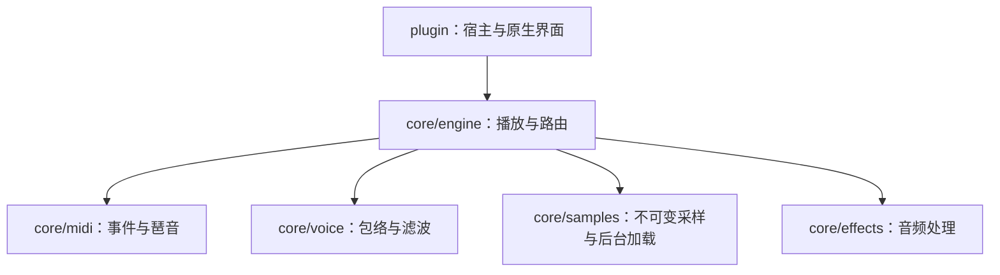

# 项目结构与开发入口

`src/core` 是独立音频核心，`src/plugin` 负责 iPlug2 生命周期、参数、宿主和原生界面。核心通过 CMake 目标 `krose::core` 使用，不依赖 iPlug2、图形库、Python 或研究目录。普通构建读取已经校验的冻结资源。

```text
krose/
  CMakeLists.txt / CMakePresets.json   构建编排与 plugin / engine / sanitize 预设
  src/
    core/
      EngineTypes.h                  控制值和 MIDI 事件等公共值类型
      engine/                        播放、声部分配、音色路由与混音
      samples/                       文件格式、解码、采样内存、缓存及后台加载
      voice/                         原厂包络、增益斜坡和滤波控制
      midi/                          事件队列、单音优先级、滑音和琶音调度
      effects/                       可独立使用的 C EQ／合唱／混响内核
      CMakeLists.txt                 krose-core 静态库及 krose::core 别名
    plugin/
      KrosePlugin.cpp/.h             插件生命周期与音频／MIDI 入口
      Parameters.cpp/.h              参数注册、固定 ID、工厂音色预设
      midi/                         控制器映射、输入演奏、配置和旧状态迁移
      ResourcePath.h                便携／安装版资源定位
      editor/NativeEditor.cpp       IGraphics 控件装配与输入路由
      editor/native/                面板绘制、输入、菜单、收藏及 PNG 资源
      resources/                    平台 plist、菜单、许可证引用
  assets/
    concert-se-grand/               Concert 引用索引、原参数和来源清单
    program-library/               Factory／GM／扩展库及原厂目录顺序
  tests/
    core/                          独立引擎、MIDI、采样、声部及效果测试
    ui/                            图像内存与 FX 动画的独立单元测试
    plugin/                        VST3 宿主与原生 Cocoa 交互检查
    tools/                         开发工具的归档／回滚测试
    fixtures/                      原固件独立观察数据，按来源保存哈希
  cmake/                           资源校验、原生资源嵌入、SDK、优化和宿主配置
  tools/
    audio/                         离线渲染、核心基准与构建期 PGO 训练
    native-ui/                     开发期素材导出、原生内存测量和设计参考页面
    resources/                     显式重建原厂编码资源
    release/                       运行资源归档、macOS PKG 脚本
    bootstrap_plugin.py            固定版本 SDK 准备
    check_project_boundary.py      不含 SDK／tools／research 的隔离构建检查
    package_plugin.py              本地便携交付与签名／校验记录
  packaging/                       Windows Inno Setup 脚本及资源归档锁
  controllers/                      内置控制器适配、通用映射、用户扩展模板和 schema
    ableton/                        可直接复制到 Live User Library 的控制脚本／参数配置
    profiles/builtin/               维护的 JSON 映射
    templates/                      独立版 JSON 与 Ableton Python 模板
  docs/                            当前架构、使用与维护说明
  licenses/                        第三方许可证
  build/                           显式构建时生成，Git 忽略
  dist/                            显式打包时生成，Git 忽略
    portable/                      本地 app、VST3、交付清单
    resources/                     已固定哈希的运行资源归档
    Krose-*.pkg                     本地安装包
```

## 模块边界



- `SampleBank` 负责 Concert 文件和共享声道引用，文件读取已经从 `PianoEngine` 移出；`SampleLoader` 只依赖采样模块。
- `ProgramLibrary` 保存采样、区域和 Program 元数据，提供选样所需的只读查询。预测解码、PCM 所有权和异步发布分别由专门模块处理。
- `InstrumentEngine` 负责琶音、两条播放路径和跨音色尾音。`PianoEngine` 保留已验证的 Concert 三种空间与立体声三次插值；`ProgramEngine` 处理原 Program／双 OSC／鼓组。这两条路径的采样和滤波语义各有验证依据，分别维护。
- 三套引擎共用固定容量 `EventQueue`：相同时间戳保持输入顺序，跨块事件保留偏移，溢出触发 Panic。播放线程不进行文件读取、锁操作或动态内存分配／释放。
- MIDI／包络／滤波不依赖采样文件格式。`EngineTypes` 只引用轻量值类型；通用参数不再包含整个声部实现。
- 原生界面按主面板、FX 绘制与参数页、输入、浏览器、收藏、MIDI 控制页拆分。`plugin/storage` 管理音色文件及有限额、原子替换的 JSON 读写；DSP 不依赖存储或 UI。现有边界足以支撑当前功能，布局和动画资源保持定稿。

## 构建和工具

```sh
python3 tools/bootstrap_plugin.py
cmake --preset plugin
cmake --build --preset plugin
ctest --preset plugin
build/plugin/test-vst3-host build/plugin/out/Krose.vst3 --editor-only
```

Release 默认自动训练并启用 PGO，要求 Clang／clang-cl 与匹配的 llvm-profdata；训练数据留在构建目录。`engine` 预设只构建核心和离线工具；`sanitize` 使用 ASan／UBSan 并关闭 PGO。离线工具的可执行文件名保持不变，例如 `build/plugin/benchmark-core`、`render-program`。

设计页面只用于开发期核对和 PNG／字体导出，入口为 `tools/native-ui/reference/`。单独生成：

```sh
cmake -S tools/native-ui -B build/native-ui/preview
python3 tools/native-ui/prepare.py
```

输出 `build/native-ui/preview/preview.html`，不进入插件资源或普通构建。原生程序仅使用 C++ 和冻结材质；开发工具的完整说明见 [tools/README.md](../tools/README.md)。

## 验证与维护

`python3 tools/check_project_boundary.py` 在临时目录构建核心并运行已注册测试，检查 SDK／UI 依赖和文件读取边界。隔离检查显式关闭 PGO，从而同时验证不含训练工具的核心构建。归档工具由 `python3 tests/tools/test_runtime_assets.py` 验证。原生交互检查和打包入口见 [使用与构建](PLUGIN.md)。

构建日志、截图、基准输出及交付物只在显式运行工具时生成，放在 Git 忽略的 `build/` 或 `dist/`，不保存进程阶段报告。

参数编号、插件 ID、bundle ID、音色索引、原厂分类顺序及冻结资源哈希保持稳定。CMake 既有 `SEGRAND_*` 配置选项继续使用，避免使现有构建命令失效。内部 `segrand` 命名空间与冻结参数头一致；产品目标使用 `krose::core`。

## 研究资料

原始固件与研究代码独立保存于 [krose-source](https://github.com/shiftz300/krose-source)。产品只保留冻结运行数据及独立测试夹具；需要重建资源时显式提供研究原件。普通构建不依赖研究目录。
