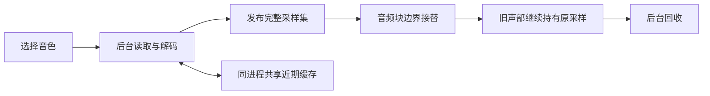

# 采样存储与后台加载

运行资源位于 `assets/program-library/` 和 `assets/concert-se-grand/`。冻结清单记录文件大小、来源及 SHA-256，CMake 配置时逐文件核对。

## 磁盘格式

`Factory.samples` 保存 4,920 段单声道波形、42,980 个区域及 1,161 项 Program：4,276 段使用原厂预测编码，644 段使用 PCM16。文件为 139,453,251 字节。`SEGrand.samples` 是 2,720 字节的引用表，其 168 个单声道引用共用 Factory 波形。

`KRPRG003` 在相位／交叉淡化表后保存 256 项有符号 16 位解码 LUT。采样描述符为 40 字节，末尾包含两个有符号 Q14 系数和编码编号：0 为 PCM24，1 为原厂预测编码，2 为 PCM16LE。区域和 Program 参数保留原数据布局。

预测反馈保留 Q31 精度，负数除法向零截断，饱和范围为 ±2147483647，取高 24 位用于播放。解码使用 4 KiB 栈缓冲。`SEGRAND1` 版本 2 的 84 项描述符在末尾保存 Factory 左／右声道索引。加载器兼容旧 PCM 格式。

## 生命周期



- 启动读取元数据和默认 Concert 采样；选择 Program 后加载其全部键区、力度层与立体声侧。
- 近期缓存上限为 32 MiB，当前音色及旧声部额外持有采样。总采样内存可以超过缓存上限。
- 至少 256 KiB 的采样使用匿名内存映射，后台释放时归还系统；小采样使用普通堆内存。
- 采样集完整就绪后统一接替。快速浏览保留最新请求，暂停的宿主也能回收取消的加载结果。
- 音频线程不读文件、不解码、不加锁、不分配或释放采样。旧音符通过不可变采样集保持播放。
- 离线导出等待目标音色；读取失败时输出静音。实时读取失败保留当前可演奏音色。

## 资源维护

普通构建只需要冻结资源。重建编码资源时，显式提供研究原件、接受过的旧 PCM 基线及已编译的 C++ 全量校验器：

```sh
python3 tools/resources/native_bank.py --source /path/to/research \
  --root /path/to/accepted-pcm-checkout --output build/native-bank \
  --verifier build/plugin/test-sample-codec
```

导出器核对原件哈希，再通过 C++ 校验器逐样本比较；验证成功后发布输出。归档／提取使用 `tools/release/runtime_assets.py`，安装后继续保留原厂编码格式。资源归档和安装包可按 [发行说明](RELEASE.md)重新生成。
