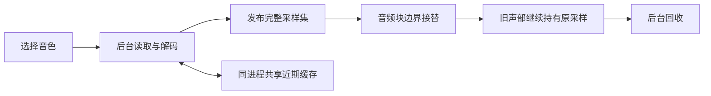

# 采样存储与后台加载

运行资源位于 `assets/program-library/` 和 `assets/concert-se-grand/`。冻结清单记录文件大小、来源及 SHA-256，CMake 配置时逐文件核对。

## 磁盘格式

`Factory.samples` 保存 4,920 段单声道波形、42,980 个区域及 1,161 项 Program：4,276 段使用原厂预测编码，644 段使用 PCM16。文件为 139,453,251 字节。`SEGrand.samples` 是 2,720 字节的引用表，其 168 个单声道引用共用 Factory 波形。

`KRPRG003` 在相位／交叉淡化表后保存 256 项有符号 16 位解码 LUT。采样描述符为 40 字节，末尾包含两个有符号 Q14 系数和编码编号：0 为 PCM24，1 为原厂预测编码，2 为 PCM16LE。区域和 Program 参数保留原数据布局。

预测反馈保留 Q31 精度，负数除法向零截断，饱和范围为 ±2147483647，取高 24 位用于播放。解码使用 4 KiB 栈缓冲。`SEGRAND1` 版本 2 的 84 项描述符在末尾保存 Factory 左／右声道索引。加载器兼容旧 PCM 格式。

## 生命周期



- 启动读取元数据和默认 Concert 采样；选择 Program 后加载其全部键区、力度层与立体声侧。
- 近期缓存上限为 32 MiB，当前音色及旧声部额外持有采样。总采样内存可以超过缓存上限。
- 至少 256 KiB 的采样使用匿名内存映射，后台释放时归还系统；小采样使用普通堆内存。
- 采样集完整就绪后统一接替。快速浏览保留最新请求，暂停的宿主也能回收取消的加载结果。
- 音频线程不读文件、不解码、不加锁、不分配或释放采样。旧音符通过不可变采样集保持播放。
- 离线导出等待目标音色；读取失败时输出静音。实时读取失败保留当前可演奏音色。

## 资源维护

普通构建只需要冻结资源。重建编码资源时，显式提供研究原件、接受过的旧 PCM 基线及已编译的 C++ 全量校验器：

```sh
python3 tools/resources/native_bank.py --source /path/to/research \
  --root /path/to/accepted-pcm-checkout --output build/native-bank \
  --verifier build/plugin/test-sample-codec
```

导出器核对原件哈希，再通过 C++ 校验器逐样本比较；验证成功后发布输出。归档／提取使用 `tools/release/runtime_assets.py`，安装后继续保留原厂编码格式。资源归档和安装包可按 [发行说明](RELEASE.md)重新生成。

## 音色电平与播放边界

音色级补偿位于 FX 之后，保留原力度层、采样和压缩／失真输入电平。离线测量采用四个音区、力度 100、三秒持续音与活动段 RMS，按类别设置目标，并用峰值保留和弦余量；补偿限制在 −36 至 +18 dB。切换采用 20 ms 电平过渡。该测量是可复现的电平校准，不是 LUFS 或实琴响度认证；慢起音和民族音色本身的动态继续保留。

`audit-program-levels Factory.samples --raw` 输出原厂 FX 下的基准；`tools/audio/calibrate_program_levels.py` 生成静态补偿表，表头保存输入指纹。移除 `--raw` 可复测补偿后的结果。

鼓组接入原厂逐层 Attack／Decay 修正和逐键 Note Off 权限，循环素材在包络运行期间继续播放，避免文件末尾硬截断。非循环和反向素材在 EOF 前使用 2 ms 尾部衰减。原厂鼓数据从锁定指纹的 PRELOAD 提取，运行时无需该输入；逐键滤波、start-offset 和完整 TG 音频行为仍有未接入部分。

D105 的串联高共振带通改用恒定裙边增益；HPF 使用独立的主机截止频率锚点，避免低采样率噪声素材被 20 kHz 高通过度衰减。这两项属于主机传递函数校准，原控制字、包络表和 ARM 参考结果保持不变，不宣称已经恢复 TG 芯片的精确响应。

### 音频排查与复测

`audit-program-audio` 在输出保护之前检查峰值、非数值、瞬时跳变及持续归零边界，并导出两段实际音频窗口。`analyze_program_audio.py` 对窗口进行相关性音高筛查；噪声、和弦、泛音、失谐和 Pitch EG 都可能产生候选，程序不自动改调。单个过零采样点不算播放中断。

常规扫描覆盖 1,161 个音色、七个音区和三档力度，共 24,381 组。另扫描 55 个鼓组的全部 128 个 MIDI 键、三档力度；未映射键与缺失源资源保留，见 [架构边界](ARCHITECTURE.md#回归范围与声音限制)。G078 使用全键位、三档力度、四秒长音复查，Jetplane 保持原慢起音。压力场景在 32／48／192 kHz 叠加 13 个音符，并加入按通道弯音、Note Off 与 All Sound Off。

增益表先由原厂 FX 下的活动 RMS 生成，再结合密集和弦峰值约束；`--stress` 必须同时提供测量所用的 `--reference-gains`，避免重复补偿。它保留力度层与瞬态，输出保护继续处理超出测试条件的过载，不对任意音符数量承诺无削波。

每个在发声的 OSC 按原 Program 的上／下弯音范围独立调音，使用 2 ms 平滑；新音符立即继承当前弯音。CC121 恢复中位。滤波器尊重原旁通位；CC120 用既有 96 帧尾音机制归零，避免直接清空非零声部。
