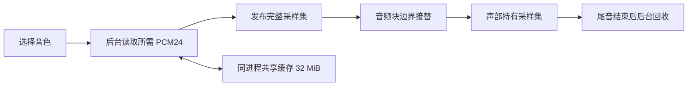

# 按音色加载与效果处理优化

2026-11-04。插件已改为按 Program 加载采样。保留全目录、原厂分类顺序、完整键区和力度层；界面布局不变。

## 实际内存

同一 Apple Silicon Mac、原生 VST3 测试宿主，1472×648 界面与 2× 帧缓冲。统计 macOS `task_vm_info.phys_footprint`，以下使用十进制 MB。基线为 `afa45ce`（上次优化后的全库常驻版）；每次测量独立运行，不并行编译或压测。DAW 和独立程序有各自的宿主开销。

| 状态 | 全库常驻基线 | 当前 Concert | 当前 A000 |
| --- | ---: | ---: | ---: |
| 打开完整编辑器 | 750 MB | 341 MB | 278 MB |
| 连续收放 FX 12 次 | 780 MB | 371 MB | 308 MB |
| 关闭编辑器 | 605 MB | 212 MB | 149 MB |

打开界面的占用分别减少约 55% 和 63%。剩余开销包括界面纹理、图形驱动、元数据、声部和效果状态。占用随音色、并发实例和旧音符的持续时间变化。

单独引擎测试中，Concert 采样约 102.68 MB，A000 约 39.84 MB。大多数小音色切换后，当前采样与近期缓存合计约 33.5 MB。最大扩展音色 EXPCM001:000 需要约 142.12 MB，完整加载它仍会提高占用。

只释放 C++ 对象时，macOS 堆分配器会保留大块内存：连续切换后，即使有效采样已降到 39.84 MB，进程仍达到 232 MB。现在至少 256 KiB 的采样使用独立匿名内存区域，后台卸载时通过 macOS `munmap`／Windows `VirtualFree` 归还系统。同一序列末次回到 A000，进程约 72 MB。小采样保留普通堆分配，避免页对齐造成过多浪费。

原始数据见 [on-demand](verification/native-ui/on-demand/)，包括优化前后物理内存、切换时间、CPU 测量和音频哈希。

## 加载与播放



- 启动读取全库元数据和默认 Concert 的采样。选择其他音色后，按其区域表加载全部 OSC、键区、力度层和立体声侧；相同采样共享一份内存。
- 缓存上限为 32 MiB。当前音色与旧声部额外持有采样，因此总采样内存可以超过该上限。快速浏览只保留最新请求，未使用的加载结果也能在宿主暂停处理时回收。
- 音频线程只读取已加载数据和原子状态，不打开文件、不分配或释放采样、不获取互斥锁。大块内存由加载线程读取并触及全部 PCM 和解码保护字节后发布。
- 首次选中未缓存音色需要等待加载。界面显示 `LOADING`，期间旧音色继续接收演奏；新音色完整就绪后接替，旧音符按原包络继续或释放。不会在一次切换中混用半套键区。
- 本机 48 kHz／128 帧测试的非初始切换约 8–43 ms。该测试覆盖插件缓存未命中，操作系统文件缓存未清空，不能当作慢盘最坏时间或零延迟承诺。这条内存测试序列每次先 Panic，不发送音符；其中音频块最大用时约 137 µs，块预算为 2667 µs。带音符和尾音的正确性另由回归测试检查，长时 DAW 验收仍需实机演奏。
- 离线导出会等待目标音色就绪再处理。读取失败时实时模式继续保留原音色，界面显示失败；离线模式输出静音，避免悄悄导出成旧音色。

## 效果处理

保留现有 EQ、合唱与 Hall 的参数和算法声音，优化重复计算和内存访问：

1. 八路 FDN 延迟线按帧交错存储，让同一帧的写入连续。
2. 初始化时剔除系数完全恒等的 EQ 级；Concert 三种空间预设共用一次双精度干声 EQ 结果。
3. 合唱湿声为零时跳过插值读取，继续更新延迟历史和 LFO；重新启用仍有完整历史。
4. 尚未收到任何信号的全零延迟网络跳过无效计算，继续推进时间与平滑参数。一旦收到信号就正常处理，不提前截断混响尾音。

同一编译优化、固定输入，交替执行新旧版本各五次；取各次中位数的中位数。48 kHz／128 帧下：

| 效果配置 | 原单块用时 | 当前单块用时 | 降低 |
| --- | ---: | ---: | ---: |
| 恒等 EQ + Hall | 5.25 µs | 1.46 µs | 72% |
| Concert EQ + 暖色 Hall | 5.33 µs | 3.38 µs | 37% |
| Concert EQ + 合唱／Hall | 5.29 µs | 3.54 µs | 33% |

三种配置输出的浮点位哈希分别与基线一致。整体 64 声部 Concert 引擎同条件中位用时约 227.0 → 227.7 µs，基本持平；主要工作仍在声部包络、滤波和采样读取。单一效果阶段加速不能换算成整个插件的 CPU 降幅。原始数据见 `effects-repeated.json` 与 `engine-*.json`。

## 验证与范围

- macOS 9/9 CTest、8/8 ASan/UBSan 与按需加载 ThreadSanitizer 测试通过。Windows 和交付包的独立验证结果见 [evidence.json](verification/native-ui/current/evidence.json)。
- 全库加载与按需加载逐样本对比：44.1／48／96 kHz、多种音色、跨引擎尾音、反向／循环／立体声区域。
- 实时路径分配和释放计数均为零；覆盖连续切换、请求取消、超过 256 次暂停宿主浏览、读取失败与离线静音。
- 大块匿名内存与小块堆内存均验证最后一个 24 位采样的读取、移动所有权、重复缩放和释放。
- 效果测试覆盖 32／44.1／48／96／192 kHz、奇数块长、湿声自动化、初始静音和长尾音。三条参考 WAV 要求与基线逐字节一致。
- 当前原硬件 IFX/MFX 的未恢复算法保持原有范围，详见 [架构限制](NATIVE_ARCHITECTURE.md)。本次优化作用于已有的主机效果实现。

## 设计参考

- [Kontakt DFD](https://support.native-instruments.com/support/solutions/articles/69000879768-what-is-dfd-) 将采样预载与后台磁盘读取分开。当前音色库规模较小，本次完整预载所选 Program，使发声后的音频线程无需持续读盘。逐声部流式播放暂未引入。
- [sfizz FilePool](https://github.com/sfztools/sfizz/blob/develop/src/sfizz/FilePool.h) 展示共享采样、后台加载与声部释放后回收的组织方式；[sfizz API](https://www.sfz.tools/sfizz/api/sfizz.h/) 明确提示预载设置可能加锁，应放在非实时线程。本项目使用自己的固定槽位发布协议，未复制其实现。
- [J. O. Smith 的 Householder FDN](https://www.dsprelated.com/freebooks/pasp/Householder_Feedback_Matrix.html) 提供现有混响网络的结构依据。本次保留反馈矩阵，调整存储布局和冗余处理。

## 复测

```sh
build/plugin/benchmark-loading build/plugin/generated/Factory.samples build/plugin/generated/SEGrand.samples
build/plugin/benchmark-effects
KROSE_UI_BENCH=1 build/plugin/test-vst3-host build/plugin/out/Krose.vst3 --editor-only
KROSE_UI_BENCH=1 KROSE_UI_BENCH_PROGRAM=1 build/plugin/test-vst3-host build/plugin/out/Krose.vst3 --editor-only
```

界面测量只打开原生测试宿主；普通构建和工具默认不改变用户安装的插件。离线工具仍可显式使用全库加载，便于独立对照。
