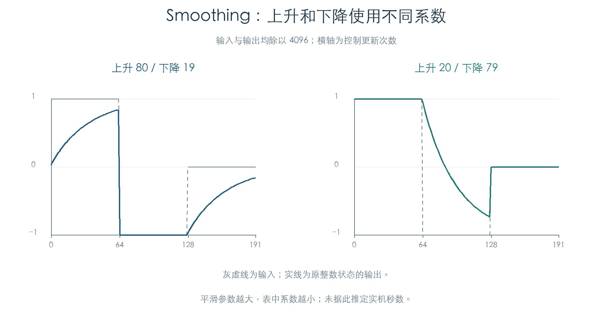
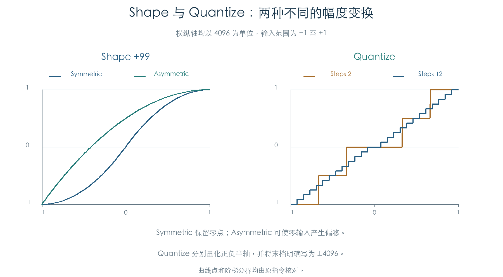
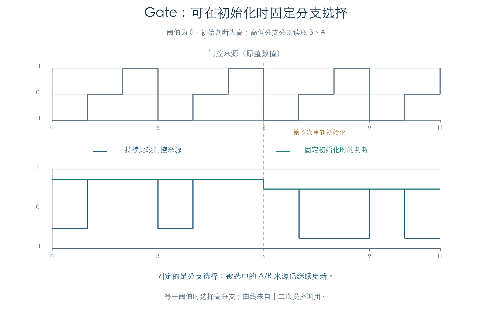

# AMS Mixer：七种调制运算与状态更新

KROSS 2 v1.2.4 · 2026-11-02

七种 AMS Mixer 已恢复为独立整数模型，并与原初始化、来源读取和更新函数逐字节对照。它们可以混合调制来源、平滑跳变、弯曲幅度、生成阶梯或按条件切换来源，随后影响 LFO、包络、音高、滤波和音量。

原厂 3072 块存储参数均执行了原 Mixer，并接入已有 LFO 与控制目标检查链。平滑和 Gate 保留内部状态，更新时不能只根据当前输入重新计算。

## 1 七种运算及原厂使用

| 类型 | 行为 | 原厂存储块 |
| --- | --- | ---: |
| A+B | 两个来源按各自强度缩放后相加 | 2202 |
| Amt A×B | B 改变 A 的强度，再对 A 缩放 | 414 |
| Offset | 来源缩放后增加固定偏移 | 101 |
| Smoothing | 分别控制上升、下降的平滑速度 | 245 |
| Shape | 对来源进行对称或非对称整形 | 63 |
| Quantize | 将正负幅度分别变成阶梯 | 15 |
| Gate Control | 按阈值选择固定值或 A/B 来源，可固定初始化时的判断 | 32 |

每个 OSC 有两个 24 字节参数块和两个 8 字节运行状态。最终输出限于 −24576 至 +24576。表中包含未启用 OSC 的存储配置，数量不代表可听音色数。

前三类的基本缩放为 `s32(强度×来源×331)>>15`，其中 `s32` 保留原低 32 位并按有符号值解释。Offset 的强度和偏移范围均为 −199 至 +199；其他普通强度为 −99 至 +99。675 组组合和 105 组 Offset 端点核对了原运算顺序、截断与最终限幅。

## 2 平滑分别保存上升与下降速度

设当前输出为 `y`、缩放后的目标为 `x`，原更新为：

```text
c = 上升表值（x ≥ y）或下降表值（x < y）
y = y + (s32(c × (x−y)) >> 16)
```

两种速度都使用 100 项原表。参数 0–7 的系数为 65536，参数 99 为 382；较大的参数产生较慢的变化。初始化先把当前来源写入状态，再执行一次更新，避免统一从零起步。



100 条轨迹各推进 192 次，覆盖全部上升参数及反向排列的下降参数。另有 75 组极端检查保留了 32 位乘法行为。例如状态从 −24576 跳向 +24576、平滑参数为 0 时，乘积截断会使输出仍停在 −24576。该现象已由原指令复现；现有原厂轨迹尚未证明它在实际演奏中可达。

图中横轴为控制更新次数，平滑表尚未换算为实机时间常数。

## 3 整形与量化

Shape 的 Asymmetric 分支直接对双极来源 `x` 计算：

```text
x + (s32((4096−(s32(x²)>>12)) × (Amount×331)) >> 16)
```

Symmetric 分支先把 `abs(x)` 转换到双极区间，使用同一曲线，再缩回原幅度并恢复符号。它保留零点；Asymmetric 在零输入处也可以产生偏移。两种模式的 774 个曲线点均已核对。



Quantize 的 Steps 为 2–32。原表精确等于 `floor(4096/N)`。取输入绝对值，先算 `k=floor((N+1)×abs(x)/4096)`；`k<N` 时输出 `k×表[N]`，其余直接输出 4096，最后恢复正负号。

因此正负半轴分别量化，最高档明确写入满量程。3503 组检查覆盖全部 Steps、各阶梯分界的前后整数和正负端点。插件需保留 `N+1` 的分界计算以及最高档的单独处理。

## 4 Gate 固定的是分支选择

门控来源值**大于或等于**阈值时选择高分支，否则选择低分支。高低分支各自可以输出固定值，也可以持续读取 B、A 来源；门控来源关闭时输出零。

初始化会保存一次门控判断。启用固定判断选项后，后续更新沿用这个结果，被选中的来源仍继续变化。重新初始化会重新判断。96 条轨迹覆盖全部八种选项组合、三个阈值、门控开关和两种初始状态，每条比较十二次更新。



图中第 6 次调用重新初始化判断，同时改变 A/B 来源。固定判断的曲线随后持续跟随所选来源，保留了“保存条件、继续读来源”的行为。

## 5 接回原 LFO 与控制目标

原初始化先处理 LFO2、LFO1，再初始化 Mixer1、Mixer2。批量刷新先缓存两路 LFO 波形，随后更新 EG 与 Mixer，再计算控制目标。Mixer2 可以读取本轮已更新的 Mixer1；Mixer1 读取的 Mixer2 状态来自此前更新。

全部 768 个 Program、1536 个存储 OSC 均参与检查。每个 OSC 访问八个明确的音乐计数值，共完成 12288 次更新：先执行原 LFO 和两个原 Mixer，再进入原音高、Filter A/B 和音量函数，对照独立模型。另有七条代表轨迹各推进 256 次，期间直接改变指定键位和力度，共比较 1792 次更新。

本章逐次比较完整 Mixer 状态，连通实验继续比较两路 LFO、随机状态、控制目标和更新标志。隔离实验把明确的来源值写入私有键盘跟踪字段，再经原 AMS getter 读取，计算函数没有替代实现。

本章连通实验沿用[控制目标检查](LFO_TARGETS.md)的受控 EG、采样和音高上下文，未推进完整 EG 状态机。[后续主 EG 检查](ENVELOPES.md)已接入三类常规包络的初始化、推进、释放和重触发。半踏板、辅助包络请求、真实选层装配及 TG 音频继续保留缺口。

## 证据与复现

- [七类独立模型与原函数检查](../../tools/firmware_ams_mixers.py) · [完整结果、原厂参数与来源哈希](../../derived/firmware/KROSS2_V124/architecture/stage04/ams-mixers-check.json)
- [原 Mixer 初始化与更新](../../derived/firmware/KROSS2_V124/architecture/stage04/ams-mixers-update.arm.txt) · [原初始化顺序](../../derived/firmware/KROSS2_V124/architecture/stage04/ams-mixers-initialize-order.arm.txt) · [原批量刷新顺序](../../derived/firmware/KROSS2_V124/architecture/stage04/ams-mixers-refresh-order.arm.txt)
- [配图脚本](../../tools/firmware_ams_mixer_figures.py) · [平滑轨迹 CSV](../../derived/firmware/KROSS2_V124/architecture/stage04/ams-mixer-smoothing.csv) · [整形/量化 CSV](../../derived/firmware/KROSS2_V124/architecture/stage04/ams-mixer-transfer.csv) · [Gate CSV](../../derived/firmware/KROSS2_V124/architecture/stage04/ams-mixer-gate.csv)

复现：`python3 research/tools/firmware_ams_mixers.py --verify-arm`。配图使用 `python3 research/tools/firmware_ams_mixer_figures.py`。输入及依赖记录 SHA-256；实验仅使用现有离线材料，产品代码未改动。
