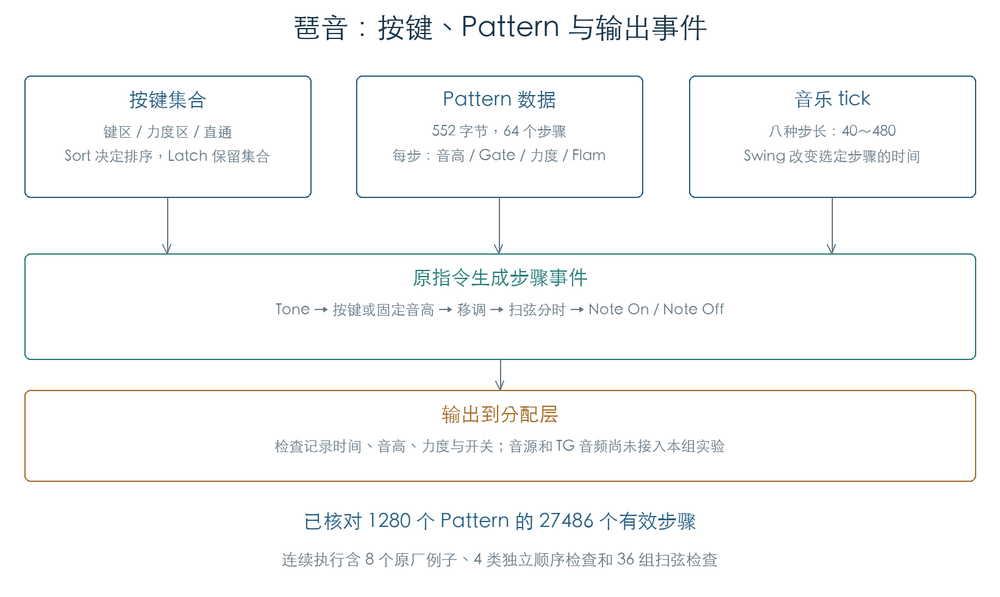
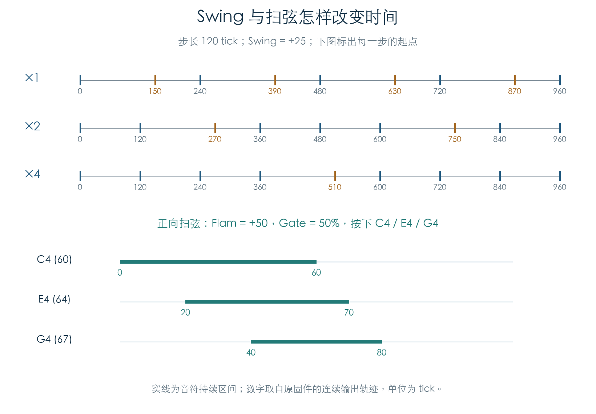
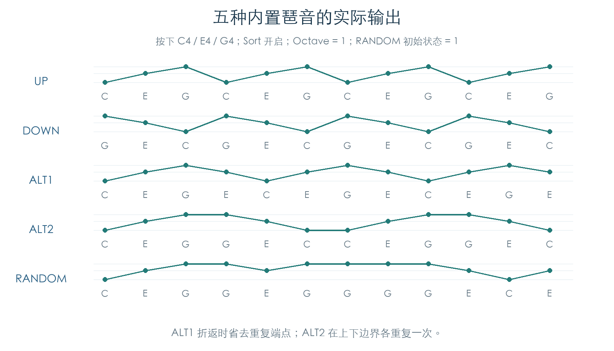
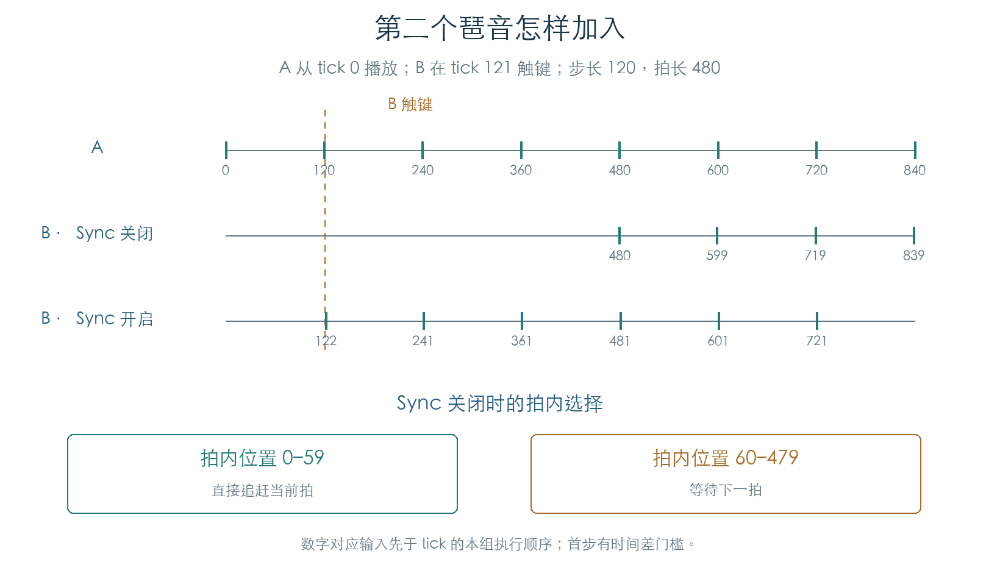

# 琶音 Pattern、触键与播放时序

KROSS 2 v1.2.4 · 2026-11-02

KROSS 2 的琶音由按键集合、Pattern 或内置生成器、音乐时钟共同驱动。Pattern 指定每步使用哪些音、力度和时长；按键集合提供音高与触键顺序；时钟决定起音、扫弦和关音的时间。本轮已让原固件完成这条控制链，核对五种内置生成器及双琶音同步，并记录送往分配层的音符事件。



## 1 Pattern 保存了什么

官方编辑器的 `PRELOAD.KRS2all` 在偏移 `0x507790` 连续保存 1280 个 Pattern，每个 552 字节。前 1024 个为命名内容，后 256 个与固件初始化函数的输出逐字节相同。原数组选择器 `0x275D0C` 和记录寻址函数 `0x27575C` 已检查全部条目。

| 记录偏移 | 大小 | 内容 |
| --- | ---: | --- |
| `00` | 24 字节 | 名称，空格补齐 |
| `18` | 1 字节 | 八度运动、音符分配类型、固定音高及全 Tone 触发标志 |
| `19` | 1 字节 | Pattern 长度 |
| `1A` | 1 字节 | Swing 步分组：×1、×2、×4 |
| `1C` | 12 字节 | Tone 0–11 的固定音高值；运行时取低七位 |
| `28` | 64 × 8 字节 | 步骤记录 |

每步依次保存有符号音高偏移、Gate、力度、有符号 Flam、16 位 Tone 位图和两个附加字节。发音组合使用位图的低 12 位。Gate 的 `0` 为关闭，`1–100` 为比例，`101` 为连音；力度 `128` 采用触键力度。步记录的附加字段仍按原字节保留，当前不赋予统一含义。

实际预载长度为 1–64，包含 26 个长度为 64 的 Pattern。原长度读取函数把结果限制在 1–64。手册同一节同时出现 48 与 64 的范围说明；这里采用固件及实际数据确认的 64 步容量。[M1]

复制、删除、插入、旋转直接操作八字节步骤。向后复制从尾部开始，避免重叠覆盖；超过末端时截短。插入丢弃末步，删除在末尾补入默认步。初始化步骤保留每步最后一个字节；新插入的默认步会清零该字节。10,463 组完整记录比较均通过，记录前后的保护字节保持原值。

## 2 按键如何变成 Tone

引擎保存 128 项按键列表和逐键力度。Sort 关闭时按触键顺序排列，开启时按音高升序排列。重复按同一键会更新力度，不增加列表项。松键后，力度字节的高位置位，低七位仍保留力度。

普通音高模式下，Latch 关闭时，松键立即从列表移除。Latch 开启时，松开的键留在列表中供后续步骤使用；新键加入前，原函数清理已松开的项目。这使“当前按住的键数”和“仍用于琶音的键数”可以不同。固定音高的全 Tone 触发另有保持规则，见第 6 节。

键区、力度区和引擎开关决定音符是否进入琶音。Keyboard 开启时，原按键还会直通；逐键计数让后续关音与已直通的起音配对。当前检查包括 16 种 Sort/Latch/Keyboard/Key Sync 组合、区域边界和完整 128 键加入/移除。

普通 Pattern 把 Tone 编号映射到按键列表。按住 C4、E4、G4，让四步依次请求 Tone 0、1、2、3，得到以下实际输出：

| 类型 | 四步的发音顺序 |
| --- | --- |
| As Played | C4 → E4 → G4 → 休止 |
| As Played (Fill) | C4 → E4 → G4 → G4 |
| Running Up | C4 → E4 → G4 → C4 |
| Up&Down | C4 → E4 → G4 → E4 |

同一步的多个 Tone 映射到相同列表项时，固件去除重复项。固定音高模式从 Pattern 读取音高，按键主要控制触发；开启 Trigger All Tones 后，一个按键即可触发该步指定的全部 Tone。400 组独立组合及全部 1280 个 Pattern 的 27,486 个有效步骤已完成映射比较。

## 3 步进、Swing 与扫弦

以一拍 480 tick 初始化引擎，八种 Resolution 生成的步长为 `40、60、80、120、160、240、320、480`，对应从三十二分三连音到四分音符。时钟消费者 `0x002B00` 递增三个引擎的计数；待处理分发 `0x002A64` 调用 `0x008504`，再进入播放主体 `0x0083C0`。

Swing 在指定步骤上增加或减少偏移。按零起点编号：×1 作用于 1、3、5…；×2 作用于 2、6、10…；×4 作用于 4、12、20…。以步长 120、Swing +25 为例，被选中的步骤延后 30 tick。周期结束点保持原位置。运行时调制采用整数插值，负值与正值的取整方式已分别核对。



Flam 把同一步的多个音依次展开。正值从低 Tone 编号开始，负值反向。图中的三音和弦分别在 0、20、40 tick 起音；Gate 为 50% 时，在 60、70、80 tick 关音。Gate 按每个起音点到下一步的剩余时间计算，因此三个音的持续时间不同。

音高偏移以半音相加。结果超出 MIDI 0–127 时，固件按八度移回有效范围。固定音高、普通音高、正反向扫弦、触键力度和步力度共 36 组连续检查，起音与关音都符合独立计算。

## 4 原厂数据的连续执行结果

连续检查从原参数绑定、同步复位和触键入口开始，经原时钟消费者推进，执行步骤解码、20 项活动音符表及输出适配器。最终在分配层入口 `0x003644` 记录事件。

| 原厂 Pattern | 核对到的行为 |
| --- | --- |
| Gt-Guitar Strum 1a | 首组三音在 0、3、5 tick 起音；后续步骤反向扫弦 |
| Gt-Country Strum 1 | 连续正反向扫弦与步力度变化 |
| Key-Soft E.Piano | 同时起音、跨步保持及八度变化 |
| Dr-Copland Timpani | 固定音高 25、37、44 等鼓音事件 |
| Dr-Timpani Roll | 普通 Tone 与步骤音高偏移 |
| Gt-Jazz Qtr Notes | 和弦、步力度与短扫弦 |
| Dr-Ride Only | 固定音高 63 与逐步力度 |
| InitArpPattern | 空步骤不产生音符 |

四类合成 Pattern、八个原厂例子和 36 组扫弦检查累计记录 890 个起音/关音事件。测试末尾执行原停止函数后，所有活动音符均已关音，活动表为空。

## 5 五种内置生成器

内置编号 0–4 依次为 UP、DOWN、ALT1、ALT2、RANDOM。它们从按键列表生成音符，覆盖 1–4 个八度。UP 从低到高，DOWN 从高到低；ALT1 折返时省去重复端点，ALT2 重复两端。Sort 关闭时，这里的先后由触键顺序决定。



200 组检查覆盖五种生成器、四个八度范围、Sort 开关和 1、2、3、7、12 键集合，共比较 9600 个输出音符的音高、力度及关音时间。高音超过 MIDI 127 时按八度折回。另有五条逐 tick 连续轨迹与相同的独立序列比较。765 次时序检查确认内置生成器忽略 Swing 和 MOD Swing，与手册一致。[M2]

RANDOM 使用全局 16 位状态 `s`，每次取位 15、11、2、0 的异或作为新低位，然后左移：

```text
feedback = bit15(s) XOR bit11(s) XOR bit2(s) XOR bit0(s)
s = ((s << 1) | feedback) & 0xFFFF
位置 = s mod (按键数 × 八度数)
```

全部 65536 种输入状态均已和原函数比较。从 1 出发，非零状态经过 65535 次更新回到 1；零状态保持为零。两个 RANDOM 引擎共用这份状态，因此 A、B 的输出受共同调用顺序影响。双引擎连续检查已逐个核对这种交错序列。

## 6 双琶音同步与保持状态

后加入的引擎先检查其他引擎是否在工作。Key Sync 开启时，从自身开头播放；关闭时，使用当前主引擎的拍内位置。以拍长 480 tick 为例，位置 0–59 采用零或负偏移，直接追赶当前拍；位置 60–479 返回到下一拍的剩余 tick，先等待再播放。已有短等待、停用状态和未绑定状态会影响查询结果，23040 组输入均已核对。



图中 B 在 tick 121 触键。Sync 关闭时等到 480 起音；开启时在 122 起音，随后在 241、361 等位置继续。首步受“时间必须向前推进”的门槛影响。本组实验固定采用“输入发生在本 tick 递增前”的顺序；后续 119/120 tick 的差别保留在原始轨迹中。它们还需要与 OS 调度连通，才能解释实机到达时刻。24 条双引擎轨迹已分别比较等待状态、首音时间和音符顺序。

固定音高的 Trigger All Tones 与 Latch 同时开启时，固件保留触发状态：

| 设置 | 松键后的行为 |
| --- | --- |
| Latch 关闭 | 移除该键并减少计数 |
| Latch 开启，普通音高或 Trigger As Played | 标记松开，列表暂时保留 |
| Latch 开启，Trigger All Tones，Key Sync 关闭 | 保留各键的触发状态 |
| Latch 开启，Trigger All Tones，Key Sync 开启 | 多键时逐个释放，最后一个触发状态继续保留 |

因此该计数在全 Tone 保持模式下不能直接解释为物理按键数。16 种标志组合的 128 次按下、松开和重复触发已比较力度字节、列表内容与计数。

当前已恢复用户 Pattern、五种内置生成器和上述双引擎同步控制。序列器录制交接、与运行中鼓轨的同步、完整时钟/OS 调度以及最终音源连通仍待继续；本章的验证对象为音符事件。

## 证据与复现

- [原指令检查脚本](../../tools/firmware_arpeggiator.py) · [机器结果](../../derived/firmware/KROSS2_V124/architecture/stage04/arpeggiator-check.json) · [1280 个 Pattern 目录及步骤](../../derived/firmware/KROSS2_V124/architecture/stage04/arpeggio-patterns.json)
- [存储与编辑汇编](../../derived/firmware/KROSS2_V124/architecture/stage04/arp-storage.arm.txt) · [用户步骤播放汇编](../../derived/firmware/KROSS2_V124/architecture/stage04/arp-user-step.arm.txt) · [音乐时钟消费者](../../derived/firmware/KROSS2_V124/architecture/stage04/arp-clock-consumer.arm.txt)
- [内置与同步检查脚本](../../tools/firmware_arpeggio_sync.py) · [内置及双引擎机器结果](../../derived/firmware/KROSS2_V124/architecture/stage04/arpeggio-sync-check.json) · [内置生成器汇编](../../derived/firmware/KROSS2_V124/architecture/stage04/arp-preset-generators.arm.txt) · [同步请求汇编](../../derived/firmware/KROSS2_V124/architecture/stage04/arp-sync-request.arm.txt)
- [音乐时钟](MUSIC_CLOCK.md) · [外部 MIDI 时钟](EXTERNAL_CLOCK.md)
- [M1：KROSS 2 Parameter Guide](../../downloads/KROSS2_Parameter_Guide.pdf)，印刷页 167–169、179–180。
- [M2：KROSS 2 Parameter Guide](../../downloads/KROSS2_Parameter_Guide.pdf)，印刷页 51–52，内置类型、Octave、Sort、Latch、Key Sync、Swing。

复现：分别运行 `python3 research/tools/firmware_arpeggiator.py --verify-arm` 与 `python3 research/tools/firmware_arpeggio_sync.py --verify-arm`。脚本只读取现有材料，在模拟器私有内存中执行原指令；堆分配、异常登记和临界区服务使用隔离替身，最终输出截获在分配层边界。结果记录固件、预载文件、工具及辅助脚本的 SHA-256。
