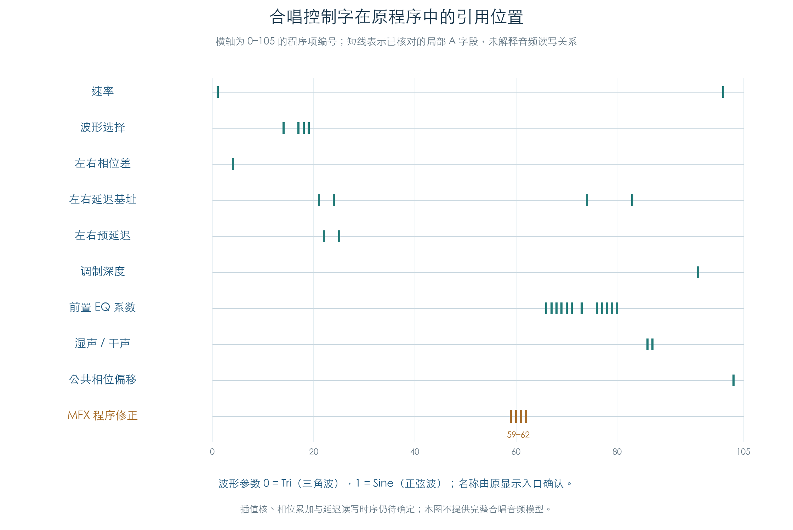

# 合唱局部程序：控制引用与 MFX 修正

KROSS 2 v1.2.4 · Stereo Chorus · 2026-11-02

原合唱含 106 条程序项。七个 IFX/MFX 槽位的初始化已逐项核对，两个 MFX 槽位另外改写程序项 59–62。速率、波形选择、相位、预延迟、深度、EQ 与干湿控制均已对应到局部字段位置。后续恢复声音时，需要同时满足这些引用和槽位差别。



## 1 已确定的控制引用

表中 A 为 48 位载荷里的一个 10 位字段，使用[已由原重定位核对的格式门槛](HALL_LOCAL_OPERANDS.md)。这里只把符合局部引用条件的 A 字段接到控制字；程序项 0、64 虽然也有 A=0，其类别为 5，已排除在 A0 参数引用外。

| 控制字 | 已恢复的用途 | 原程序项编号 |
| --- | --- | --- |
| 1 / 2 | 左 / 右延迟基址 | 21、74 / 24、83 |
| 3 | 自由或同步速率 | 1、101 |
| 4 / 5 | 波形选择系数 | 17、19 / 14、18 |
| 6 | 左右相位差 | 4 |
| 7 / 8 | 左 / 右预延迟加 1 | 22 / 25 |
| 9 | 调制深度 | 96 |
| 11 / 12 | 湿声 / 干声系数 | 86 / 87 |
| 13、14、15 | 低频 EQ 三项系数 | 68、77 / 67、76 / 66、73 |
| 16、17、18 | 高频 EQ 三项系数 | 71、80 / 70、79 / 69、78 |
| 26 | 公共 LFO 相位偏移，原参数固定为 0 | 103 |

原显示入口 `9B3CC` 明确选择 `0 → Tri`、`1 → Sine`。已有原控制检查对应写入 `(字4,字5)=(8388607,0)` 或 `(0,8388607)`。这确定了三角波和正弦波的选择含义；DSP 怎样计算波形、何时更新相位仍未恢复。

字段 B 另出现局部编号 27–30，超出 27 项初始值；还引用固定编号 768、961、991。B 的数值不能直接照搬 A 的参数名称，也不能仅凭相邻编号连成音频路径。这些编号的读写和状态角色继续保留为待解项。

## 2 IFX 与 MFX 使用不同程序

原 `6793C` 先调用 `9B510` 做通用重定位，再两次调用 `9B960`，分别处理程序项 59/60、61/62。后两次修正仅作用于槽位 5、6，即两个 MFX。

| 程序项 | 在通用重定位结果上追加 | 载荷高 16 位的变化 |
| --- | --- | --- |
| 59、61 | 加 `2^43` | `0008 → 0808` |
| 60、62 | 减 `2^43` | `0A00 → 0200` |

修正常数来自原字对 `(0x00000000,0x00000800)`，按已确认的 48 位传输顺序组合。检查比较完整载荷，其他字段保持通用重定位的结果。该编码差异已确定；它具体改变哪个累加或混合操作，仍需运算语义证明。不能据此直接换算音频增益。

七槽位的 27 项初始化值也全部比较：除字 1、2 外保留原值；字 1 从原 `AA8F4` 查询取得，字 2 比它大 2881。原像中的槽位表给出基值 `0、338、396、454、512、570、6332`。这些是原初始化使用的表值，尚未证明它们在芯片内部如何映射成物理存储；本项不把七个槽位画成同一块连续延迟 RAM。

左右偏移 2881 与最高预延迟 2160、最大深度 720 及加一偏移相符。这个数量关系约束缓冲需求，尚不能确定分数读指针、插值阶数、端点取样或内部反馈。

## 3 验证范围

七槽位分别执行原缓冲加载 `5A51C`、初始化 `6793C`、通用重定位 `9B510`、MFX 修正 `9B960` 和基值查询 `AA8F4`；这些调用没有替代函数。全部 106 项载荷和完整 80 字控制缓冲与独立整数模型一致。

另对 106 项分别翻转全部 48 个可见位，放到六个非零槽位执行原重定位，共 30528 个变异通过。变异用于检查字段掩码与分支，不代表每个变异都能作为合法 DSP 运算执行。两个波形名称调用只在显示字符串输出边界截获。

[原合唱控制结果](EFFECT_CHORUS.md)中的 309 个原厂启用槽位，已按真实槽号关联到本项原初始化程序，并核对源记录及输入指纹。这一步复用既有控制矩阵，没有重复运行全部参数回调。

本项恢复了控制字引用、程序布局与四处 MFX 修正。完整合唱音频仍缺延迟读写、插值核、波形采样、累加器和舍入；当前没有足够证据将这些行为填入“原算法已恢复”。

## 4 复现与证据

```text
python3 research/tools/firmware_chorus_program.py --verify-arm
python3 research/tools/firmware_chorus_program_figures.py
```

- [完整结果与 309 槽位关联](../../derived/firmware/KROSS2_V124/architecture/stage04/chorus-program-check.json)
- [引用位置 CSV](../../derived/firmware/KROSS2_V124/architecture/stage04/chorus-program-references.csv)、[图形核验](../../derived/firmware/KROSS2_V124/architecture/stage04/chorus-program-figure-check.json)
- 原指令：[初始化](../../derived/firmware/KROSS2_V124/architecture/stage04/chorus-slot-program.arm.txt)、[MFX 修正](../../derived/firmware/KROSS2_V124/architecture/stage04/chorus-mfx-program.arm.txt)、[波形名称](../../derived/firmware/KROSS2_V124/architecture/stage04/chorus-wave-label.arm.txt)
- [检查脚本](../../tools/firmware_chorus_program.py)、[图形脚本](../../tools/firmware_chorus_program_figures.py)
