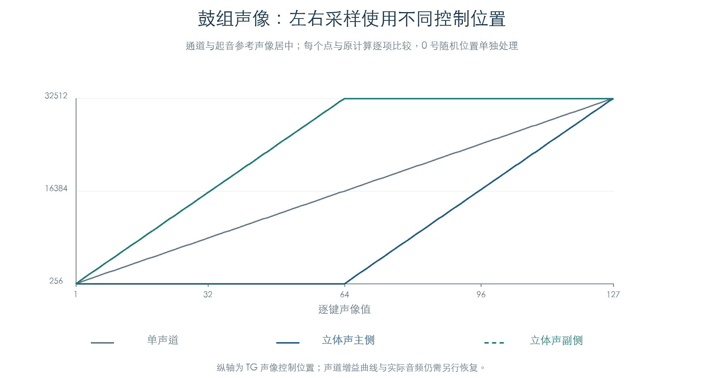
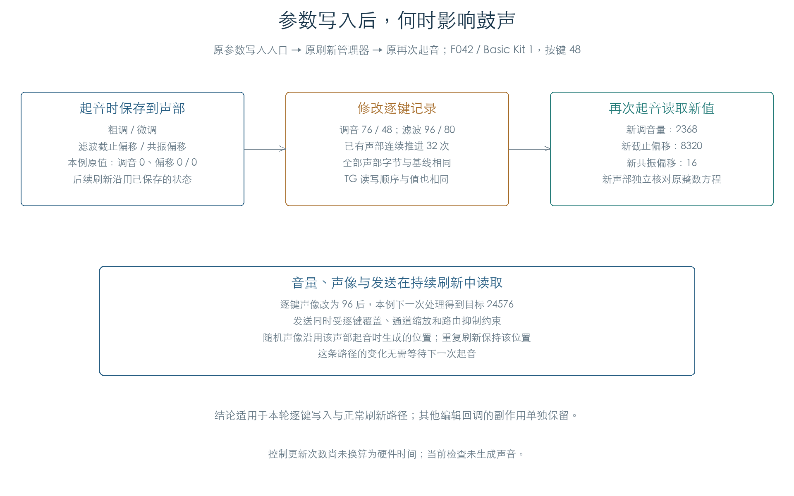

# 鼓组逐键控制与参数生效时机

KROSS 2 v1.2.4 · 插件音源逻辑 · 2026-11-02

鼓组运行态为每个键保留 12 字节控制记录。音量、声像和效果发送在持续刷新中读取；粗调、微调与滤波偏移先保存到起音时的声部状态。这条差别决定参数编辑怎样作用于已经发出的鼓声。

## 1 参数怎样写入每个鼓键

原入口用通道记录中的键号与参数选择器定位控制字节。绝对写入保存收到的值；增减写入读取有符号旧值，再将相加结果限制到 0–127。

| 选择器 | 控制记录偏移 | 用途 |
| --- | --- | --- |
| 20 / 21 | 0 / 1 | 截止与共振偏移 |
| 22 / 23 | 2 / 3 | 包络起音与衰减时间修正 |
| 24 / 25 | 4 / 5 | 粗调与微调 |
| 26 | 7 | 逐键音量 |
| 28 | 8 | 声像覆盖 |
| 29 / 30 | 10 / 9 | 第二、第一效果发送覆盖 |

选择器 27 在这张表中无有效目标，写入被忽略。默认声像和发送覆盖为 −1，表示沿用鼓组记录。增减入口把 −1 当有符号数参与计算，再执行限制；它不会自动恢复默认值。

检查直接执行原参数写入入口，比较完整 128 键控制区，确认目标键、字段和其他字节。后续[逐键 NRPN 连通](DRUM_NRPN_LIVE.md)已把解码后的 MIDI CC 事件接到这个入口与真实包络；原输入字节解析另列边界。

## 2 声像先合成位置，再分配左右侧



原计算结合 OSC 声像、逐键覆盖、通道声像、起音参考值和 AMS。启用逐键来源时，非负覆盖值替换鼓组声像；覆盖为 −1 时沿用鼓组值。声像值零使用起音时已生成的随机位置，后续刷新沿用这个位置。

合成位置 `P` 先限制到 256–32512。立体声主侧和副侧再分别变换：

```text
主侧：P <= 16384 时取 256，否则取 2P − 32512
副侧：P >= 16384 时取 32512，否则取 2P − 256
```

因此居中时，左右素材分别保持在两端；向一侧移动时，其中一侧逐渐靠拢。图中的纵轴是声像控制位置，实际声道增益曲线仍需从音频运算确认。

效果发送先选择逐键或 OSC 来源，再按通道因子进行整数缩放：`发送目标 = (来源值 × 通道因子) >> 7`。当前声部路由编号为 0 或 12 时保留结果，其余编号把这两个声部发送目标清零。IFX 后续的发送位置另见[效果路由](EFFECT_ROUTING.md)，这里不把目标清零解释为整条效果链静音。

## 3 已发出的鼓声保留哪些值



F042 / Basic Kit 1 的按键 48 用于成对比较：一侧通过原写入入口修改截止、共振、粗调和微调，另一侧保留默认值。之后执行 32 次原推进与刷新，两侧全部声部字节和 TG 读写保持一致。再次起音后，新声部读到修改值：内部调音量由 0 变为 2368，截止偏移由 0 变为 8320，共振偏移由 0 变为 16。

中性基值之外的原整数关系为：

```text
调音量 = 2 × [100 × (层粗调 + 逐键粗调) + 层微调 + 逐键微调 − 6464]
截止偏移 = signed16[(层截止修正 + 逐键截止 − 64) × 260]
共振偏移 = signed8[层共振修正 + 逐键共振 − 64]
```

逐键声像改成 96 后，下一次处理该声部得到 24576 的控制目标。连续轨迹同时包含逐键音量/发送变化、松键和再次起音，再次起音的调音与滤波偏移另用上述方程核对。这里的时机结论适用于这条写入与正常刷新路径；其他编辑回调可能有附加副作用。

## 4 持续刷新与验证边界

| 检查 | 结果 |
| --- | --- |
| 绝对写入 / 增减写入 | 212992 / 600 组，比较完整 128 键控制区 |
| 声像位置 / AMS 与分类分支 | 13824 / 108 组，独立方程对照 |
| 效果发送 | 15360 组，覆盖来源、覆盖值、路由和通道缩放 |
| 原厂持续刷新 | 42 套鼓组、72 个代表键配置、216 条轨迹 |
| 更新 / TG 提交 | 20736 / 11946 次，原管理器与显式调度一致 |
| 再次起音 | 建立 318 个新声部，独立检查调音和滤波偏移 |
| 起音保存对照 | 连续 32 次更新保持与基线一致，再次起音后出现预期差异 |

全部 42 套鼓组均选择代表键；另加入立体声、反向、松键接收及特殊按键标志的代表键。每个配置使用 1、3、8 三种批量大小连续推进 96 次，对照原管理器与显式原函数调度。逐步比较全部声部、列表、控制器、随机状态，以及 TG 读写和等待顺序。

独立声像/发送方程覆盖通道及参考位置合成、零值随机选择、覆盖回退、AMS、分类分支、立体声变换和路由抑制；连续提交还核对[音量、音高和滤波的 TG 目标/步长](VOICE_REFRESH.md)。完整数量见[原指令结果](../../derived/firmware/KROSS2_V124/architecture/stage04/drum-controls-check.json)。

两段附加控制块仍使用明确的私有参数绑定，与前一正常刷新实验一致；它们的产品绑定来源尚未恢复。测试采用八声部池、固定时钟和受控 TG 状态读回，没有运行 OS、连接硬件或生成芯片音频。包络时间已有[阶段入口检查](DRUM_ENVELOPE_TIMES.md)和[自然连续推进](DRUM_ENVELOPE_LIVE.md)；其他编辑回调、实际声像增益及滤波音频传递函数仍有后续工作。

[原指令结果](../../derived/firmware/KROSS2_V124/architecture/stage04/drum-controls-check.json) · [声像 CSV](../../derived/firmware/KROSS2_V124/architecture/stage04/drum-control-pan.csv) · [持续刷新 CSV](../../derived/firmware/KROSS2_V124/architecture/stage04/drum-control-refresh.csv) · [参数写入汇编](../../derived/firmware/KROSS2_V124/architecture/stage04/drum-control-writers.arm.txt) · [声像与发送汇编](../../derived/firmware/KROSS2_V124/architecture/stage04/drum-pan-sends.arm.txt)

```sh
python3 research/tools/firmware_drum_controls.py --verify-arm
python3 research/tools/firmware_drum_control_figures.py
python3 research/tools/firmware_runtime_verify.py
```
