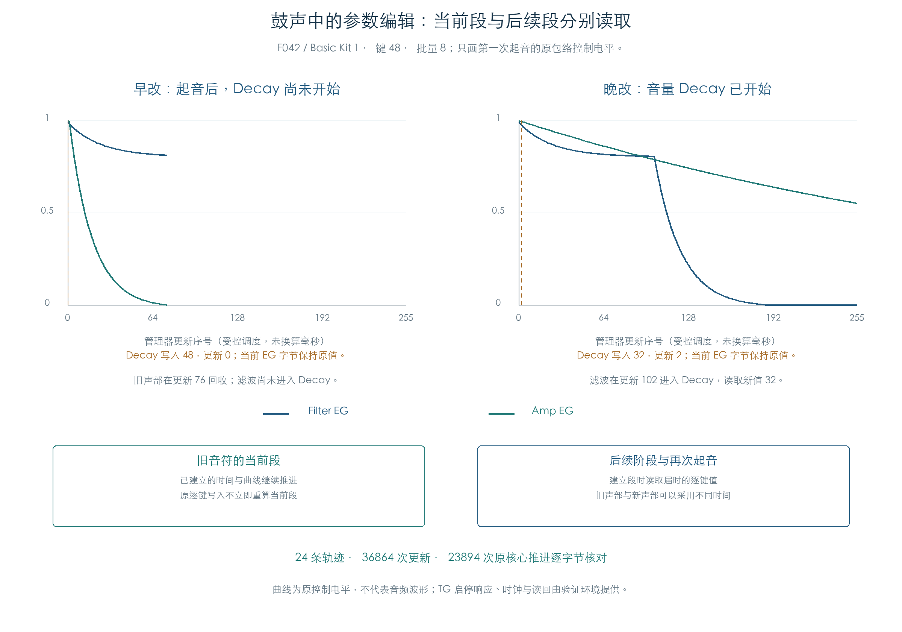

# 鼓组包络：演奏中编辑与自然阶段切换

KROSS 2 v1.2.4 · 插件演奏逻辑 · 2026-11-02

逐键时间编辑保留正在运行的包络段。后续阶段建立时读取届时的新值，再次起音也采用新值；同一个音符的 Amp 和 Filter 可以因此使用不同批次的参数。原声部管理器自然推进已验证这条规则。



## 1 当前段与后续段

F042 / Basic Kit 1 的键 48、力度 100 用于成对实验。原 Program 和鼓组字节保持原值，通过原逐键写入设置 Attack=72、Decay=80，再执行起音。初始 Filter/Amp Attack 时间索引分别为 68/12。

两个场景都在第一次管理器更新前把 Attack 改为 0。原写入前后，全部八个槽位的完整 Filter/Amp EG 状态不变；旧声部继续沿原 Attack 推进。

| 场景 | Decay 编辑时机 | 原 Amp Decay | 后续结果 |
| --- | --- | --- | --- |
| 早改 | 第一次管理器更新前改为 48 | 进入时读取 48，索引 63、时长 1752 单位 | Amp 先结束，旧声部在更新 76 回收；Filter 未进入 Decay |
| 晚改 | Amp 已进入 Decay 后改为 32 | 保留已建立的索引 95、时长 43680 单位 | Filter 在更新 102 进入 Decay，读取 32，索引 65、时长 2016 单位 |

表中更新序号对应批量大小 8 的受控调度，时长为原内部单位。每次原核心推进扣除 24 个单位，尚未将这些序号换算为宿主帧数或实测毫秒。

这也说明，音量包络结束会影响滤波包络还能推进多久。插件需要同时保留包络参数的读取时机和声部的回收条件。

## 2 再次起音与松键

晚改场景在观察到第一次 Filter Decay 后再次起音。F042 的新声部在更新 103 使用 Attack=0，Filter/Amp 时间索引均为 0；更新 104 建立 Decay 时，两者分别采用 65/47。旧声部仍保留原 Amp Decay 时长。

起音时长为零的段也沿原路径建立，随后由正常推进处理。这里没有直接跳过段或删除零时长状态。

F068 / Human BeatBox 的键 34 另覆盖允许接收 Note Off 的路径。批量 8 的晚改场景在更新 18 松键，新声部进入 Filter/Amp Release；旧的同音声部仍沿自身 Decay 推进。F042 键 48 的松键则保留原忽略设置。这些结果保留重复起音后的配对与逐键释放权限，不能将一次松键解释成清除所有同音声部。

## 3 连续执行怎样核对

| 检查 | 结果与范围 |
| --- | --- |
| 原厂来源 | F033、F036、F042 的键 48；F068 的键 34，覆盖单声道、立体声和松键接收 |
| 调度组合 | 每个来源使用批量 1/3/8 与早改/晚改两场景，共 24 条轨迹 |
| 自然更新 | 每条 1536 次，共 36864 次；不改阶段字节、不注入包络时间状态 |
| 原核心推进 | 23894 次，完整 48 字节核心状态与结束标志对照独立整数模型 |
| 段建立 / 修正 | 238 次原段建立、175 次逐层/逐键修正；沿用已核对的时间与曲线模型 |
| 参数编辑 | 48 次，写入前后比较完整 EG 状态 |
| 控制提交 | 15544 次，额外核对音量、音高、滤波目标与步长方程 |
| 再次起音 | 15 条轨迹进入；其余场景中原声部先结束，未达到触发条件 |

原管理器与显式原函数调度逐步比较八个声部、链表、控制器、随机状态，以及 TG 读写、等待和提交顺序。原 Filter/Amp 核心每步还对照独立曲线、剩余时间、电平与结束判断；本轮实际进入的核心调用均未启用动态踏板时间缩放。

“早改”表示第一次管理器更新前执行写入，各预置当时所处的阶段可能不同。F068 的短 Attack 很快结束，不能将 F042 的具体阶段时间套用于其他鼓键。

## 4 执行边界

再次起音需要验证环境回应 TG 启停：命令 1 清除锁存掩码，命令 2 设置掩码，沿用已有密集演奏检查中的受控响应。缺少停止响应会让原函数等待硬件反馈；该等待属于验证环境的缺项，未计为固件错误。

当前使用八槽私有声部池、固定 elapsed 序列与受控 TG 活动位、幅度和评分读回。两段附加参数继续使用前序鼓组刷新中的私有绑定。原 MIDI 字节路由、动态踏板缩放、OS 调度、宿主采样时基及 TG 实际音频未在本项中执行。

- [完整结果与指纹](../../derived/firmware/KROSS2_V124/architecture/stage04/drum-eg-live-check.json)
- [33189 行实际声部状态 CSV](../../derived/firmware/KROSS2_V124/architecture/stage04/drum-eg-live-states.csv)
- [原连续检查](../../tools/firmware_drum_envelope_live.py)、[配图脚本](../../tools/firmware_drum_envelope_live_figures.py)、[配图指纹](../../derived/firmware/KROSS2_V124/architecture/stage04/drum-eg-live-figure-check.json)
- 前序：[修正公式与阶段入口](DRUM_ENVELOPE_TIMES.md)、[逐键写入与持续刷新](DRUM_CONTROLS.md)

```text
python3 research/tools/firmware_drum_envelope_live.py --verify-arm
python3 research/tools/firmware_drum_envelope_live_figures.py
python3 research/tools/firmware_runtime_verify.py
```
