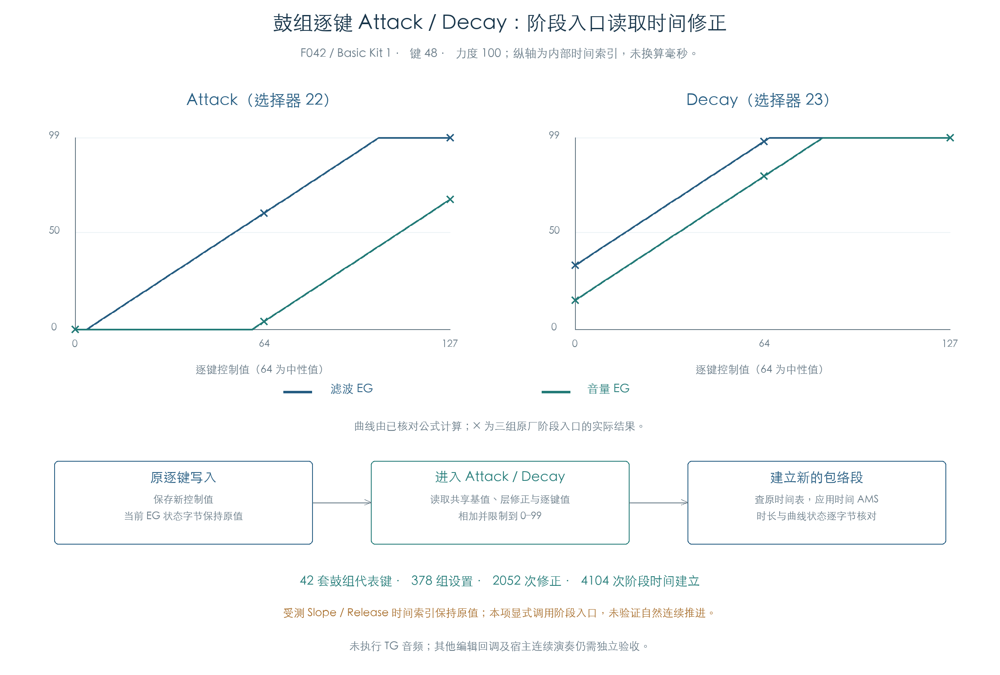

# 鼓组逐键 Attack / Decay 的时间修正

KROSS 2 v1.2.4 · 插件演奏逻辑 · 2026-11-02

逐键 Attack 和 Decay 同时影响音量包络与滤波包络。原参数写入只保存新的控制值；相应阶段入口读取它，再建立包络段。当前包络的剩余时间和曲线状态不会被这条写入入口立即改写。



## 1 时间索引的公式

令 B 为原共享控制变换后的时间索引，L 为当前鼓采样层的有符号修正，K 为逐键控制值：

```text
阶段时间索引 = clamp(B + L + K − 64, 0, 99)
```

K 的有效写入范围为 0–127，64 为中性值。L 与 K 相加后才执行最终限制；不要分别限制中间值。所得索引查原时间表，随后应用该阶段的时间 AMS 和曲线计算。它本身没有毫秒单位。

| 阶段 | 层描述符字节 | 逐键记录字节 | 原入口 |
| --- | --- | --- | --- |
| Amp Attack | +8 | +2，选择器 22 | `0x1FAF6C` |
| Filter Attack | +8 | +2，选择器 22 | `0x1FBC60` |
| Amp / Filter Decay | +9 | +3，选择器 23 | `0x1FAFD8` |

Attack 的两个入口先执行各自的共享控制变换。Decay 的基值从阶段调用者传入，仍包含其共享参数处理。该公式描述这之后的逐层、逐键修正，不能用原 Program 时间值直接替换 B。

## 2 原厂例子

F042 / Basic Kit 1 的键 48、力度 100 下，共享 Attack 基值为 Filter 60、Amp 4；两者层修正均为零。Decay 基值为 Filter 94、Amp 76，两者层修正均为 +3。

| 逐键值 K | Filter Attack | Amp Attack | Filter Decay | Amp Decay |
| --- | ---: | ---: | ---: | ---: |
| 0 | 0 | 0 | 33 | 15 |
| 64 | 60 | 4 | 97 | 79 |
| 127 | 99 | 67 | 99 | 99 |

同一个逐键值对不同包络产生不同时间索引；临近上限的 Decay 更早饱和。原共享时间核心还会应用时间 AMS，最终时长不能由这张表线性换算。

## 3 参数什么时候生效

检查先比较完整 48 字节 Filter EG 和 100 字节 Amp EG，再执行原逐键写入入口；两块状态逐字节不变。随后显式调用原 Attack、Decay、Slope、Release 入口：Attack/Decay 读取新值，建立的时间索引与上述公式一致。每次建立包络段后的完整 48 字节核心状态，与独立时间/曲线整数模型一致。

因此，插件应在建立相应包络段时读取这组修正。此次受测 Slope/Release 时间索引没有随 Attack/Decay 编辑改变。本项检查显式安排阶段切换；自然推进、原逐键编辑与再次起音另见[连续执行后续](DRUM_ENVELOPE_LIVE.md)，其他编辑通知仍保留缺口。

## 4 验证范围

| 检查 | 数量与边界 |
| --- | --- |
| 独立修正入口 | 268950 组：100 个基础索引、128 个逐键值、7 个层边界修正；另含非鼓组区域回退 |
| 原厂阶段设置 | 42 套鼓组各一代表键，Attack/Decay 的 0、64、127 两两组合，共 378 组 |
| 原修正调用 | 2052 次；共享控制变换执行原 ARM，修正结果对照独立加法与限制 |
| 原时间段建立 | 4104 次；覆盖两类 EG 的四个阶段，完整核心状态对照独立模型 |
| 写入生效边界 | 每组比较原写入前后的 EG 状态，随后显式进入阶段 |

独立入口矩阵把上游共享 Attack 变换提供为恒等边界，只验证修正分支和限制；原厂矩阵执行真实共享变换，并在返回处采集 B。普通采样的区域回退分支另核对 +13/+14 字节及空区域情况。

全部检查使用私有内存、原厂输入与现有离线固件。未执行硬件、OS 或 TG 音频，也未修改产品。逐键控制到完整 MIDI 消息的连接、自然连续阶段切换与实际声音仍保留缺口。

- [完整结果与输入指纹](../../derived/firmware/KROSS2_V124/architecture/stage04/drum-eg-times-check.json)
- [4104 次原阶段参数 CSV](../../derived/firmware/KROSS2_V124/architecture/stage04/drum-eg-time-segments.csv)
- [修正入口汇编](../../derived/firmware/KROSS2_V124/architecture/stage04/drum-eg-time-offsets.arm.txt)、[Filter Attack 汇编](../../derived/firmware/KROSS2_V124/architecture/stage04/drum-filter-attack-time.arm.txt)
- [原检查脚本](../../tools/firmware_drum_envelope_times.py)、[配图脚本](../../tools/firmware_drum_envelope_time_figures.py)、[配图指纹](../../derived/firmware/KROSS2_V124/architecture/stage04/drum-eg-times-figure-check.json)

```text
python3 research/tools/firmware_drum_envelope_times.py --verify-arm
python3 research/tools/firmware_drum_envelope_time_figures.py
python3 research/tools/firmware_runtime_verify.py
```
