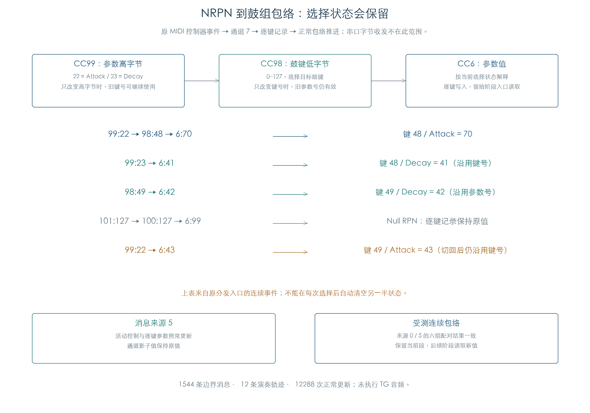

# MIDI NRPN 到鼓组控制与包络

KROSS 2 v1.2.4 · 插件演奏逻辑 · 2026-11-02

原 MIDI 控制器事件已接到真实鼓键记录和连续包络。逐键 Attack/Decay 通过 CC99、CC98、CC6 写入；当前包络段保持原状态，后续阶段与再次起音读取新值。NRPN 的选择状态会保留另一半已收到的参数号或鼓键号。



## 1 每个事件都按当时的选择解释

CC99 指定 NRPN 高字节，逐键参数 22/23 对应 Attack/Decay；CC98 指定鼓键。CC6 写入 0–127 的控制值。原通道同时保存选择族、已收到的选择字节和 Data Entry 状态。

初始化后，只收到高字节时，CC6 尚不能写入逐键参数。已收到两半选择后，改变其中一半会沿用另一半；切换参数族也没有自动清除已经保存的 NRPN 键号。

下表为同一通道上的连续事件，冒号左侧为 CC 编号，右侧为值：

| 事件顺序 | 逐键结果 |
| --- | --- |
| `99:22 → 98:48 → 6:70` | 键 48 的 Attack 写为 70 |
| `99:23 → 6:41` | 继续选中键 48，Decay 写为 41 |
| `98:49 → 6:42` | 保留参数号 23，键 49 的 Decay 写为 42 |
| `101:127 → 100:127 → 6:99` | Null RPN，逐键记录保持原值 |
| `99:22 → 6:43` | 切回 NRPN 后沿用键 49，Attack 写为 43 |

插件需要保留这些通道状态，逐事件执行。将选择字节拼成一次完整事务，或每次切换后清空另一半，会改变上述结果。

## 2 增减、默认值和消息来源

逐键 NRPN 使用 CC6 的七位绝对值，CC38 不补充逐键精度。CC96/97 固定增减一步，不把数据值当作步长；结果限制到 0–127。未设置的声像/发送覆盖字节为有符号 −1，增量先得到 0，随后减量仍停在 0；这条路径不会恢复 −1。

消息来源值 5 正常更新活动控制器和逐键参数，但保留通道影子副本。来源 0 同时更新影子副本。六组连续演奏配对中，活动值与逐键记录相同，包络核心、阶段建立、声部状态及控制提交结果逐项一致；该结论限于本次来源、参数和演奏组合。

## 3 接到自然包络推进

原厂 F033 / F042 的键 48 与 F068 / Human BeatBox 的键 34 分别覆盖立体声、单声道及松键接收。每个来源采用批量 1/8 和消息来源 0/5，共 12 条轨迹。

初始化、演奏中编辑均由原 MIDI CC 事件入口写入 Attack/Decay，未直接调用逐键 setter。之后执行原采样起音、管理器自然推进、正常轮询、再次起音和松键。包络阶段字节与时间状态均未注入。

F042 的晚改场景继续得到前序规则：旧 Amp Decay 保留原时长，Filter 后进入 Decay 时读取新值，新音符使用更新后的 Attack。详细电平曲线及读取时机见[连续包络检查](DRUM_ENVELOPE_LIVE.md)。

| 检查 | 本轮结果 |
| --- | --- |
| 边界消息 | 1544 条，包含选择不全、保留状态、全部逐键选择器、边界键/值、增减、Null RPN 与来源差异 |
| 连续演奏 | 12 条轨迹，每条 1024 次更新，共 12288 次 |
| 演奏中的 NRPN 消息 | 144 条，每条均比较完整通道、活动控制和全部鼓键 |
| 包络核心 | 13716 次完整状态与结束标志对照独立整数模型 |
| 段建立 / 修正 | 138 / 110 次，核对原时间和曲线运算 |
| 正常控制提交 | 9334 次，另核对音量、音高、滤波目标及步长 |

每条 CC 后，原指令结果与独立模型比较全部 436 字节选中通道、128 字节活动控制、1536 字节鼓键区，其他 15 个通道保持原值。离线总核验还从初值重放每条消息，比较全部键区哈希和逐字节变化。

## 4 边界与复现

事件从已解码的 MIDI CC 开始，执行原 `0x271500` 路由、`0x26EC34` 分发、`0x27422C` 控制复制和逐键写入；调制通知 `0x58E74` 在边界接管。当前为模式 3、通道 7 的单个真实鼓组上下文。

起音和松键沿用前序原 PCM 入口，未在本项中重新连接完整 MIDI Note On 路由或串口字节解析。八槽私有声部池、TG 启停即时响应、幅度/评分读回、附加参数绑定与受控时钟沿用前序连续检查。动态踏板、宿主采样时基及 TG 实际音频仍有独立缺口。

- [原指令结果与指纹](../../derived/firmware/KROSS2_V124/architecture/stage04/drum-nrpn-live-check.json)
- [1544 条边界消息 CSV](../../derived/firmware/KROSS2_V124/architecture/stage04/drum-nrpn-messages.csv)、[144 条演奏消息 CSV](../../derived/firmware/KROSS2_V124/architecture/stage04/drum-nrpn-live-messages.csv)
- [原检查脚本](../../tools/firmware_drum_nrpn_live.py)、[配图脚本](../../tools/firmware_drum_nrpn_figures.py)、[配图指纹](../../derived/firmware/KROSS2_V124/architecture/stage04/drum-nrpn-figure-check.json)

```text
python3 research/tools/firmware_drum_nrpn_live.py --verify-arm
python3 research/tools/firmware_drum_nrpn_figures.py
python3 research/tools/firmware_runtime_verify.py
```
