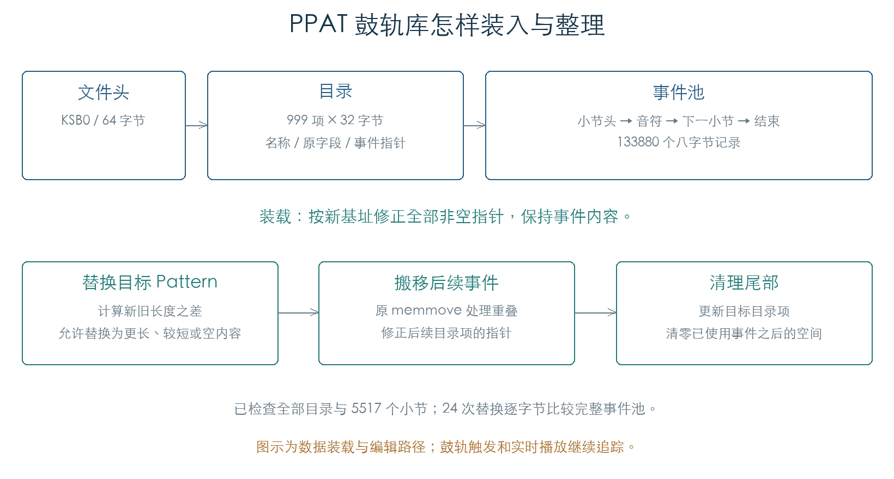
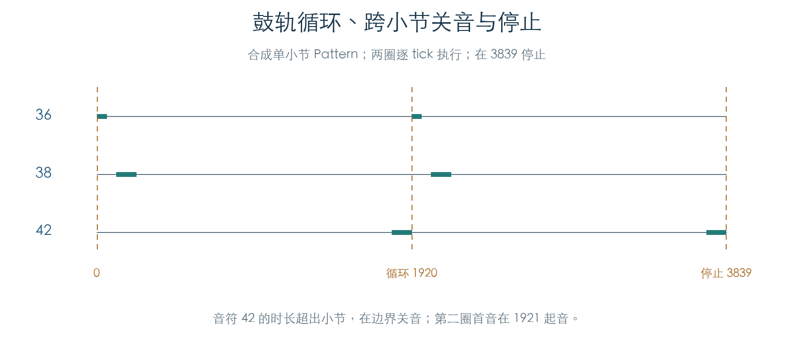
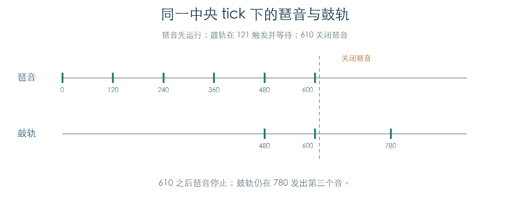

# 鼓轨 Pattern 库的存储与整理

KROSS 2 v1.2.4 · 2026-11-02

官方更新包的 `PPAT.BIN` 保存鼓轨 Pattern。已恢复目录、小节事件块、装载时的地址重定位和替换时的事件搬移，并执行原固件函数逐字节核对。当前数据包含 Off、799 个 Pattern 和 199 个空槽。

## 1 文件与目录

`PPAT.BIN` 共 1312036 字节，开头为 64 字节 `KSB0` 文件头，后接 `0x1404E4` 字节数据。文件头中的长度采用大端序，数据区的指针及事件字段采用小端序。

| 数据区偏移 | 内容 |
| --- | --- |
| `0000` | 保存数据时的基址，本文件为 `C199BD98` |
| `0004` | 999 个目录项，每项 32 字节 |
| `7CE4` | 连续排列的八字节事件记录 |

目录项前 24 字节为名称，接着四字节原字段，最后四字节为事件指针。空槽的指针为零。原目录函数对编号 0–998 寻址；编号 999 返回零。本轮据此确认目录容量。

本文件的 0–799 项均有事件数据，0 为 Off，800–998 为空槽。手册部分章节使用 0–772 的范围；v1.2.4 数据还包括 773 之后的 Future Pop、Trap Pop 等内容。报告保留版本与实际目录，不沿用旧范围。

## 2 小节与音符事件

每个 Pattern 由多个小节块和一个终止记录组成。小节头的类型为 `1`，`+04` 的 16 位值记录该块占用的八字节记录数，包含小节头自身；`+06` 保存小节编号。原查找函数按记录数跳到下一块。类型 `3` 表示结束，计入 Pattern 占用空间。

本文件共 5517 个小节块、127563 条音符记录及 800 条终止记录，合计 133880 条记录。音乐事件的类型均为 `9`，使用与已有轨道音符解码相同的八字节布局：

| 事件偏移 | 内容 |
| --- | --- |
| `+00` | 类型 9 |
| `+02` | 音高 |
| `+03` | 力度 |
| `+04` | 16 位时长 |
| `+06` | 16 位小节内位置 |

目录中的 Off 也有小节头和终止记录，音符数为零。读取库时应按事件指针和终止记录判断占用，单靠名称或音符数量无法区分 Off 与空槽。

## 3 重定位与替换

原装载函数 `0x2870C0` 计算新旧基址之差，将它加到所有非空事件指针，更新保存基址，再清理未使用尾部。实验把官方原件装到模拟器中的新地址，原指令处理后的全部字节与独立生成的期望结果一致。999 个目录项、全部 Pattern 的长度及 5517 个小节查找也逐项通过。

替换入口 `0x28718C` 先比较新旧事件长度，再用原 memmove 搬移后续内容、写入新记录并修正后续指针。写入完成后清零尾部。24 组检查覆盖目录前部、中部、末部及空槽，分别写入空内容、短 Pattern 和较长 Pattern；每次都比较完整数据区，包含未参与编辑的目录和事件。

## 4 键盘触发与 Latch

触键入口 `0x2488F8` 先取得路由描述，再检查等待键盘触发状态、输入通道、键区及力度区。按键通过时，将音高登记到 128 位按键集合；集合原先为空时，向待处理队列提交恢复请求。重复按同一键只保持对应位，不增加计数或重复恢复。

松键不再检查起音力度区。Latch 关闭时，清除最后一个按键会提交挂起请求；Latch 开启时，松键清理按键集合，播放保持。若集合本来为空，重复松键仍会产生挂起请求。本轮已保留这一实际行为。

| 条件 | 原入口的结果 |
| --- | --- |
| 通道不符、键区外或起音力度区外 | 不登记鼓轨触发键 |
| 第一键通过筛选 | 登记按键，提交恢复请求 |
| 另一个键或重复键通过 | 更新集合，保持播放 |
| 松开最后一键，Latch 关闭 | 提交挂起请求 |
| 松开最后一键，Latch 开启 | 保持播放 |

待处理项每项 12 字节，环形缓冲有 128 个存储槽，可容纳 127 项。560 组门槛、两条连续按键轨迹及 460 次入队/出队操作已验证筛选、按键集合、容量和回绕。另一组连续检查执行原消费者 `0x248440`，将队列请求连到实际的轨道恢复/挂起分支。

这组触发实验在路由描述选择与轨道恢复/挂起动作处截获，并固定时钟读数。后续播放检查直接绑定活动轨道，见下节。

## 5 活动轨道、循环与关音

原轨道绑定入口 `0x245760` 将编码后的 Pattern 编号接到官方 PPAT 目录，读出事件指针和拍号。推进入口 `0x2462B8` 维护小节位置，调用事件解码器 `0x245ECC`，将音符送入每轨 64 项活动表。解码、到期释放和停止入口已连接到本机 MIDI 输入边界。

音高先加 Shift；结果超出 0–127 时跳过该音。普通时长截到当前小节末端；位置字段 `0x7FFF` 是延音续接，匹配已有音高与力度并更新关音时间，不再次起音。官方库的 127563 条记录包含 124574 次起音和 2989 条续接，800 个占用项的全部起音顺序、音高、力度及位置均已和独立解析比较。

合成 Pattern 另外完成六组移调与两圈逐 tick 检查，覆盖全部越界、部分越界和正常音高。长音在小节边界关闭，停止时立即关闭残留音符，活动表归零。循环到终止记录时，固件先复位游标；在本组每 tick 调用一次的执行顺序下，第二圈首音出现在 1921，其他音仍位于 2040、3720 等原时间。

原厂检查按事件及到期边界推进，逐 tick 循环检查使用合成 Pattern。最终截获点为本机 MIDI 输入，完整声音合成尚未参与。

## 6 触发到播放的连续执行

后续检查将前面的模块连接起来：原管理器初始化轨道池，选择路由描述、分配轨道并绑定 PPAT；触键提交请求后，原消费者恢复或挂起轨道；原内部 tick 计数推动事件解码，最终生成本机 MIDI 音符。轨道分配、路由选择、请求消费和播放主体都执行原函数。

合成 Pattern 包含三个音符。立即启动、键盘触发后松键停止、Latch 保持三条流程，共产生 16 个起音/关音事件，全部时间与独立计算一致。键盘在 37 触发、187 松开时，Latch 关闭会在 187 立即截断第二个音；Latch 开启则继续播放第三个音。最后发出停止请求后，活动音符表和请求队列均清空。

Sync 开启时，原代码查询当前琶音引擎的拍内位置。拍长 480 的六组输入覆盖位置 0、1、59、60、120、479：前段可直接追赶，后段进入等待。例如位置 120 返回 360 tick 等待量，按本组先递增再消费的顺序，首音出现在第 359 次相对推进。逐 tick 顺序及首步门槛会带来一次推进的差别，原始轨迹完整保留。

这组相位实验的琶音参照对象保持在声明的相位，用来检验鼓轨读取该相位后的行为。后续双侧持续推进结果见下节。

## 7 共用中央节拍的双侧运行

原中央音乐 tick `0x2C82C0` 会更新共享计数，随后调用琶音和鼓轨的时钟消费者。新增连续检查执行这一入口，再按固定顺序调用双方管理器；每个 tick 都核对共享计数。16 种场景覆盖双方先后加入、Key Sync 开关及四个触发位置，共执行 23040 个中央 tick。

琶音先运行时，鼓轨在 37 触发会追赶当前拍；在 61、121、479 触发则都等到 480 发出首音。鼓轨先运行时，琶音的 Key Sync 开关决定从头开始或等待当前鼓轨拍长。全部起音时间与独立相位计算一致，两个输出序列在停止后也都保持起音/关音配对。

图中鼓轨在 121 触发，等待至 480、600、780 发音。610 关闭琶音时，原入口清理琶音按键与活动音符，鼓轨仍在 780 发出第三个音。这确认两者能够在同一节拍下独立停止。

本组使用原 UP 生成器与合成鼓轨 Pattern，并截获堆、临界区、显示/缓存通知及最终输出。管理器调用顺序在实验中固定；真实中断、OS 调度、运行中歌曲、录制写回和实际音频合成仍需继续核对。

## 证据与复现

- [检查脚本](../../tools/firmware_drum_patterns.py) · [原指令机器结果](../../derived/firmware/KROSS2_V124/architecture/stage04/drum-patterns-check.json) · [完整目录与小节事件](../../derived/firmware/KROSS2_V124/architecture/stage04/drum-patterns.json)
- [目录与装载汇编](../../derived/firmware/KROSS2_V124/architecture/stage04/drum-pattern-directory.arm.txt) · [替换汇编](../../derived/firmware/KROSS2_V124/architecture/stage04/drum-pattern-replace.arm.txt)
- [触发检查脚本](../../tools/firmware_drum_trigger.py) · [触发及队列机器结果](../../derived/firmware/KROSS2_V124/architecture/stage04/drum-trigger-check.json) · [触键入口汇编](../../derived/firmware/KROSS2_V124/architecture/stage04/drum-key-trigger.arm.txt)
- [播放检查脚本](../../tools/firmware_drum_playback.py) · [原厂播放及循环结果](../../derived/firmware/KROSS2_V124/architecture/stage04/drum-playback-check.json) · [活动轨道解码汇编](../../derived/firmware/KROSS2_V124/architecture/stage04/drum-track-decode.arm.txt)
- [连续执行脚本](../../tools/firmware_drum_integration.py) · [触发、播放与同步轨迹](../../derived/firmware/KROSS2_V124/architecture/stage04/drum-integration-check.json)
- [共同节拍检查脚本](../../tools/firmware_music_interlock.py) · [双方持续运行轨迹](../../derived/firmware/KROSS2_V124/architecture/stage04/music-interlock-check.json)
- [序列器音符解码](SEQUENCE_NOTES.md) · [KROSS 2 Parameter Guide](../../downloads/KROSS2_Parameter_Guide.pdf)，Drum Track 的 Pattern 与触发设置。

运行 `python3 research/tools/firmware_drum_patterns.py --verify-arm` 和 `python3 research/tools/firmware_drum_trigger.py --verify-arm`。全部检查在 Unicorn 私有内存中执行；重定位、长度计算、小节查找、替换、memmove 和尾部清零均执行原函数。触发检查的边界见第 4 节。输入、固件和工具指纹随结果保存。
