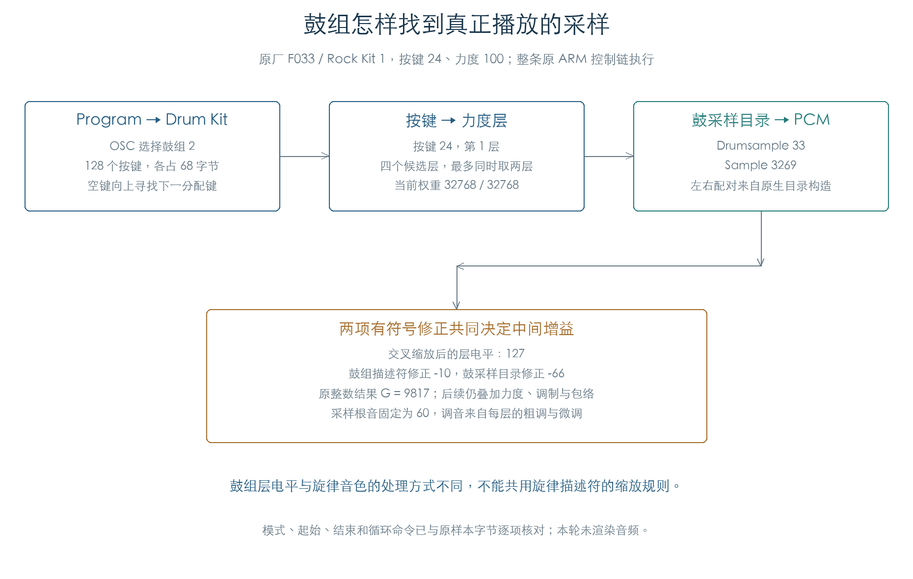
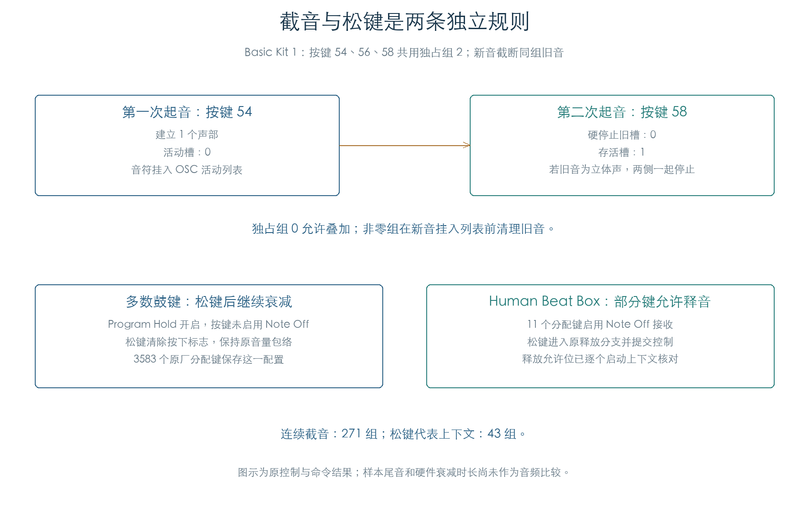

# 鼓组的选样、增益与截音

KROSS 2 v1.2.4 · 插件音源逻辑 · 2026-11-02

鼓组按“Program → Drum Kit → 按键 → 力度层 → 鼓采样目录 → PCM”选择声音。空键可向上借用下一分配键的素材；每层还保存调音、播放起点和反向选择。新音通过独占组停止旧音，松键行为另受 Program Hold 与按键标志控制。

## 1 从按键连接到真实采样



官方预载含 42 套原厂鼓组，每套由 24 字节名称和 128 条按键记录组成。按键记录长 68 字节，前 48 字节容纳四个 12 字节层描述符。原选择器最多同时选择两个力度层；立体声层各使用两个声部。

运行时先根据“已分配”标志建立重映射表：已分配键距离为零；两个分配键之间的空键指向上方最近的分配键；最高分配键以上填入 −1。负值抑制起音。被借用的素材使用对应分配键的控制记录，音高计算保留重映射距离。

“已分配”与“允许选层”分别使用按键 `+65.bit0` 和 `+65.bit2`。力度范围、Program 键区及运行态静音在此之前筛选。普通、查表与叠层交叉沿用[旋律选层](RUNTIME_FLOW.md)的三种权重规则。

板载鼓采样目录有 1014 条 32 字节记录。原目录构造得到 49 对立体声素材；选择立体声描述符时，原代码先查左右目录编号，再取得各自的 Sample。这里的目录与旋律 Multisample 目录分别绑定。

## 2 鼓组有两项独立电平修正

鼓层首先由交叉权重计算层电平，随后同时应用描述符和鼓采样目录中的两个有符号修正量：

```text
L = (127 × 权重) >> 15
A = 32768 + 331 × 描述符修正
B = 32768 + 331 × 鼓采样目录修正
P = (A × B) >> 15
G = clamp(signed32(signed32(P × L) × 129) >> 14, 0, 65535)
```

原厂 F033 / Rock Kit 1，按键 24、力度 100，选中 Drumsample 33 → Sample 3269。满权重得到 `L=127`；描述符修正 −10、目录修正 −66，原结果为 `G=9817`。忽略目录修正会得到 29456，约为原结果的三倍。`G` 是中间控制量，后续还要应用力度、调制和包络。

调音在中性逐键控制下写为 `2 × (100 × 粗调 + 微调)`，采样根音固定为 `60 × 256`。与旋律音色相比，鼓组描述符的电平字节在修正阶段参与计算；直接套用旋律描述符的层电平规则会改变结果。

反向选择还要经过素材能力查询。1014 条目录中，36 条通过当前板载采样标志判断。立体声能力由左右两侧共同约束。通过检查的反向位、起点选择及实际 Sample 元数据继续进入原 TG 采样命令构造。

## 3 独占组决定哪些旧音被截断



新音完成声部构造后，原 OSC 入口遍历已有活动声部。独占组为零时允许叠加；非零时硬停止同组旧音、归还分配槽并清除列表关系。立体声旧音的配对侧也会停止。新音随后挂入活动列表，因此同一次起音创建的左右侧和力度层会一起保留。

Basic Kit 1 的按键 54、56、58 同属组 2，对应闭镲、踏镲和开镲。新触发其中一个键会截断该组此前的声音。这个机制适合在插件中直接恢复，无需重建硬件驱动。

## 4 松键接收与自然衰减

Program Hold 开启、音符位于 Hold 键区且按键 `+65.bit3` 清零时，声部的释放允许位置零。松键仍清除按下标志，但保持当时的音量包络。

原厂分配键共有 3594 个，其中 3583 个保存了上述关闭松键接收的按键设置。另 11 个位于 Human Beat Box，启用松键接收。原代码为它们保留释放允许位，松键后进入包络释放和 TG 控制提交。最终是否允许释放仍要结合 Program Hold 与键区判断。

两条规则共同决定鼓音色表现：独占组处理新音对旧音的截断；松键接收处理按键释放。插件需要分别保存这两个状态。

## 5 验证范围与边界

| 检查 | 结果 |
| --- | --- |
| 原厂鼓组 / 分配键 | 42 套 / 3594 个，全部纳入 |
| 选层 | 682752 组，逐套遍历 128 键 × 127 个非零力度 |
| 真实启动上下文 / 声部 | 10642 组 / 12820 个，全部当次进入 TG 采样启动 |
| 初始化过的不同按键层 | 5237 个；另两条存储启用层被原力度门槛遮住 |
| 连续起音 | 271 组，含 229 组非零独占组和 42 组允许叠加的组零 |
| 松键代表上下文 | 43 组，覆盖每套鼓组及 Human Beat Box 的另一种按键标志 |
| 目录 | 1014 条、49 对立体声；36 条通过原反向能力判断 |

原数据共保存 5239 条启用层。未进入声部的两条分别为 F060 / 按键 74 和 F061 / 按键 106 的第二层：三个门槛均为 1，交叉宽度均为零，所有非零力度直接选择第一层。这两条已在[层覆盖分析](../../derived/firmware/KROSS2_V124/architecture/stage04/drum-voice-coverage.json)单独列出。

真实启动检查遍历每个分配键的力度门槛、交叉区边界及力度 100。每条启动路径均执行原 OSC 起音、选层、分配、鼓采样查找、参数构造、完整控制初始化、截音分派、列表挂接和 TG 启动。

独立计算逐项比较重映射、层及权重、左右目录、Sample 地址、调音、两个电平修正、反向与释放允许位、键盘跟踪，以及模式、起始、结束与循环命令。连续检查对每个有两个不同键的独占组执行两次起音，并比较硬停止对象、存活声部和空闲槽数；每套鼓组另选松键标志的代表键执行原松键入口。

测试使用原始预载的私有副本、中性逐键控制、新的八声部池及固定时钟。原目录构造、银行查询和鼓组提供者寻址均实际执行。仅私有内存分配、异常框架登记和 TG 总线读写由边界回调提供，另设断言陷阱。TG 状态读回为零，没有执行芯片音频，也没有连接实机。

GM 特殊重映射、扩展银行、逐键参数编辑和鼓组持续控制刷新仍有独立缺口。声像与发送的原初始化已随链执行，本轮没有独立恢复它们的全部组合方程。产品代码、采样资源及既有验证基线保持原状。

[后续逐键控制](DRUM_CONTROLS.md)已补充原写入、独立声像/发送方程及持续刷新，并区分起音保存与后续读取。GM/扩展、其他编辑副作用与音频行为继续单列。

[原指令结果](../../derived/firmware/KROSS2_V124/architecture/stage04/drum-voice-chain-check.json) · [启动参数 CSV](../../derived/firmware/KROSS2_V124/architecture/stage04/drum-voice-chain.csv) · [重映射 CSV](../../derived/firmware/KROSS2_V124/architecture/stage04/drum-voice-remap.csv) · [重映射汇编](../../derived/firmware/KROSS2_V124/architecture/stage04/drum-kit-remap.arm.txt) · [独占组汇编](../../derived/firmware/KROSS2_V124/architecture/stage04/drum-exclusive.arm.txt)

```sh
python3 research/tools/firmware_drum_voice_chain.py --verify-arm
python3 research/tools/firmware_drum_voice_figures.py
python3 research/tools/firmware_runtime_verify.py
```
