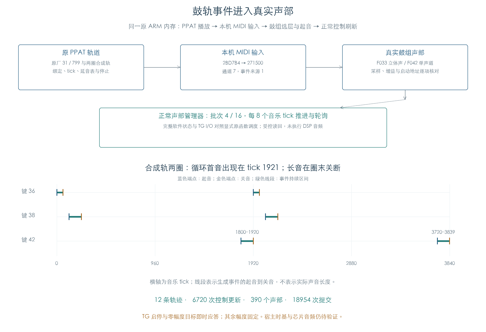

# 鼓轨到真实声部

## 1 对插件的用途

插件鼓伴奏需要把 Pattern 的起音、松键和循环接到音源。此前的鼓轨检查停在本机 MIDI 输出边界；本项继续执行原输入、鼓组选层、声部分配、控制初始化和采样启动，并接入正常声部刷新。



## 2 调用与数据

同一 ARM 私有内存内执行 `2456C4 / 245760 / 2458C0 → 2462B8 → 244A60 → 2BD7B4 → 271500 → 鼓组声部`。本机输入 `2BD7B4` 保持原实现，事件由通道 7、来源 1 分发；缓存/显示通知 `2AA44` 在边界截获，移调/力度预处理关闭，外发端口关闭。

每个新声部独立核对鼓键重映射、层权重、实际 Sample、音高、两项电平修正和主侧增益；副侧增益按进入增益函数时的值检查。采样启动另核对模式、起始、末端及循环地址。每 8 个音乐 tick 调用原管理器推进/轮询，与显式原函数调度比较完整声部、链表、控制和 TG I/O。这个间隔为实验调度单位。

## 3 验证结果

12 条轨迹共生成 520 条起音/关音事件，建立 390 个声部，执行 390 次采样启动和 6720 次控制更新，完成 18954 次声部控制提交。每行分别以批次 4、16 运行，共两条轨迹。

| Program | 轨道 | 每条 tick | 每条起音 | 每条声部 |
| --- | --- | --- | --- | --- |
| F033 | 两圈合成轨 | 3840 | 6 | 12 |
| F033 | 原厂 799 | 1920 | 10 | 20 |
| F033 | 原厂 31 | 7680 | 49 | 98 |
| F042 | 两圈合成轨 | 3840 | 6 | 6 |
| F042 | 原厂 799 | 1920 | 10 | 10 |
| F042 | 原厂 31 | 7680 | 49 | 49 |

合成轨第二圈首音出现在 tick 1921；两条长音分别在 1920 与 3839 关断。生成音符在停止后全部配平，末尾 CC120 清理后 32 槽全部可用。

## 4 验证边界

TG 启动/停止命令即时更新活动位；活动槽幅度固定为 16384，空闲槽或写入零幅度目标后返回 0，新的非零目标取消归零覆盖。评分固定。零幅度即时应答只用于让原回收流程继续，实际渐变速度与采样自然结束仍未知。

首次长轨在 F033、Pattern 31、批次 4 的 tick 6480 停住：原代码发出 `0xFE000000` 归零命令，旧验证环境持续返回非零幅度。失败信息与当时脚本均归档。当前 32 槽布局避开鼓组缓冲；原压力实验的 120 槽节点地址与本项鼓组缓冲会重叠，因此没有沿用。

原生对照在私有零页记录空链表写入，主机版本仅省略对应的 4/0 两次空写。轨道停止需要配平生成音符，鼓键的 Note Off 权限继续生效；末尾另发 CC120 清理，单独记录其结果。归零应答日志包含装载初始化，音乐事件的时间单独比较。真实硬件零页、键盘/Latch 管理器、琶音与共同中央时钟、宿主时基及 DSP 音频未纳入本项连续链。

## 5 复现

```sh
python3 research/tools/firmware_drum_voice_playback.py --verify-arm
python3 research/tools/firmware_drum_voice_playback_figures.py
python3 research/tools/firmware_runtime_verify.py
```

Unicorn JIT 需要宿主允许执行。CSV 和结果文件见 `research/derived/firmware/KROSS2_V124/architecture/stage04/drum-voice-playback-*`；全部固件、输入、辅助脚本与失败记录均带指纹。这里只使用既有离线材料。
