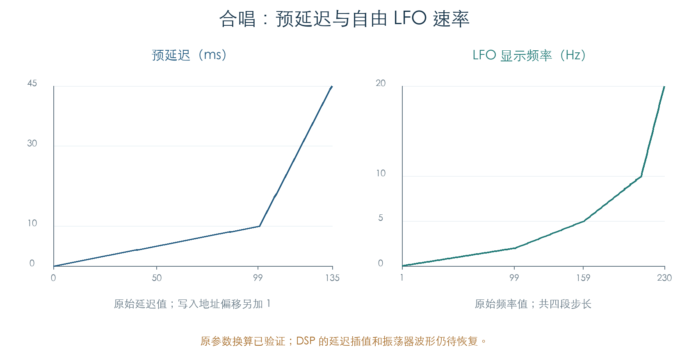
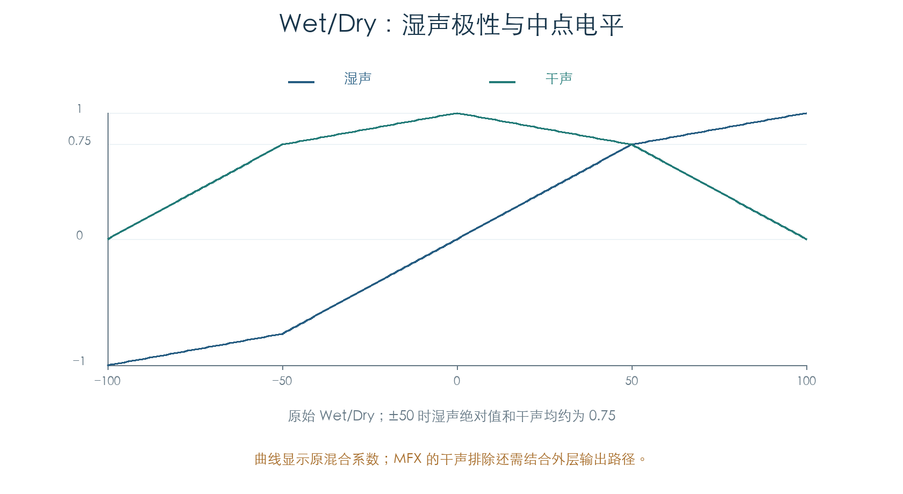
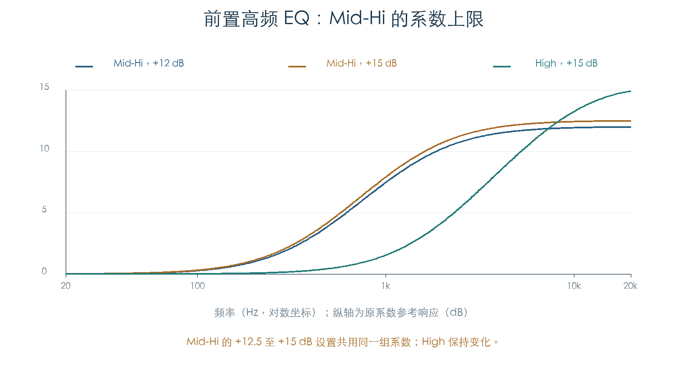

# 立体声合唱：延迟、LFO、混合与前置 EQ

KROSS 2 v1.2.4 · 效果 064 Stereo Chorus · 2026-11-02

合唱的预延迟、深度、自由/同步 LFO、左右相位和干湿系数已恢复。前置低、高频 EQ 的全部 244 组设置已还原为可执行的一阶滤波方程。原厂 309 个启用的合唱槽位，均已执行原初始化及全部静态参数回调。

这些结果补齐了现有近似合唱缺少的原参数映射。DSP 的延迟插值、波形生成和内部音频连接仍待恢复，完整合唱算法尚未复现。

[局部程序后续](CHORUS_PROGRAM.md)已核对七槽位的全部 106 项，恢复 MFX 四处修正及参数引用，确认 0 为三角波、1 为正弦波。30528 个有效位变异通过；具体波形时序与插值仍待恢复。

## 1 预延迟与调制深度

左右预延迟各有独立参数。原始值 0–99 表示 0–9.9 ms、步长 0.1 ms；100–135 表示 10–45 ms、步长 1 ms。原函数先生成整数采样偏移，再加 1 写入控制字：

```text
raw < 100：samples = floor(48×raw/10)
raw ≥ 100：samples = 48×(raw−90)
写入值 = samples + 1
```



Depth 0–100 经三段整数换算得到 0–720。初始化时，左右存储起点相差 2881；最高预延迟 2160、最大深度 720，再加一个地址偏移，恰好为 2881。这为延迟空间大小提供了结构证据，尚未证明 LFO 到读指针的具体计算形式。

原参数定义未提供反馈旋钮。内部是否存在固定反馈或多抽头，仍需从音频程序确认。

## 2 自由 LFO 与 MIDI 同步

自由频率原始值 `r=1…230` 经四段换算得到百分之一 Hz：

| r | 频率 c（0.01 Hz） |
| --- | --- |
| 1–99 | `2r` |
| 100–159 | `5r−300` |
| 160–209 | `10r−1100` |
| 210–230 | `50r−9500` |

对应显示范围为 0.02–20 Hz。自由速率的控制字为 `256×(trunc(c×32768/9375)+1)`。调制先把基础频率与 Amount 换算到频率单位，再叠加来源值；结果只设下限 `0x700`，因此最大正调制可超过静态显示的 20 Hz 上限。

MIDI Sync 打开后，自由频率回调停止改写速率。同步路径使用 BPM、十项时值表和 1–32 倍数：

```text
时值因子 = [32,24,16,12,8,6,4,3,2,1]
word = floor(BPM100 × 时值因子 × 2^21 / (562500 × 倍数))
```

BPM 原始值小于 4000 时采用当前速度；合法的 3999 表示该特殊状态。固定 BPM 从 4000 至 30000，对应 40–300 BPM。若将该控制字解释为 48 kHz 下的 32 位相位步进，它与同步频率 `BPM100×因子/(24000×倍数)` 一致；DSP 相位累加器尚未执行，这个解释仍需核对。

左右 LFO 相位参数以 10° 为步长，范围 −180° 至 +180°。原写入值为 `trunc(角度×8388607/180)`。37 个相位值全部检查。

720 组同步设置分别通过 Sync、BPM、时值和倍数四个回调入口。另有 400 组自由速率调制及一条八步连续轨迹，覆盖自由、固定同步、实时速度来源和关闭后保持。

## 3 干湿混合包含极性和中点补偿

Wet/Dry 的合法范围为 −100 至 +100。令 `v=abs(raw)`，以 `Q=8388607` 表示单位电平，原混合系数为：

```text
v < 50： wet = trunc(3vQ/200)
         dry = trunc((200−v)Q/200)
v ≥ 50： wet = trunc((v+100)Q/200)
         dry = trunc(3(100−v)Q/200)
raw < 0 时，wet 取负号
```



原始值 0 为纯干声；±100 为纯湿声，符号决定湿声极性。±50 时两项绝对值各约为 0.75。采用普通线性混合会改变中间位置的电平和相消关系。

全部 201 个值均覆盖开启和关闭两种状态。动态更新先叠加 `trunc(来源值×Amount/127)`，再限幅到 ±100 并使用相同映射。MFX 外层需要排除干声分量；本节只恢复内部混合系数，该外层音频路径尚未执行。

## 4 前置 EQ 的一阶方程与表内限幅

PreEQ Trim 按百分比生成输入电平。低、高频 EQ 各有 −15 至 +15 dB 增益和两个 Fc 选项：Low / Mid-Lo、High / Mid-Hi。每组只含三个系数，可表示为：

```text
y[n] = b0×x[n] + b1×x[n−1] + f×y[n−1]
H(z) = (b0+b1×z⁻¹)/(1−f×z⁻¹)
```

低频表使用有符号 24 位 Q22，高频表使用 Q20。两组基准角度分别对应 500 Hz 和 1500 Hz；Fc 选项改变增益与极点、零点的组合关系，精确方程保存在检查脚本中。增益与 Fc 回调会重新写入整个一阶节。

244 组设置均与独立搁架方程比较，最大系数差约 `1.369×10⁻⁶`，检查极点稳定。高频 Mid-Hi 表在原始增益 25（+12.5 dB）后重复同一组系数；High 表继续变化到 +15 dB。



图中响应由原系数计算。该限幅已由原表及回调确认；完整效果中的最终电平还受 Trim、干湿和其他处理影响。

## 5 验证与插件用途

| 检查 | 数量 | 内容 |
| --- | ---: | --- |
| 标量参数 | 1377 | 全部预延迟、Depth、Trim、自由频率、相位和干湿，以及固定参数 |
| 前置 EQ | 244 组 | 全部增益/Fc 组合、两个回调入口、独立方程 |
| 同步控制 | 720 组 | 速度边界、十种时值、倍数、当前速度和四个回调入口 |
| 动态组合 | 192 | Sync、速度来源、参数来源、正负来源值及开关 |
| 自由速率调制 | 400 | 分段边界、正负 Amount、上下限及来源匹配 |
| 连续更新 | 8 步 | 模式切换、速度变化、干湿更新和关闭后保持 |
| 原初始化 | 5 个槽位 | IFX 与 MFX 的初始化入口、左右地址和常数 |
| 原厂启用槽位 | 309 | 真实槽号、原加载器、初始化及全部静态回调 |

所有控制检查比较完整 80 字缓冲。参数 getter、当前速度 getter，以及监听/显示通知在边界提供或截获；缓冲加载、初始化、运算和写入均执行原 ARM。原厂特殊速度状态以 120 BPM 检查，不据此断言其运行时速度。

现有结果可用于插件的参数解码、前置 EQ、混合及同步控制。下一步仍需确认延迟插值、LFO 实际波形与时序、内部连接和音频电平。产品代码未修改。

## 证据与复现

- [原函数检查脚本](../../tools/firmware_chorus.py) · [完整结果与原厂来源](../../derived/firmware/KROSS2_V124/architecture/stage04/chorus-check.json)
- [合唱参数与初始化](../../derived/firmware/KROSS2_V124/architecture/stage04/chorus-parameters.arm.txt) · [自由/同步 LFO](../../derived/firmware/KROSS2_V124/architecture/stage04/chorus-lfo-rate.arm.txt)
- [延迟与深度](../../derived/firmware/KROSS2_V124/architecture/stage04/chorus-delay-depth.arm.txt) · [混合映射](../../derived/firmware/KROSS2_V124/architecture/stage04/chorus-mix.arm.txt) · [前置 EQ](../../derived/firmware/KROSS2_V124/architecture/stage04/chorus-pre-eq.arm.txt)
- [EQ 表选择](../../derived/firmware/KROSS2_V124/architecture/stage04/chorus-pre-eq-tables.arm.txt) · [Fc 选项名称](../../derived/firmware/KROSS2_V124/architecture/stage04/chorus-pre-eq-labels.arm.txt)
- [配图脚本](../../tools/firmware_chorus_figures.py) · [延迟/速率 CSV](../../derived/firmware/KROSS2_V124/architecture/stage04/chorus-control-maps.csv) · [混合 CSV](../../derived/firmware/KROSS2_V124/architecture/stage04/chorus-signed-mix.csv) · [EQ 响应 CSV](../../derived/firmware/KROSS2_V124/architecture/stage04/chorus-pre-eq-response.csv)

复现：`python3 research/tools/firmware_chorus.py --verify-arm`。全程使用现有离线材料，不连接设备。
