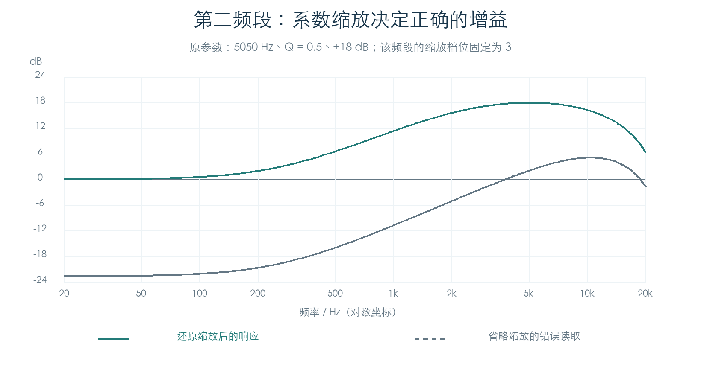
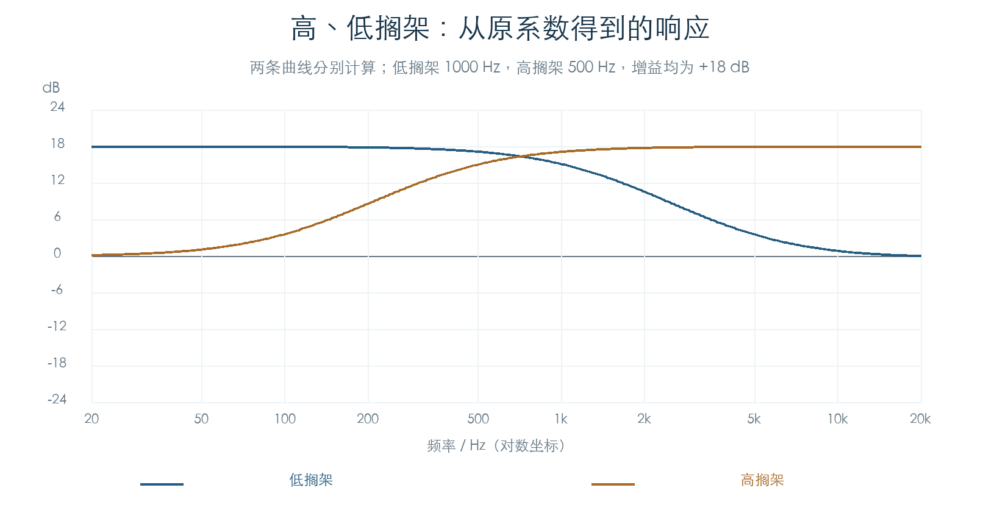

# 四段参数均衡器：系数、缩放与调制

KROSS 2 v1.2.4 · 效果 007 St.Parametric4EQ · 2026-11-02

这套 EQ 的四个频段已恢复到可执行的主机滤波方程，覆盖峰值、低搁架和高搁架模式。660 组边界参数及原厂 768 个 A–F Program 中全部 331 个启用的同类槽位通过原指令对照。系数带有缩放档位，读取后需要还原；第二频段还保存基础增益与调制后增益两组端点。

## 1 频段与参数

增益索引 `g` 的单位为 0.5 dB，范围 −36 至 +36。峰值模式的 Q 为 `(q + 5) / 10`，范围 0.5–10；搁架模式不使用 Q。

| 频段 | 模式 | 频率索引 i 对应的 Hz | 系数存储 |
| --- | --- | --- | --- |
| B1 | 峰值 | `20 + 10i` | 两字组成一个有符号 Q30 系数 |
| B1 | 低搁架 | `20 + 20i` | 同上 |
| B2 | 峰值，带增益调制 | `50 + 10i` | 两组 Q30 系数，缩放档位固定为 3 |
| B3 | 峰值 | `300 + 100i` | 有符号 24 位 Q22，档位随频率选择 |
| B4 | 峰值 / 高搁架 | `500 + 100i` | Q22；峰值随频率选择，高搁架固定档位 4 |

低搁架与峰值的频率索引步长不同。切换 B1 类型后，保持同一原始索引会改变实际频率。

## 2 缩放怎样还原

每组系数依次表示 `b0、b1、b2、f1、f2`。先按 Q30 或 Q22 解码，再将五项同时乘以 `2^(s−1)`，其中 `s` 为缩放档位。B3/B4 峰值在 1200 Hz 以下取 1，1200–4800 Hz 取 2，4900 Hz 起取 3。



主机参考使用以下差分方程：

```text
y[n] = b0*x[n] + b1*x[n−1] + b2*x[n−2]
     + f1*y[n−1] + f2*y[n−2]
```

原第二频段使用固定的四倍还原。省略它会同时改变增益和极点，无法得到设定的频率响应。高搁架的还原倍数为八倍，部分正常系数的绝对值会超过 2。

## 3 峰值与搁架的计算

峰值模式先根据频率和 Q 计算阻尼量，再根据增益方向构造系数。独立参考保留原数学常数：角度步长约 `0.000130899949`，角度达到 π/2 后采用约 `76.39000868` 的正切替代值。

```text
theta = Hz * angle_step * 5 / (q + 5)
a = tan(theta)；达到角度上限时使用 tangent_cap
c = cos(2π * Hz / 48000)
G = 10^(abs(g) / 40)

提升：d = 1 + a
      b = [(1+G*a)/d, −2*c/d, (1−G*a)/d]
      f = [2*c/d, (a−1)/d]

衰减：d = 1 + G*a
      b = [(1+a)/d, −2*c/d, (1−a)/d]
      f = [2*c/d, (G*a−1)/d]
```

搁架模式可表示为两个相同的一阶节相乘。它先按增益查表修正频率：低搁架乘补偿系数，高搁架除补偿系数。补偿表共 37 项，例如增益索引 12、18、24、36 分别约为 1、1.41424、2、4；原表值随机器结果保存。

令修正后的频率为 `f′`、`A=10^(abs(g)/80)`、`t=tan(πf′/48000)`、`z1=z⁻¹`，提升模式可写为：

```text
低搁架：H(z) = [((1+t) + (t−1)*z1)
               / ((1+t/A) + (t/A−1)*z1)]²
高搁架：H(z) = [A*((1+t) + (t−1)*z1)
               / ((1+A*t) + (A*t−1)*z1)]²
```

衰减模式取对应提升传递函数的倒数。展开后即可得到主机使用的五项二阶系数。



独立浮点方程与原生系数还原后的最大差值为 `3.364×10⁻⁵`。该差值包含原数学近似和定点量化，参考模型保留原上传字及缩放档位供后续精化。

## 4 输入电平、干湿与动态控制

原 Trim 回调按 `trunc(Trim × 8388607 / 100)` 写入增益常数。101 个合法输入逐项一致。静态 Wet/Dry 也使用相同比例；关闭时写零，开启时读取当前参数，八组检查通过。

动态回调按源编号分别更新 B2 权重和湿声量。B2 权重将源值映射到 0–8388607；湿声量先计算 `Wet + trunc(源值 × Amount / 127)`，限制到 0–100 后再换算。216 组检查覆盖源匹配、开关、正负调制与限幅，同时确认其他常数字段保持原值。

B2 的两组端点分别对应基础增益和 `clamp(基础增益 + Amount, −36, 36)`。本章恢复了端点和控制权重的生成。[局部程序后续](EQ_B2_PROGRAM.md)进一步核对双端点引用、完整槽位初始化和两种主机候选；DSP 内部的实际动态过渡仍需继续核对。

## 5 验证范围与插件用途

660 组参数检查覆盖 ±18 dB、Q 两端及中间值、频率缩放边界、增益叠加限幅和搁架模式；331 个原厂槽位另逐段执行原系数函数。所有检查中的极点均位于单位圆内，最大半径约 0.999869。

五组主机双精度脉冲响应使用恢复的系数实际运行，每组 131072 帧，再以四个频率的复数 DFT 对照解析响应。此项验证了主机二阶滤波实现形式。图中的曲线由恢复系数计算，尚无物理琴录音对照。

这些结果可用于插件的静态四段 EQ、参数显示与控制更新。[整链主机音频参考](EFFECT_EQ_AUDIO.md)已进一步连接 331 组系数的双通道级联、分块处理及五份源采样试听。[效果路由](EFFECT_ROUTING.md)已核对原厂槽位分配、发送/返回和切换顺序。DSP 内部动态过渡、干湿音频混合、芯片舍入及音频一致性继续恢复。原厂“启用槽位”统计只说明设置状态，其可听贡献还取决于信号路由。

## 证据与复现

- [检查脚本](../../tools/firmware_parametric_eq.py) · [完整结果及 331 项原厂来源](../../derived/firmware/KROSS2_V124/architecture/stage04/parametric-eq-check.json)
- [四频段编程](../../derived/firmware/KROSS2_V124/architecture/stage04/p4eq-band-programming.arm.txt) · [峰值计算](../../derived/firmware/KROSS2_V124/architecture/stage04/p4eq-peaking-math.arm.txt) · [搁架补偿表](../../derived/firmware/KROSS2_V124/architecture/stage04/p4eq-shelf-factor.arm.txt)
- [曲线生成脚本](../../tools/firmware_parametric_eq_figures.py) · [频率响应 CSV](../../derived/firmware/KROSS2_V124/architecture/stage04/p4eq-response-curves.csv)

复现：`python3 research/tools/firmware_parametric_eq.py --verify-arm`。系数路径无替代函数，原缓冲模式阻止 MMIO 写入；动态控制检查在参数 getter 边界提供值。全程不连接设备，产品代码未接入此次新增模型。
