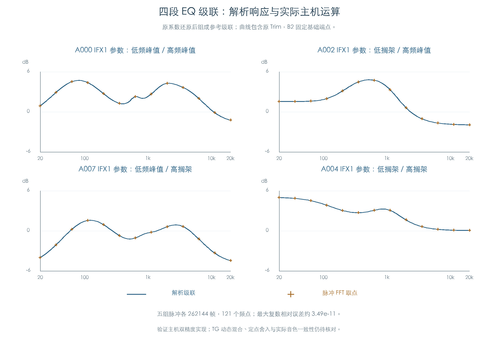

# 四段 EQ 的整链音频参考与试听

KROSS 2 v1.2.4 · 原系数、主机级联与音频验证 · 2026-11-02

已恢复的四段 EQ 系数现可直接处理双通道音频。331 组原厂启用槽位的基础系数全部组成四节级联，通过分块处理、独立实现和通道隔离检查。五组整链脉冲与解析响应一致；另提供同一段源弦乐的五份对照试听。

本项实现主机双精度参考。它能用于插件静态 EQ 的实现和回归，TG 动态混合、内部舍入及与原机声音的一致性仍待核对。



图中横轴为频率 Hz，纵轴为相对输入增益 dB。蓝线来自四个传递函数相乘；橙色取点来自实际滤波后的整链脉冲。曲线包含各组原 Trim，因此高低频基线也会随输入电平设置变化。

## 1 从原系数到流式音频

[原参数 EQ 检查](EFFECT_EQ.md)已保存每个频段的原定点字与缩放档位。本项重新解码 Q30/Q22，核对还原结果，再按 B1 → B2 → B3 → B4 组成参考级联：

```text
输入 × 原 Trim → B1 → B2 基础端点 → B3 → B4 → 输出
```

B2 始终选择基础端点，未加入未知的 DSP 动态过渡。试听的四组参数另外满足 Amount=0、Wet=100；参考直接输出处理后的信号，不构造未经确认的干湿混合或旁路电平。

每个声道、每个频段保留独立状态。主实现采用转置直接 II 型；另一套直接 I 型逐样本使用当前输入、前两次输入和前两次输出，独立核对结果。所有算术均使用主机双精度，未加入猜测的芯片饱和或逐指令舍入。

## 2 331 组系数怎样验证

每组处理 2048 帧不对称双通道输入。连续处理与按 `1、7、64、257、3、128、511` 帧循环分块的结果逐位一致，跨块保留滤波状态。两种直接型的最大归一化绝对差约 `6.02e-15`。

把右声道输入置零后，其输出始终为零，左声道与原结果逐位相同。所有输出均为有限值，各节极点保持在单位圆内。

另选四种峰值/搁架组合，以及高极点半径的 E090 IFX1 系数组，分别运行 262144 帧脉冲。在 20 Hz 至 20 kHz 的 121 个 FFT 频点比较复数响应，最大相对差约 `3.49e-11`。

这项误差衡量同一组已还原系数的主机实现与解析响应。原系数与独立数学公式之间约 `3.364e-5` 的最大系数差仍按前章保留；两项指标不能互换，也没有测量原机输出误差。

## 3 源采样试听

输入取现有板载样本 2445/2446，对应 `Str.Ensemble 2 -L/-R` 的一对源片段。两侧均为 48000 Hz、55340 帧，直接读取 PCM24，末尾各补 48000 帧零输入观察滤波尾部。全程没有重采样、循环、移调或包络合成。

| 试听 | EQ 参数来源 | Trim | 低频 / 高频模式 |
| --- | --- | ---: | --- |
| [源弦乐](../../output/EQ_reference_audio/source-strings.wav) | 无 | 100 | 不经过 EQ |
| [参考 A000](../../output/EQ_reference_audio/strings-eq-A000-IFX1.wav) | A000 IFX1 | 86 | 峰值 / 峰值 |
| [参考 A002](../../output/EQ_reference_audio/strings-eq-A002-IFX1.wav) | A002 IFX1 | 80 | 低搁架 / 峰值 |
| [参考 A007](../../output/EQ_reference_audio/strings-eq-A007-IFX1.wav) | A007 IFX1 | 53 | 峰值 / 高搁架 |
| [参考 A004](../../output/EQ_reference_audio/strings-eq-A004-IFX1.wav) | A004 IFX1 | 60 | 低搁架 / 高搁架 |

五份文件均为双通道 PCM24、103340 帧。所有文件统一乘约 `0.783881` 的导出增益，使最大峰值为 0.9；没有分别归一化或削波，各组 Trim 和 EQ 造成的相对电平差保留。实际 WAV 逐字节读回，文件参数及指纹另存结果。

文件名中的 Program 号仅表示 EQ 参数来源。试听采用同一段源弦乐，没有渲染这些 Program 的完整选层、EG、滤波或其他效果；也未完成与原机录音的听感比较。

## 4 插件用途与剩余边界

本项提供四节状态、分块接口、可追溯系数和实际音频参考，可用于实现静态四段 EQ。主机级联的顺序和浮点状态由参考模型明确定义，未宣称它们就是芯片内部布局。

B2 调制端点间的过渡、参数变化的平滑、干湿混合、内部余量、非线性和定点舍入仍未恢复。普通 TG Filter A/B 的传递函数也不由这套效果 EQ 推出。主机音频检查与原 ARM 模块结果分列，未增加原指令验证数量。

## 复现与证据

使用已提供的 Python/NumPy 环境执行，无新增依赖下载：

```text
python3 research/tools/firmware_eq_audio_reference.py
python3 research/tools/firmware_eq_audio_figures.py
python3 research/tools/firmware_runtime_verify.py --evidence-only
```

- [全部系数、流式检查、脉冲与音频指纹](../../derived/firmware/KROSS2_V124/architecture/stage04/eq-audio-reference-check.json)
- [484 行频率响应 CSV](../../derived/firmware/KROSS2_V124/architecture/stage04/eq-audio-reference-curves.csv)、[配图指纹](../../derived/firmware/KROSS2_V124/architecture/stage04/eq-audio-reference-figure-check.json)
- [主机参考实现](../../tools/firmware_eq_audio_reference.py)、[配图脚本](../../tools/firmware_eq_audio_figures.py)、[原 ARM 系数结果](../../derived/firmware/KROSS2_V124/architecture/stage04/parametric-eq-check.json)
