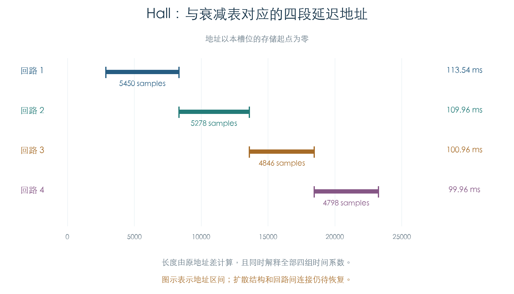
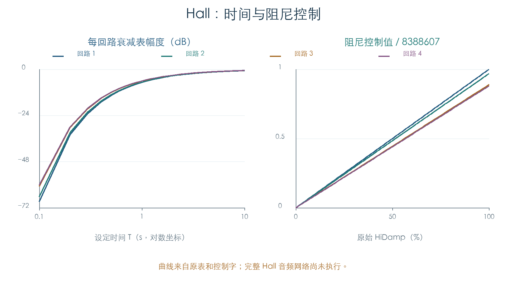

# Hall 混响：延迟区间、衰减与阻尼

KROSS 2 v1.2.4 · 效果 105 Reverb Hall · 2026-11-02

Hall 的四组时间系数已与四段原延迟地址对应起来，全部 400 个表项符合设定时间到 60 dB 衰减的公式。阻尼、输入电平、干湿和前置 EQ 的原运算也已核对；原厂 425 个启用槽位均执行了原初始化及全部静态回调。

这确定了混响核心的部分数值关系。扩散、回路间连接、阻尼递推和输出组合尚未恢复，完整 Hall 音频算法仍未复现。

[局部字段后续](HALL_LOCAL_OPERANDS.md)已将全部 121 条程序项接到七槽位原初始化，并核对两个局部索引、接口字段及两处 MFX 位修正。3744 个有效位变异通过；25 个地址引用与四组衰减/阻尼已排出程序顺序。索引 62/63 超出初始常数表，角色尚未明确。该结果约束后续音频解码，未补写未知运算。

## 1 延迟地址与四组时间表

原初始化将 25 个地址常数加上当前效果槽位的存储起点。四组时间表对应的长度，可由其中四对地址的差直接计算：

| 回路 | 相对起点 → 终点 | 长度（采样） | 48 kHz 下的时间 |
| --- | --- | ---: | ---: |
| 1 | 2880 → 8330 | 5450 | 113.54 ms |
| 2 | 8331 → 13609 | 5278 | 109.96 ms |
| 3 | 13610 → 18456 | 4846 | 100.96 ms |
| 4 | 18457 → 23255 | 4798 | 99.96 ms |



长度采用地址差；实际读写是否包含端点，还需结合 DSP 时序确认。本节以衰减表的独立公式核对这四个长度，没有将所有地址差都解释为完整音频拓扑。

## 2 设定时间怎样生成衰减

Time 原始值为 1–100，单位 0.1 s。设定时间为 `T`、上述长度为 `L`，原 16 位表项精确等于：

```text
q = floor(32767 × 10^[−3L/(48000T)])
```

四组表各有 100 项。写入常数时，第一、三组为 `+q×256`，第二、四组为 `−q×256`，符号与原指令一致。不能把四个系数都取为正数。

若把幅度解释为 `g=q/32768`，单回路每经过 `L` 个采样衰减一次，连续包络的 60 dB 时间为 `−3L/(48000×log10(g))`。量化后的最大相对偏差约 0.874%，出现在最短的 0.1 s 设置；这描述原表的量化关系。

另以原系数运行 12 组主机单回路脉冲，覆盖四个长度和 0.1、1.8、10 s。参考式 `y[n]=x[n]+g×y[n−L]` 的非零位置、正负幅度和衰减斜率均逐项一致。实验未加入 Hall 的扩散、阻尼或耦合，不能当作完整混响脉冲响应。

## 3 阻尼按回路长度分配

HiDamp 先生成 `s=trunc(raw×8388607/100)`，再写入四个控制值：

```text
weights = [2725,2639,2423,2399] = L / 2
d[i] = trunc(s × weights[i] / 2725)
```

因此四项按延迟长度成比例变化，第一项最大。101 个合法值全部核对。该控制关系尚不能单独给出截止频率或高频混响时间，仍需恢复它参与音频递推的方式。



衰减和阻尼常数在 DSP 程序中的位置也已定位：

| 回路 | 衰减常数 → 程序项 | 阻尼常数 → 程序项 |
| --- | --- | --- |
| 1 | 31 → 37 | 35 → 41、42 |
| 2 | 32 → 44 | 36 → 50、52 |
| 3 | 33 → 53 | 37 → 60、61 |
| 4 | 34 → 64 | 38 → 69、70 |

表中均从零编号。原槽位重定位会将这些常数索引加上 `80×槽号`，五个槽位逐项符合。该检查确认了高程序字的 19–28 位在这些位置携带常数索引，尚未据此命名整条 DSP 指令的运算。

## 4 电平、干湿和前置 EQ

PreEQ Trim 写入 `trunc(raw×8388607/200)`；100 对应约 0.5，保留原内部余量。PreDlyThru 使用 `/100` 比例。Hall 定义中的 Pre Delay 固定为零，但回调仍写入“槽位存储起点 + 1”。

Wet/Dry 使用[合唱章节](EFFECT_CHORUS.md)恢复的中点补偿：50 时干、湿系数各约为 0.75。Hall 的参数范围为 0–100，动态更新会把负结果限制为零。七步连续轨迹确认来源不匹配或关闭时保持原缓冲。

前置低、高频 EQ 复用同一套一阶搁架表及 Fc 选择。244 组增益/Fc 组合分别通过增益和 Fc 回调，最大系数差约 `1.369×10⁻⁶`。高频 Mid-Hi 在 +12.5 dB 后共用同一表项，继续保留该行为。

## 5 验证范围与剩余工作

| 检查 | 数量 | 内容 |
| --- | ---: | --- |
| 标量参数 | 605 | 全部 Time、HiDamp、Trim、Thru、Wet/Dry 及开关 |
| 时间表 | 400 项 | 原值、独立公式、符号和延迟地址差 |
| 前置 EQ | 244 组 | 全部增益/Fc、两个回调入口及独立方程 |
| 动态组合 | 400 | 正负 Amount/来源值、限幅、来源匹配与开关 |
| 连续更新 | 7 步 | 参数保持与重新启用 |
| 原初始化 | 5 个槽位 | 地址平移、常数缓冲和八项控制的程序引用 |
| 单回路参考脉冲 | 12 组 | 原系数的独立主机递推 |
| 原厂启用槽位 | 425 | 原加载器、真实槽号、初始化及全部静态回调 |

全部控制实验比较完整 80 字槽位缓冲。仅参数 getter 提供已解码值，原加载、初始化、数学运算和缓冲写入照常执行。未执行 TG 音频代码、OS、硬件读写或产品代码。原厂启用状态仍需结合路由判断可听贡献。

接下来需沿已定位的八项常数引用，恢复扩散、阻尼递推和耦合关系，再核对完整混响脉冲与电平。原控制结果和单回路参考将作为约束，避免把现有近似网络当作原 Hall。

## 证据与复现

- [原函数检查脚本](../../tools/firmware_hall.py) · [完整结果与原厂来源](../../derived/firmware/KROSS2_V124/architecture/stage04/hall-check.json)
- [Hall 参数与初始化](../../derived/firmware/KROSS2_V124/architecture/stage04/hall-parameters-and-init.arm.txt) · [共享电平/EQ 回调](../../derived/firmware/KROSS2_V124/architecture/stage04/hall-shared-parameters.arm.txt)
- [时间与阻尼原运算](../../derived/firmware/KROSS2_V124/architecture/stage04/hall-time-damping.arm.txt) · [常数引用重定位](../../derived/firmware/KROSS2_V124/architecture/stage04/hall-constant-relocation.arm.txt)
- [配图脚本](../../tools/firmware_hall_figures.py) · [衰减表 CSV](../../derived/firmware/KROSS2_V124/architecture/stage04/hall-decay-tables.csv) · [阻尼 CSV](../../derived/firmware/KROSS2_V124/architecture/stage04/hall-damping-map.csv) · [单回路脉冲 CSV](../../derived/firmware/KROSS2_V124/architecture/stage04/hall-isolated-loop-impulses.csv)

复现：`python3 research/tools/firmware_hall.py --verify-arm`。固件、预载文件和依赖脚本均记录 SHA-256，仅使用现有离线材料。
