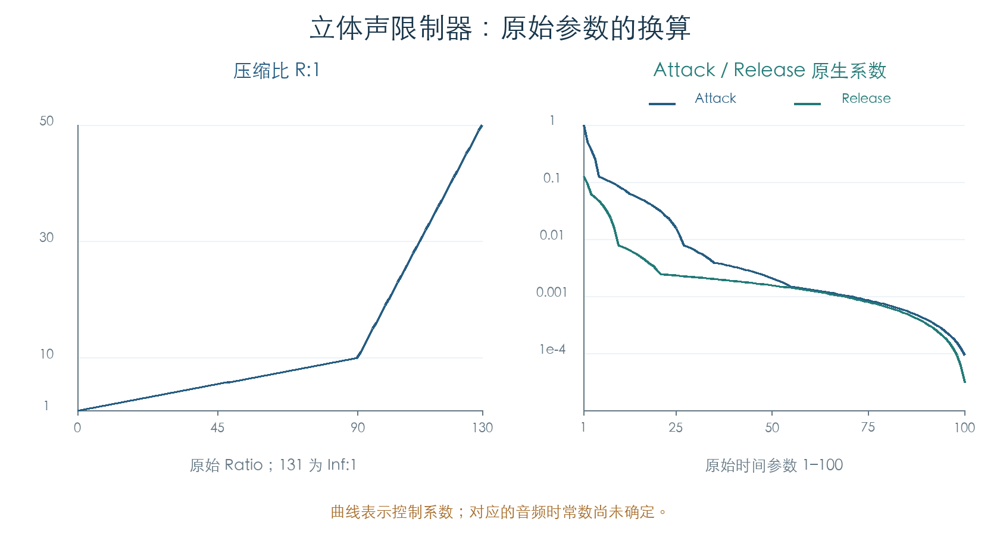
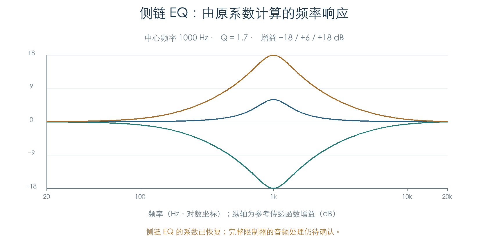
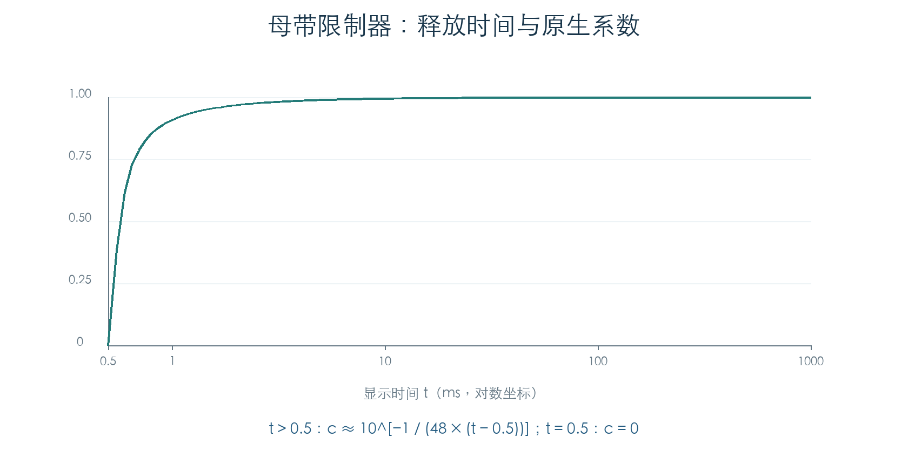

# 限制器：压缩比、时间、电平与侧链 EQ

KROSS 2 v1.2.4 · 效果 003 Stereo Limiter / 005 St.MasteringLimiter · 2026-11-02

两类限制器的参数到原生控制字已恢复。普通立体声限制器包含分段压缩比、Attack/Release、增益、检测源和侧链 EQ；母带限制器使用独立的阈值、上限及释放系数表。全部 768 个 A–F Program 中，567 个普通限制器启用槽位和 94 个母带限制器启用槽位已逐项执行原回调。

侧链 EQ 已得到可执行的主机二阶滤波方程。完整限制器的检测、拐点、预读和增益平滑仍需恢复，本节不将参数检查计作完整声音复现。

## 1 普通限制器的压缩比与时间

Ratio 原始值 `r` 的合法范围为 0–131。显示值与倒数系数使用同一分段规则，令 `Q=8388607`：

```text
r = 0…90：   R = (r + 10) / 10；word = floor(10Q / (r + 10))
r = 91…130： R = r − 80；      word = floor(10Q / (10(r − 80)))
r = 131：    R = Inf；         word = 0
```

因此 0、90、91、130 分别对应 1:1、10:1、11:1、50:1。全部 132 个输入与原指令一致。



Attack、Release 的原始值均为 1–100，各自通过多段整数运算生成系数。二者都先取 `u=101−raw`，随后采用不同分段，精确公式保存在检查脚本中。插件不能把原始值直接传给常见的毫秒参数。

| 原始时间值 | Attack 控制字 | Release 控制字 |
| ---: | ---: | ---: |
| 1 | 8388607 | 1048576 |
| 2 | 4194304 | 786432 |
| 10 | 720896 | 65536 |
| 50 | 17408 | 13056 |
| 100 | 768 | 256 |

表中数值是控制系数。其参与检测器或增益平滑的具体递推形式尚未确定，暂不换算为音频时常数。

## 2 阈值、增益与静音档

普通限制器的阈值为 −40 至 0 dB，按阈值绝对值查询 64 项衰减表。前 62 项近似 `Q × 10^(−i/20)`，与解析值相差小于一个整数单位；索引 62 使用 −63 dB 的值，索引 63 为零。

输出增益 `g` 的控制字来自同一张表的 `24−g` 项，包含内部电平偏置。原始值 −39 显示为 −Inf，并写入零；−38 则读取最后一个有限表项。由 −37 调到 −38 时，该控制值下降约 2 dB。这一表项已按原字节保留，尚未确认其物理音频表现。

调制时先计算 `g′=clamp(g+trunc(源值×Amount/127),−39,24)`，再查表。Wet/Dry 另计算 `w′=clamp(w+trunc(源值×Amount/127),0,100)`，写入 `trunc(w′×Q/100)`。中间的有符号除法向零截断。

Gain 和 Wet/Dry 可绑定同一来源，原回调会同时更新两项；来源不匹配或效果关闭时保留原缓冲。三条连续轨迹覆盖共享来源、关闭后保持、重新启用和限幅，逐步比较完整常数缓冲。

## 3 检测源与侧链 EQ

普通限制器保留四组 Env Sel 系数组合。Env Src 选择外部控制输入时，会关闭原内部检测混合项，按 FXCtrl Trim 将信号送入对应支路。48 种模式/来源/Trim 组合分别通过三个入口更新，共 144 次比较。Side PEQ 和 Trigger Monitor 各自使用互补的开关系数，独立保留。

侧链频率索引 `i` 为 1–200，对应：

```text
1…50：    Hz = 20i
51…130：  Hz = 50i − 1500
131…200： Hz = 100i − 8000
Q值 = (q + 5) / 10；增益 dB = g / 2
```

原系数使用两字组成的有符号 Q30，五项同时乘以 4 后还原为主机二阶节。方程与[四段参数 EQ](EFFECT_EQ.md)的峰值模式相同，采用原数学常数和正切限幅。Frequency、Q、Gain 三个回调均写入完整五项系数；Q/Gain 在抑制更新标志生效时保持缓冲。



150 组边界检查覆盖三段频率边界、Q 两端及中间值、±18 dB 与零增益。加上原厂参数，最大系数差约 `3.4163×10⁻⁵`，检查极点全部位于单位圆内。图中曲线由恢复系数计算，尚未通过完整限制器音频链。

## 4 母带限制器的独立参数

阈值与 Ceiling 的原始值为 −300 至 0，单位 0.1 dB。阈值表近似 `floor(Q×10^(raw/200))`；Ceiling 使用同表值减 1。两项各 301 个输入均核对了原查表与写入，避免丢失这一个整数单位的差别。

Release 索引 10–290 显示为 0.50–1000 ms：

| 原始值 | 显示时间 t（ms） |
| --- | --- |
| 10–19 | `0.05×raw` |
| 20–109 | `(raw−10)/10` |
| 110–199 | `raw−100` |
| 200–290 | `10×raw−1900` |



原表 281 项与以下独立计算的差值均小于一个整数单位：

```text
t = 0.5 ms：word = 0
t > 0.5 ms：word ≈ Q × 10^[−1 / (48×(t−0.5))]
```

这是原系数表的数学关系，尚未证明声音按此式直接衰减。母带限制器还需要确认检测、预读和增益控制的递推路径。

## 5 验证范围与后续工作

| 检查 | 数量 | 范围 |
| --- | ---: | --- |
| 标量参数 | 1728 | 全部合法 Ratio、阈值、时间、Gain、Ceiling、Wet/Dry 及开关 |
| 检测源更新 | 144 | 模式、来源、Trim 与三个回调入口 |
| 侧链 EQ 参数组 | 150 | 三种参数入口、完整缓冲及更新抑制 |
| 动态参数组合 | 2808 | 正负来源值、正负 Amount、限幅、匹配与效果开关 |
| 共享来源连续轨迹 | 3 | 每条七次更新，核对状态保持及双参数更新 |
| 原厂启用槽位 | 661 | 567 个普通、94 个母带限制器，原加载器及全部静态回调 |

567 个普通限制器槽位分布于 410 个 Program，94 个母带限制器槽位分布于 93 个 Program。启用状态不等同于参与当前音色的可听路径，连接关系见[效果路由](EFFECT_ROUTING.md)。

原函数运行于私有 ARM 内存，采用原缓冲加载器与写入函数，参数 getter 提供已解码的值。每次比较完整 80 字缓冲，检查目标之外的值保持不变。未运行 OS、硬件读写或 TG 音频代码，产品代码未接入本节模型。

下一步需要恢复音频检测器、拐点/限幅、预读及内部干湿；并继续常用合唱、混响及通用滤波。现有结果可先用于插件参数解码、原控制字生成和侧链 EQ。

## 证据与复现

- [原函数检查脚本](../../tools/firmware_limiters.py) · [完整检查及原厂来源](../../derived/firmware/KROSS2_V124/architecture/stage04/limiters-check.json)
- [普通参数](../../derived/firmware/KROSS2_V124/architecture/stage04/limiter-common-parameters.arm.txt) · [侧链、来源与动态更新](../../derived/firmware/KROSS2_V124/architecture/stage04/limiter-sidechain-parameters.arm.txt)
- [母带限制器](../../derived/firmware/KROSS2_V124/architecture/stage04/mastering-limiter-parameters.arm.txt) · [公共动态湿声更新](../../derived/firmware/KROSS2_V124/architecture/stage04/effects-dynamic-wet.arm.txt)
- [配图脚本](../../tools/firmware_limiter_figures.py) · [Ratio/时间 CSV](../../derived/firmware/KROSS2_V124/architecture/stage04/limiter-control-maps.csv) · [母带释放 CSV](../../derived/firmware/KROSS2_V124/architecture/stage04/mastering-release-map.csv) · [侧链响应 CSV](../../derived/firmware/KROSS2_V124/architecture/stage04/limiter-sidechain-response.csv)

复现：`python3 research/tools/firmware_limiters.py --verify-arm`。输入固件、预载文件及依赖脚本均记录 SHA-256。
