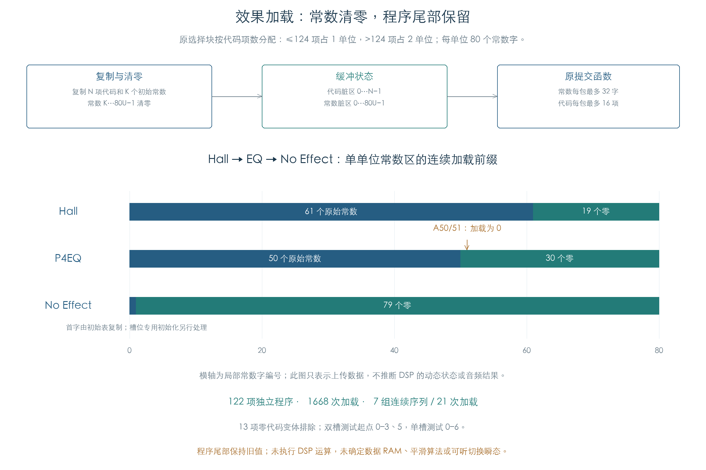

# 效果加载：常数清零与初始上传

KROSS 2 v1.2.4 · 2026-11-02

效果替换时，旧常数是否残留会影响新效果的初始状态。原加载器会复制初始常数，再将占用范围的其余位置清零；程序仅复制新代码，剩余位置保持原内容。EQ 的 A50/51 虽然超出其 50 项初始表，仍会随完整常数区以零值上传。



## 1 原加载规则

原调用块 `5C724–5C744` 根据代码项数 N 选择单位数 U：N≤124 时 U=1，超过时 U=2。每单位预留 80 个常数字。`5A51C` 将 K 项初始常数复制到局部 0…K−1，再将 K…80U−1 清零；新代码只覆盖 0…N−1。

本项用非零哨兵填充完整 CPU 常数区与程序区，执行原选择块及加载器，逐字比较写入范围和邻槽。122 项有独立代码的效果共完成 1668 次加载：112 项单单位效果检查起点 0–6，10 项双单位效果检查 0–3、5；每个位置各执行即时与缓冲两种方式。13 项零代码变体依赖专用装配，本项排除。

## 2 常数与程序分别提交

即时加载直接调用原传输函数。缓冲加载先记录代码范围 0…N−1、常数范围 0…80U−1，暂不输出。原 `5A7E4(ctx,0)` 提交常数，`5A728(ctx,1)` 提交程序并关闭缓冲状态；常数每包最多 32 字，程序每包最多 16 项。

总线边界记录原 16 位写入，再独立拼成上传镜像。常数区始终提交完整 80U 字，包括清零尾部；程序区只提交新范围。整个 CPU 缓冲、上传镜像、包边界和上下文状态均比较，程序容器中未上传的 16 位填充另行保留，未当作指令位。

## 3 对 EQ 的具体约束

七个起点各执行 Hall→P4EQ→No Effect 的加载前缀，共 21 次连续加载。单单位 Hall 复制 61 项并清零 19 项，P4EQ 复制 50 项并清零 30 项，No Effect 复制 1 项并清零 79 项。即使先载入 Hall，后续 EQ 的 A50/51 在 CPU 缓冲和上传内容中均为零。

这补充了[前序 EQ 局部程序](EQ_B2_PROGRAM.md)的初值证据：零值来自原清尾逻辑。前序独立实验预留两单位；本项按原调用块选择实际单位，额外核对邻槽不被覆盖。A50/51 的运行作用、更新方向和平滑时序仍未知。

序列只覆盖加载与提交，不包含完整效果对象装配、全部参数回调或音频运行。槽位专用初始化仍可能修改初始表中的值，例如 No Effect 的 IFX/MFX 常数差别，见前序章节。这里没有据上传零值推断静音、数据 RAM 清除或可听切换瞬态。

## 4 复现与证据

```sh
python3 research/tools/firmware_effect_load_state.py --verify-arm
python3 research/tools/firmware_effect_load_state_figures.py
python3 research/tools/firmware_runtime_verify.py
```

- [完整原 ARM 结果](../../derived/firmware/KROSS2_V124/architecture/stage04/effect-load-state-check.json)
- [加载 CSV](../../derived/firmware/KROSS2_V124/architecture/stage04/effect-load-state-loads.csv)、[连续加载 CSV](../../derived/firmware/KROSS2_V124/architecture/stage04/effect-load-state-sequences.csv)
- [加载与提交指令](../../derived/firmware/KROSS2_V124/architecture/stage04/effect-load-state.arm.txt)、[原单位选择](../../derived/firmware/KROSS2_V124/architecture/stage04/effect-load-allocation.arm.txt)
- [检查脚本](../../tools/firmware_effect_load_state.py)、[配图脚本](../../tools/firmware_effect_load_state_figures.py)、[图形指纹](../../derived/firmware/KROSS2_V124/architecture/stage04/effect-load-state-figure-check.json)

全部检查使用既有离线材料和私有 ARM 内存；总线读回仅提供就绪。上传镜像用于核对传输内容，没有执行 DSP 数学、读取设备或修改产品代码。
