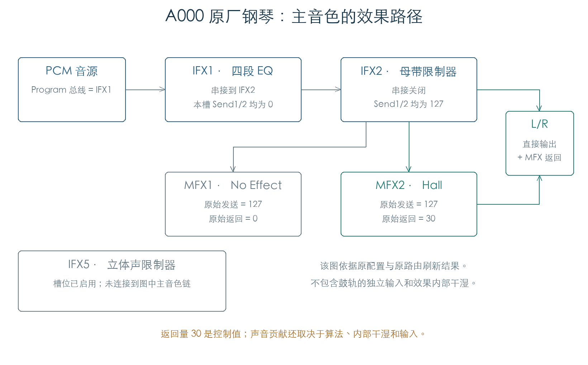
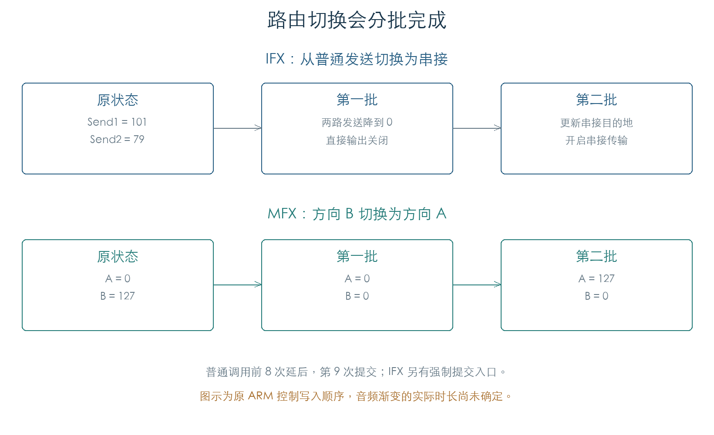

# 效果路由：串接、发送、返回与电平

KROSS 2 v1.2.4 · 2026-11-02

插件需要保留原厂效果的连接方式。IFX 串接、MFX 发送和返回电平会共同决定音色；只加载已启用的效果列表，无法得到正确的信号链。本节已执行全部 768 个 A–F Program 的原槽位分配与路由刷新，并核对电平转换、路由开关和切换顺序。

## 1 一条原厂音色怎样经过效果器

A000 的主音色进入 IFX1 四段 EQ，再串接到 IFX2 母带限制器。IFX1 的独立发送在串接生效后归零；IFX2 同时保留直接输出和两路 MFX 发送。MFX1 为 No Effect、返回量为零，MFX2 为 Hall、返回量为 30。



同一 Program 的 IFX5 立体声限制器处于启用状态，但未出现在这条主音色链上。鼓轨仍可能使用独立路由。插件的效果优先级需要结合输入来源、连接关系和电平判断，原始启用次数只能作为线索。

## 2 五个 IFX 槽位怎样分配

原分配循环根据效果代码长度决定占用：不超过 124 个 64 位字时使用一个槽位，超过时使用两个。双槽效果的后一个逻辑位置不可单独使用；输出控制落在占用范围的末端。

| 原分配状态 | Program 数 | 含义 |
| --- | ---: | --- |
| `1,1,1,1,1` | 751 | 五个槽位独立分配 |
| `2,0,1,1,1` | 15 | 第一个效果占用前两槽 |
| `1,2,0,1,1` | 2 | 第二个效果占用第二、三槽 |

MFX 中 766 个 Program 使用两个普通槽，另两个使用一个双槽效果。双槽 MFX1 会关闭主效果串接。以上统计来自原分配循环，未执行效果代码上传。

IFX 的串接目标在载入时被整理到后续槽位；最后一槽不再串接。有效串接还要求目标槽位可用。关闭目标效果的处理开关，与失去槽位分配属于两种状态，不能混为同一个条件。

## 3 输出开关与电平

IFX 有两路 MFX 发送、一路直接输出及独立声像控制。串接生效时，普通发送关闭；直接输出也关闭，由后续效果继续处理。最后一个物理槽的输出控制有独立分支，双槽分配时需要沿用这一规则。

完整载入会把旧式输出总线值 1–6 归为 Off（7）。Off 关闭直接输出，两路 MFX 发送仍可保留。底层发送回调接受总线值 0–7，超出该范围会把发送归零；插件读取旧资源时应先执行同样的载入整理。

发送、返回和直接输出的原始电平 `v` 通过以下公式转为控制目标：

```text
target(v) = 258*v + (v > 63 ? 1 : 0)     0 ≤ v ≤ 127
```

0、64、127 分别得到 0、16513、32767。上传字的低 16 位保存目标，高 16 位保存变化步长：增加用 +85，减少用 −85；新旧值相同时不写入。该编码已逐个检查全部 128 个输入及三种旧值。

声像使用另一组双控制字和 ±43 步长，128 个位置全部核对。这里恢复的是控制编码；尚未据此确认音频增益曲线、声像定律或渐变的实际时长。

## 4 改路由时先清除旧连接

IFX 更新串接目标前，会先把旧发送支路降为零。后续批次再写目的地并恢复传输。MFX 的两个方向共用互斥条件：旧方向未清零时，新方向保持关闭。两个方向的处理顺序固定，因此一次换向可在同一批完成，反向换向可能需要下一批。



普通更新入口前八次调用只推进计数，第九次提交。IFX 另有强制提交参数。插件应保留安全的断开与连接顺序；原计数对应的墙钟周期、TG 渐变完成时间仍需结合音频控制调度确认。

## 5 验证范围及剩余工作

| 检查 | 数量 | 对照内容 |
| --- | ---: | --- |
| 电平转换与写入 | 384 | 全部 128 个值、三种旧值、目标与步长 |
| 声像 | 128 | 双目标及写入方向 |
| IFX 控制组合 | 3200 | 五种分配、串接、16 种总线值、电平与缓存 |
| MFX 控制组合 | 96 | 普通/双槽/缺槽、开关、方向、发送与返回 |
| 连续切换 | 7 条 | IFX 三条、MFX 四条，逐批比较写入顺序 |
| 更新批次 | 2 条 | 八次延后及第九次提交 |
| 原厂 Program | 768 | 原分配循环、目标整理、回调参数与最终路由状态 |

原电平、声像、发送、返回及路由状态函数均在隔离 ARM 内存中执行。TG 读接口返回就绪，写接口只记录地址和值。原厂载入在资源释放、命名空间查询和效果对象装配入口截获；效果代码与音频未执行。两个 MFX 方向在本次初始化下写往相同 TG 地址，物理总线含义仍需补充证据，本文只确认其控制状态与互斥顺序。

这些结果可直接约束插件的效果图构造、资源兼容和参数更新。后续集中在效果算法、内部干湿、调制过渡、滤波与采样播放；整机驱动和完整芯片模拟已移出当前交付条件。产品代码尚未接入本节结果。

## 证据与复现

- [原函数检查脚本](../../tools/firmware_effect_routing.py) · [完整结果与原厂来源](../../derived/firmware/KROSS2_V124/architecture/stage04/effect-routing-check.json)
- [IFX 控制](../../derived/firmware/KROSS2_V124/architecture/stage04/effects-ifx-routing.arm.txt) · [MFX 控制](../../derived/firmware/KROSS2_V124/architecture/stage04/effects-mfx-routing.arm.txt)
- [原分配与目标整理](../../derived/firmware/KROSS2_V124/architecture/stage04/effects-layout.arm.txt) · [声像、电平与路由写入](../../derived/firmware/KROSS2_V124/architecture/stage04/effects-route-gains.arm.txt)
- [配图生成器](../../tools/firmware_effect_routing_figures.py)

复现：`python3 research/tools/firmware_effect_routing.py --verify-arm`。输入版本与 SHA-256 固定在脚本和结果中，全程不连接设备。
