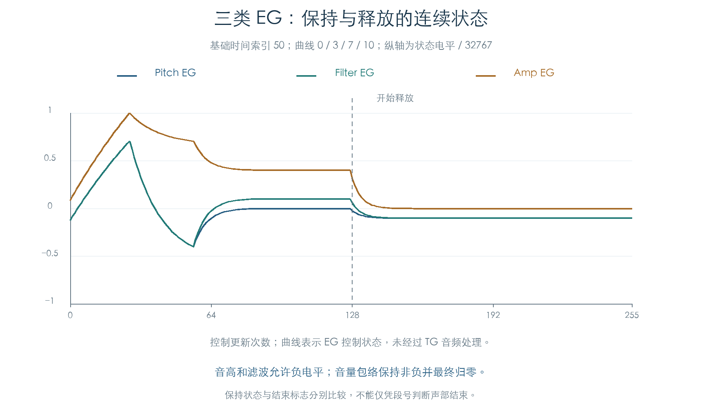
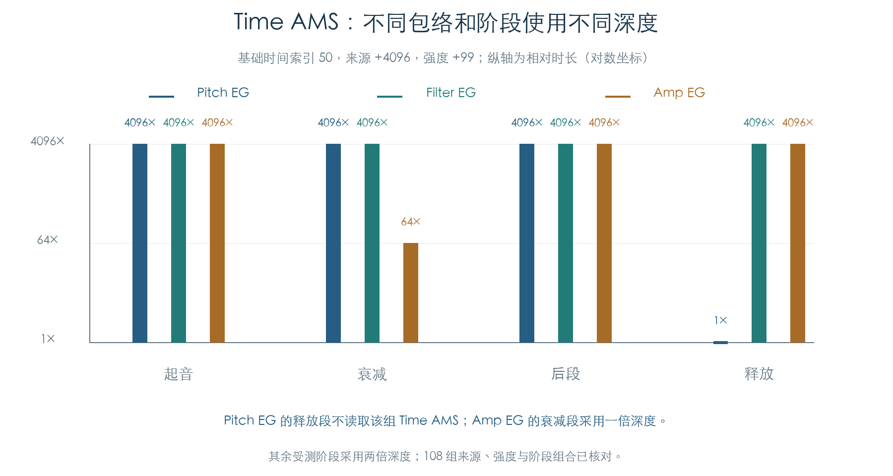

# 三类 EG：阶段、时间调制与重触发

KROSS 2 v1.2.4 · 2026-11-02

音高、滤波和音量主包络已建立独立整数模型，并接回原 LFO、两个 AMS Mixer 和控制目标。原初始化、段间切换、保持、释放及阈值重触发均执行了逐状态对照。常规控制链现在可以使用真实变化的 EG 来源，替代此前指定的固定电平。

三类包络共用曲线核心，各自保留阶段规则。音高 EG 的释放段不读取这组 Time AMS；音量 EG 的 Decay 采用一倍调制深度，其他受测阶段采用两倍。模型保留这些差别。

## 1 从起音到释放

音高和滤波包络允许正负电平；音量主包络限制在 0–32767。三者都从当前电平建立下一段，按原曲线和时间推进。到达时间边界后，以当时的实际电平进入下一段，保留整数取整结果。

图中基础时间索引为 50，四段采用曲线 0、3、7、10，第 128 次调用进入释放。音高在按住阶段回到零，滤波保持指定电平，音量保持 Sustain。释放后，音高和滤波可以停在负的 Release Level，音量归零。

| 包络 | 起音后的阶段 | 释放与保持 |
| --- | --- | --- |
| Pitch EG | 到 Attack Level、Break Level，再向零变化 | 释放向指定 Release Level 变化，之后保持 |
| Filter EG | 到 Attack Level、Break Level、Sustain Level | 释放向指定 Release Level 变化，之后保持 |
| Amp EG | 到 Attack Level、Break Level、Sustain Level | 释放归零，按条件设置声部结束请求 |

音量包络的保持和结束请求需分别判断：段号 6 可以出现在保持阶段，也可以出现在已提交结束标志的状态。本次同时比较包络状态和声部标志 `+0x10` 的 `0x20` 位，没有仅按段号回收声部。

## 2 共享的整数曲线核心

核心保存当前电平、段的低电平与跨度、方向、曲线系数、进度、总时长和 64 位剩余时间。每次先递推曲线进度，再扣减 24 个内部时间单位。段结束由剩余时间判断，电平由曲线计算；两者分别保留。

时间参数先查 100 项原表，再按调制量缩放。基础时间不大于 7、且正向时间调制生效时，原逻辑先将基础量提高到 8。时长超过上限时饱和到 `2147483647`。这些规则均进入独立模型。

共享核心覆盖 11 种曲线，检查时间索引 0、1、7、50、99，三种当前值、三种目标值和正负/零时间调制，共 1485 个段、14850 次单步。每次比较完整 48 字节核心状态及完成返回值，包含剩余时间、原曲线进度和供后续提交使用的时长字段。

图中的时间轴为调用次数。名义调度关系另见[控制调度与 TG 平滑](../VOICE_TIMING.md)，本章没有测量实际线程周期。

## 3 Time AMS 的阶段差别

同一来源和强度在不同阶段生成的时间调制量不同：

| 包络 | 起音 | Decay | 后段 | Release |
| --- | --- | --- | --- | --- |
| Pitch EG | 两倍 | 两倍 | 两倍 | 不读取该组 Time AMS |
| Filter EG | 两倍 | 两倍 | 两倍 | 两倍 |
| Amp EG | 两倍 | 一倍 | 两倍 | 两倍 |

来源 +4096、强度 +99、基础时间索引 50 时，两倍深度把原 696 单位放大为 2850816 单位，即 4096 倍；一倍深度得到 44544 单位，即 64 倍。Pitch Release 保持 696 单位。108 组来源、强度与阶段组合通过原段准备函数核对，负向缩放同样保留取整和短时长边界。

Amp 与 Filter 还分别组合三组 Time AMS；Pitch 的这一组只覆盖释放前的三段。插件需按参数所属包络和阶段计算，不能给所有段套用同一深度。

## 4 阈值重触发与释放后的区别

重触发比较 `99×来源值` 与 `4096×阈值`，并保存上次来源值。非负阈值检测向上越过，负阈值检测向下越过；到达阈值也计入越过。来源关闭时不触发。

触发后，原入口重新计算初始电平并准备起音段。普通起音会立即推进一次曲线，重触发刷新只准备新段，二者的第一步不同。

音量包络进入释放后会设置内部标记，停止自身阈值重触发；音高和滤波的刷新入口继续进行阈值判断。五条轨迹覆盖 −99、−1、0、1、99 五个阈值，各执行十六次推进/刷新，并在中途释放。比较包括方向、等值、重复越过、当前电平和阶段重置。

这些实验直接调用原 EG 入口，未代替上游 MIDI、踏板或声部回收的事件门槛。

## 5 原厂控制链与验证范围

全部 768 个 Program、1536 个存储 OSC 均执行了三个 EG。Pitch EG 参数由同一 Program 的两个 OSC 共用，因此计数为 **3840 个独立参数位置、4608 个 EG 执行上下文**；后者包含共用参数在不同 OSC 中的执行。

每个 OSC 完成八次更新，中途进入释放，共 12288 次控制链检查。按已定位的单声部顺序，先推进三个 EG 和两路 LFO，再缓存 LFO 波形、处理 EG 重触发、更新两个 Mixer，最后生成音高、Filter A/B 与音量目标。

| 检查 | 数量 |
| --- | ---: |
| 共享曲线段 | 1485 个，共 14850 次单步 |
| 阶段时间 AMS | 108 组 |
| 连续生命周期 | 12 条 × 256 次更新 |
| 阈值重触发 | 5 条 × 16 次推进/刷新 |
| 原厂参数位置 | 3840 个 |
| 原厂 EG 上下文 | 4608 个 |
| 原厂控制链更新 | 12288 次 |

连续轨迹覆盖零时长、短段、常规段及尚未完成起音时释放。较长参数只验证本次运行的轨迹前缀。所有比较保留三类主 EG、辅助状态的未变部分、LFO、Mixer、控制目标、随机状态及声部标志。

本章 Tone Adjust 为中性，外部控制器关闭，采样与音高上下文沿用[控制目标实验](LFO_TARGETS.md)的固定输入。[踏板后续](PEDAL_ENVELOPES.md)已补齐 CC64 动态时间缩放、辅助初始化与原请求消费；真实采样区域装配、另一管理器释放分支和 TG 音频仍待连接。产品代码保持原状。

## 证据与复现

- [独立状态模型与原函数检查](../../tools/firmware_envelopes.py) · [完整结果、参数位置与原厂记录哈希](../../derived/firmware/KROSS2_V124/architecture/stage04/envelopes-check.json)
- [共享核心汇编](../../derived/firmware/KROSS2_V124/architecture/stage04/envelope-core.arm.txt) · [音高 EG](../../derived/firmware/KROSS2_V124/architecture/stage04/envelope-pitch.arm.txt) · [滤波 EG](../../derived/firmware/KROSS2_V124/architecture/stage04/envelope-filter.arm.txt) · [音量 EG](../../derived/firmware/KROSS2_V124/architecture/stage04/envelope-amplitude.arm.txt)
- [配图脚本](../../tools/firmware_envelope_figures.py) · [生命周期 CSV](../../derived/firmware/KROSS2_V124/architecture/stage04/envelope-lifecycles.csv) · [时间 AMS CSV](../../derived/firmware/KROSS2_V124/architecture/stage04/envelope-time-modulation.csv) · [重触发 CSV](../../derived/firmware/KROSS2_V124/architecture/stage04/envelope-retriggers.csv)
- 前置连接：[七种 AMS Mixer](AMS_MIXERS.md) · [LFO 输入](VOICE_LFO_INPUTS.md) · [LFO 控制目标](LFO_TARGETS.md)

复现：`python3 research/tools/firmware_envelopes.py --verify-arm`。配图使用 `python3 research/tools/firmware_envelope_figures.py`。输入及依赖均记录 SHA-256，仅在私有模拟器执行现有离线材料。
