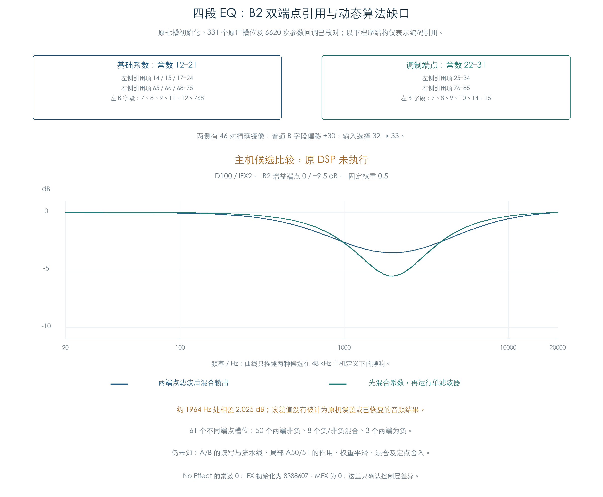

# 四段 EQ：B2 双端点引用与动态算法缺口

KROSS 2 v1.2.4 · 效果 007 St.Parametric4EQ · 2026-11-02

B2 把基础增益和调制后增益保存为两组 Q30 系数。原程序分别引用两组数据，左右对应段有 46 对字段镜像。331 个原厂槽位完成全部参数回调后，程序保持原值，完整常数缓冲与已恢复的系数一致。动态音频运算仍需进一步确定。



## 1 两组系数怎样进入程序

每个效果槽的程序含 118 项可见 48 位载荷，初始常数为 50 项。原初始化完成通用重定位；两个 MFX 槽还分别修改程序项 55、106，在通用结果上减去可见载荷的第 41 位权值，其他位保持原值。

| 数据 | 常数编号 | 左侧程序项 | 右侧程序项 |
| --- | --- | --- | --- |
| B2 基础系数 | 12–21 | 14、15、17–24 | 65、66、68–75 |
| B2 调制端点 | 22–31 | 25–34 | 76–85 |

两组常数各包含五个拆分系数。左侧基础组的 B 字段集合为 `{7,8,9,11,12,768}`，调制端点为 `{7,8,9,10,14,15}`；字段引用不同。A/B 的读写方向、流水线延迟和算术含义仍未知，暂不把这些编号直接标成输入、反馈状态或音频连接。

程序项 7–52 与 58–103 组成 46 对精确镜像：普通 B 字段加 30，输入选择编号 32 改为 33，其他可见字段相同。完整七槽载荷均由原初始化核对。

程序还引用局部 A50/51，它们超出 50 项初始常数。当前私有 CPU 缓冲将多余位置预清零，原参数回调未改写它们；这无法确定 TG 的运行状态及其初值。两项的作用、权重平滑和状态更新顺序继续保留缺口。

后续[加载状态检查](EFFECT_LOAD_STATE.md)确认：原加载器会清零剩余常数并提交完整占用区，A50/51 的初始上传值为零。运行中的状态更新与运算语义仍未知。

## 2 两种动态候选并不等价

本轮只比较两个明确的主机假设，用来构造后续需要区分的输入。它们都采用已恢复的原端点系数：

```text
输出混合候选：H(w) = (1−w) H(c0) + w H(c1)
系数混合候选：H(w) = H((1−w)c0 + w c1)
```

第一种持续运行两个端点滤波器，再混合输出；第二种逐帧混合五项系数，只保留一套直接 I 型历史。两者从零状态开始，各通道独立。这里定义了数学模型，没有执行原 DSP 指令，也没有恢复原权重更新时序。

331 个启用槽位中，270 个的两套 B2 系数相同，其余 61 个分布如下：

| 端点增益 | 槽位数 | 候选比较中的意义 |
| --- | ---: | --- |
| 两端非负 | 50 | 原反馈系数相同，固定权重频响基本一致；变化权重仍可能产生不同状态轨迹 |
| 一端负、一端非负 | 8 | 包含零增益端点；原反馈系数不同，固定权重也可区分两个候选 |
| 两端为负 | 3 | 同样需要比较反馈与动态状态 |

D100 / IFX2 的 B2 增益端点为 0 / −9.5 dB。在固定权重 0.5、约 1964.34 Hz 的主机定义下，输出混合候选为 −3.511 dB，系数混合候选为 −5.536 dB，相差约 2.025 dB。该差值来自候选间的计算，不能作为原机误差或还原精度。

61 组端点均比较了三个固定权重及 129 个频率点。另用 512 帧非对称双通道输入，让权重先保持零、再线性变化、最后保持一。两种候选在端点权重下相同，连续与不规则分块结果逐位一致；独立转置滤波参考核对数值实现。任何一种候选要成为插件的原算法实现，仍需原运算证据。

## 3 No Effect 的初始化也分槽位

原 `0x82580` 为 IFX0–4 把常数 0 设为 8388607，为 MFX5–6 设为零。八项程序载荷分别符合通用重定位，完整 80 字缓冲核对通过。

这证明了控制层的初始化差异。其具体音频作用仍取决于未恢复的指令语义，当前没有据此把所有旁路或空效果统一解释成静音。

## 4 原指令与主机检查的边界

| 检查 | 结果 |
| --- | --- |
| P4EQ / No Effect 初始化 | 各七槽，原加载、重定位及槽位专用修正 |
| 原厂 P4EQ | 331 个启用槽位，执行 6620 次原参数回调 |
| 完整数据比较 | 每槽 118 项程序、80 字常数缓冲；系数对照前序独立公式结果 |
| 程序结构 | 46 对字段镜像、两组端点引用和额外 A50/51 |
| 主机候选 | 61 组不同端点，固定频响与双通道动态输入 |

原系数计算、初始化和回调均执行 ARM；参数 getter `0xD5AC4` 在边界提供源记录中的值。输入为已有原厂预载，程序哈希按实际上传使用的可见 48 位规范化计算。

此次没有执行 TG 音频、读取硬件或修改产品。完整动态算法、混合、内部余量和舍入尚未恢复；本章也不把字段重定位或候选运行计为原 DSP 音频执行。

- [完整结果、载荷与来源指纹](../../derived/firmware/KROSS2_V124/architecture/stage04/eq-b2-program-check.json)
- [118 项程序 CSV](../../derived/firmware/KROSS2_V124/architecture/stage04/eq-b2-program-items.csv)、[23607 行候选频响](../../derived/firmware/KROSS2_V124/architecture/stage04/eq-b2-candidate-responses.csv)、[512 帧候选差异](../../derived/firmware/KROSS2_V124/architecture/stage04/eq-b2-candidate-dynamic.csv)
- [EQ 原初始化](../../derived/firmware/KROSS2_V124/architecture/stage04/eq-b2-slot-init.arm.txt)、[No Effect 原初始化](../../derived/firmware/KROSS2_V124/architecture/stage04/eq-empty-slot-init.arm.txt)
- [检查脚本](../../tools/firmware_eq_b2_program.py)、[配图脚本](../../tools/firmware_eq_b2_program_figures.py)、[配图指纹](../../derived/firmware/KROSS2_V124/architecture/stage04/eq-b2-program-figure-check.json)

```text
python3 research/tools/firmware_eq_b2_program.py --verify-arm
python3 research/tools/firmware_eq_b2_program_figures.py
python3 research/tools/firmware_runtime_verify.py
```
