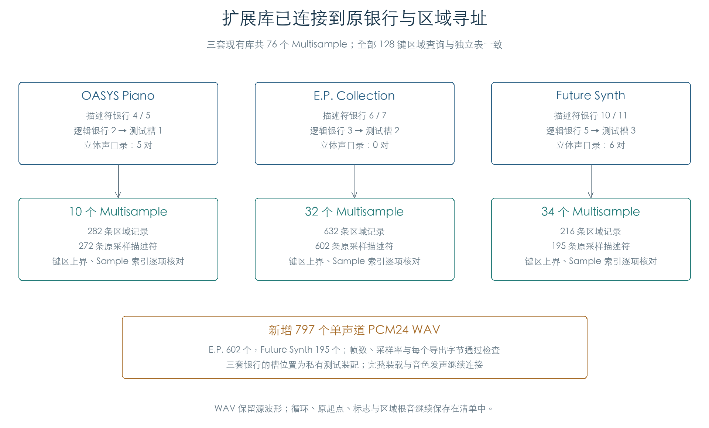
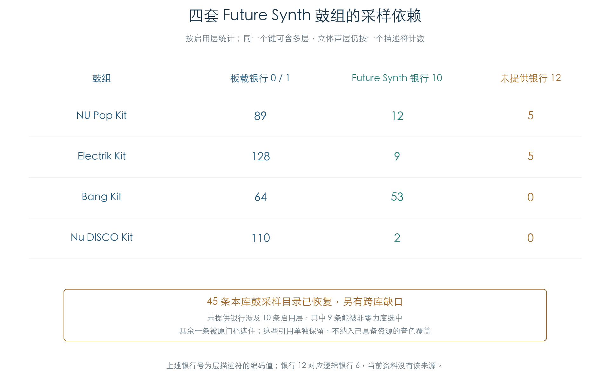

# 扩展采样、银行寻址与鼓组依赖

KROSS 2 v1.2.4 · 插件音源逻辑 · 2026-11-02

E.P. Collection 的 602 个采样和 Future Synth 的 195 个采样已全部导出为单声道 PCM24 WAV。三套现有扩展库的原银行查询、立体声目录与键区寻址也已接通。Future Synth 另有十条鼓组启用层引用当前资料没有提供的银行，其中九条可被选中；它们仍是完整音色的资源缺口。

## 1 从扩展银行找到源采样



| 扩展库 | 逻辑银行 | Multisample / 区域 | 采样 | 本轮 WAV 导出 |
| --- | --- | --- | --- | --- |
| OASYS Piano | 2 | 10 / 282 | 272 | 沿用既有导出，本轮重验原目录与区域查找 |
| E.P. Collection | 3 | 32 / 632 | 602 | 全部 602 个 |
| Future Synth | 5 | 34 / 216 | 195 | 全部 195 个 |

描述符把逻辑银行和单声道/立体声选择合在一个字节中。E.P. 使用编码银行 6/7，Future Synth 使用 10/11。原代码从银行表取得参数头，再从 Multisample 的首区域和数量建立 128 键索引；每个键最终得到区域记录或空结果。

本轮以板载目录和三套扩展参数的私有副本执行原银行查询、目录构造、键区映射与区域查找。9728 组查询覆盖全部 76 个 Multisample 的 128 个键。OASYS、E.P.、Future Synth 分别生成 5、0、6 对原生立体声目录，编号与独立名称配对一致。测试槽 1/2/3 为受控装配，原装载器的槽分配与上传地址重定位尚未接入。

## 2 完整导出与解码核对

新增 797 个 WAV 共保留 17387114 帧，占 52196828 字节，约 49.78 MiB。每个重建帧均比较 C 解码器与独立 Python 参考；导出后重新读取 WAV，逐字节比较重建值的高 24 位，同时检查声道数、位宽、速率和帧数。

原 ARM 编码器的预测、逆量化和饱和反馈另核对 32272 个点，覆盖每个样本的开头、循环附近和尾部。两个库的预测/输出饱和计数均为零。这证明本轮重建与固件反馈运算一致，TG 硬件解码仍未执行。

标称速率由原 CPU 音高运算返回的步进比例乘以 48000 得到，再舍入为 WAV 整数速率。E.P. 的范围为 32004–192000 Hz，Future Synth 为 22055–192000 Hz。所有出现的音高字段都通过原指令比较；这里的速率不替代按键调音、步进上限与 TG 插值行为。

波形文件对应单条采样描述符，循环、原起点、结束地址和标志留在[采样清单](../../derived/firmware/KROSS2_V124/architecture/stage04/expansion-samples.csv)。Program 的根音继续来自区域记录，因此 WAV 没有统一填入根音或循环标签。

Future Synth 的采样 0、1 共用一段底层数据：起点分别为 205 和 0，末端均为 12133；对应 11929 和 12134 帧。本轮分别从各描述符起点重建，并保留两条记录。仅按底层字节范围去重会丢失这个起点差别。

[E.P. 源采样示例](../../output/Expansion_PCM_WAV/EXPCM002/0000.wav) · [Future Synth 源采样示例](../../output/Expansion_PCM_WAV/EXPCM004/0000.wav)

## 3 Future Synth 的鼓采样目录与跨库缺口



EXP1 头的第四个资源计数（文件偏移 `0xA8`）为 45，与此前单列的 1440 字节正好对应。按原鼓采样结构解析后得到 45 条 32 字节记录，包含 Sample 编号、逻辑银行、起点边界、名称和有符号电平修正。把它们绑定到原参数头后，原能力扫描和目录构造正常执行；45 条记录均指向本库有效 Sample。

库内四套鼓组共保存 342 个分配键和 477 条启用层。大部分使用板载鼓采样或本库的 45 条目录；NU Pop Kit 和 Electrik Kit 各有五条层引用编码银行 12，对应逻辑银行 6。当前三份库提供逻辑银行 2、3、5，缺少银行 6 的来源。

十条引用中，Electrik Kit / 键 32 的第二层被力度门槛遮住；其余九条在部分非零力度下可选中。具体键位、目录编号与力度覆盖见[鼓组依赖表](../../derived/firmware/KROSS2_V124/architecture/stage04/expansion-kit-dependencies.csv)。资源缺口保留原编号，尚未指定替代采样。

## 4 验证范围与剩余工作

| 检查 | 结果 |
| --- | --- |
| 原材料 | 三套 KEP、既有解密产物的指纹及各节字校验和通过；本轮未重新解密 |
| 原目录与银行 | 256 组逻辑银行查询、76 个目录能力、11 对立体声目录及 9728 组区域查找 |
| 完整波形 | 797 个 WAV、17387114 帧，C/Python 与导出字节一致 |
| 原 ARM 反馈 | 32272 点，包括每个采样的开头、循环和尾部 |
| 标称速率 | E.P. 三种、Future Synth 七种音高字段分别通过原 CPU 路径 |
| 鼓采样与鼓组 | 45 条附加目录进入原扫描；四套鼓组分配和十条跨库引用已解析 |

原计算仅在私有内存中执行，内存分配、异常框架登记和原始 TG 总线接口沿用明确的边界回调。[后续声部检查](EXPANSION_VOICES.md)已连接扩展 Program 与鼓组的原选层、分配、参数初始化及采样启动。持续调制、效果和完整音频仍待验证；真实导入重编号单列待查，PCM 硬件上传重定位已归档。本轮没有改动产品运行资源，也没有连接实机。

[完整结果与 WAV 指纹](../../derived/firmware/KROSS2_V124/architecture/stage04/expansion-pcm-check.json) · [采样清单 CSV](../../derived/firmware/KROSS2_V124/architecture/stage04/expansion-samples.csv) · [区域映射 CSV](../../derived/firmware/KROSS2_V124/architecture/stage04/expansion-region-map.csv) · [原区域查找汇编](../../derived/firmware/KROSS2_V124/architecture/stage04/expansion-region-map.arm.txt)

```sh
python3 research/tools/firmware_expansion_pcm.py --verify-arm
python3 research/tools/firmware_expansion_figures.py
python3 research/tools/firmware_runtime_verify.py
```

后续：[压缩循环的历史与末端候选](PCM_LOOP_BOUNDARY.md)量化两种历史策略的 PCM 差异；反馈算术通过，TG 循环策略仍待直接证据。
