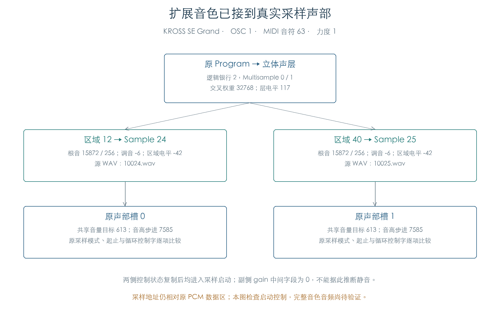
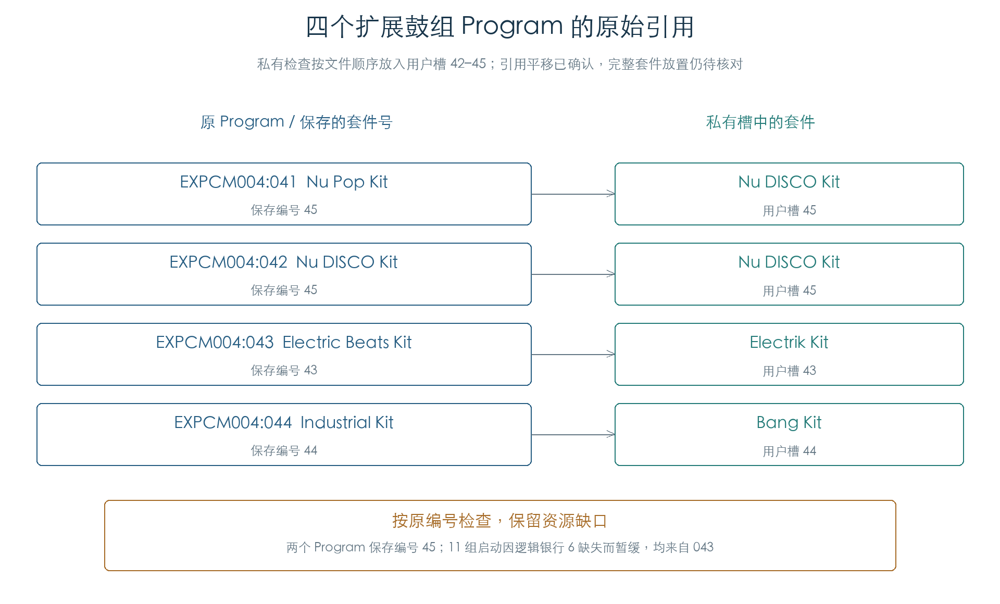

# 扩展音色的声部启动

KROSS 2 v1.2.4 · 插件音源逻辑 · 2026-11-02

三套扩展库的 124 个旋律 Program、222 个 OSC 配置已接通原选层、声部分配、采样参数和控制初始化。四个鼓组 Program 也按保存的套件号执行。检查连接到 572 个现有 WAV；这些结果为插件提供选样和起音规则，完整音色音频仍待验证。

## 1 从 Program 到采样



扩展层描述符首先选定银行与 Multisample，再由音符定位区域。区域提供 Sample、根音、调音和电平修正；原管理器随后分配声部，初始化包络、调制和音高，生成采样模式、起止与循环控制字。立体声层分别建立两侧声部，并复制共享控制状态。

图中 KROSS SE Grand 的 OSC 1，在音符 63、力度 1 时选中 OASYS 银行的区域 12/40、Sample 24/25。区域电平为 −42，主侧中间增益为 17379；两侧音量目标均为 613。副侧的中间 gain 字段保持零，但共享控制已复制，且两侧均进入启动，不能据此判断副侧静音。

本轮逐项比较原选层权重、区域与采样指针、根音/调音、电平、反向/释放标志、配对关系和启动控制字。引用的 WAV 单独保存 SHA-256，能够从初始化结果追溯到源波形。扩展采样地址仍相对原 PCM 数据区，插件读取导出资源时需使用自己的地址映射。

## 2 鼓组引用与缺失资源



四份扩展套件在私有检查中按文件顺序放入用户槽 42–45。原始 Program 041、042 均保存套件号 45；043 保存 43，044 保存 44。检查严格跟随编号，保留名称与编号的差异。[后续引用修正检查](PROGRAM_RELOCATION.md)已确认原导入函数按目标起点平移用户鼓组号，并保留重复编号；[后续原分节导入](RESOURCE_IMPORT.md)已确认当前格式的文件顺序放置及实际关联；这里仍不推断完整实机安装的外层行为。

在该受控装配下，043 的键 45、83、96 有选层引用缺失的逻辑银行 6。11 组受测启动因此暂缓，选层结果仍完成原指令比较；未调用缺失银行的声部构造，也未补入替代采样。先前[资源依赖检查](EXPANSION_PCM.md)统计了四份套件全部十条缺失层；本轮只执行原 Program 实际引用的三份套件，统计口径不同。

## 3 检查结果与插件用途

| 项目 | 覆盖 |
| --- | --- |
| 旋律音色 | 124 个 Program、222 个 OSC；键区低/中/高点及力度、交叉层边界 |
| 旋律启动 | 3126 组上下文，3198 个声部，3083 次立即采样启动；无缺失银行暂缓 |
| 鼓组选层 | 四个 Program × 128 键 × 127 力度，共 65024 组 |
| 鼓组启动 | 1739 组上下文，1883 个声部和启动；其中 11 组因缺失银行暂缓 |
| 源波形 | 572 个引用 WAV 指纹，含板载和扩展来源 |

声部数量与立即启动数量不同：部分旋律声部带有启动延迟。本轮每个上下文使用新的八槽声部池、中性 Part/控制器和受控 TG 读回；原材料刷新、分配、参数构造、控制初始化与启动实际执行，底层分配和总线接口在边界接管。

插件可直接使用本轮恢复的银行/区域索引、立体声配对和起音参数。原导入重编号已有后续结果。当前格式的分节放置与容量已有[后续结果](RESOURCE_IMPORT.md)；扩展持续刷新、跨 OSC 演奏交互与音频算法仍待检查。完整硬件装载、上传重定位和 TG 芯片模拟已移出当前完成标准。

[完整检查与源 WAV 指纹](../../derived/firmware/KROSS2_V124/architecture/stage04/expansion-voices-check.json) · [启动 CSV](../../derived/firmware/KROSS2_V124/architecture/stage04/expansion-voice-startups.csv) · [鼓组引用 CSV](../../derived/firmware/KROSS2_V124/architecture/stage04/expansion-voice-kit-links.csv)

```sh
python3 research/tools/firmware_expansion_voices.py --verify-arm
python3 research/tools/firmware_expansion_voice_figures.py
python3 research/tools/firmware_runtime_verify.py
```
