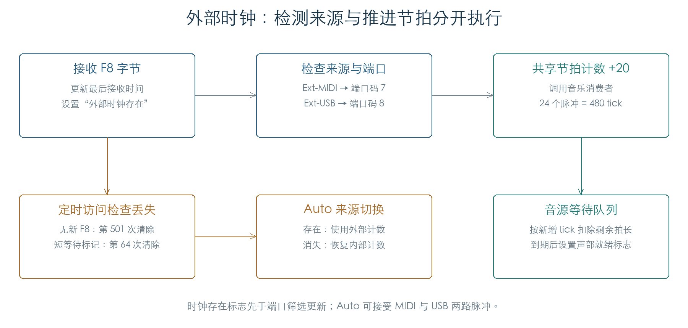
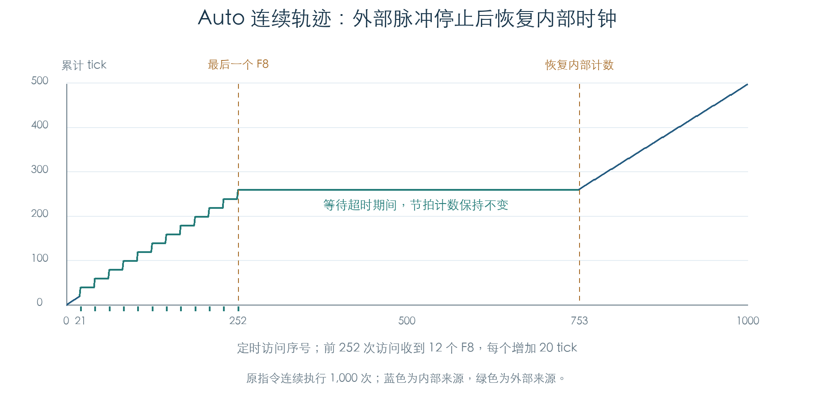

# 外部 MIDI 时钟与来源切换

KROSS 2 v1.2.4 · 阶段 04 · 2026-11-01

每个有效 MIDI Clock（F8）给共享节拍计数增加 20。24 个脉冲形成四分音符的 480 tick，声部的节拍延迟直接读取这份计数。Auto 模式收到外部时钟后切换来源；脉冲停止一段时间后，内部时钟重新推进计数。



## 1 接收与端口筛选

字节解析器 `0x2C2E90` 将系统状态交给 `0x2C21F8`。F8 到达后，先更新外部时钟的最后接收时间及存在标志，再判断输入端口是否符合设置。

| MIDI Clock 设置 | 推进节拍的输入 |
| --- | --- |
| Internal | 内部发生器；收到 F8 不增加共享计数 |
| Ext-MIDI | 端口码 7 |
| Ext-USB | 端口码 8 |
| Auto | 存在外部时钟时，接受外部端口；正常输入码为 7、8 |

端口码与手册中 MIDI/USB 的设置顺序对应。原始分支在 Auto 外部状态下接受大于 6 的输入码，夹具也检查了其他码值；这些额外码值的实际来源尚未逐一恢复。

Auto 没有在这个入口锁定先到的端口。交替输入两路 F8 时，两路均增加计数。连接两个持续发出时钟的来源时，本入口会累加它们；上游设备层是否另有限制，仍需检查。

F8 在解析器内完成处理，不生成普通音符消息。运行状态中的音符可以在省略后续状态字节的情况下继续组包。1,152 条字节流验证了 F8、Active Sensing（FE）穿插在 Note On、Note Off、压力、CC 与 Pitch Bend 数据之间的行为，音符和控制数据均保持正确。

## 2 Auto 怎样恢复内部计数

外部检测对象位于 `C1B58340`。定时入口每次把它的访问计数加一，并检查：

```text
最后一个 F8 的时间 + 500 < 当前时间
```

满足条件时清除外部存在标志。普通计数区间内，最后一个 F8 后第 500 次访问仍保持外部状态，第 501 次清除。手册将这段等待描述为 500 ms；当前实验直接核对访问次数，真实定时器周期尚未测量。[E1]



图中前 252 次访问收到 12 个 F8，最后一个在第 252 次到达。随后共享计数暂停，到第 753 次恢复内部推进。这条来源切换轨迹在音乐消费者边界截获，恢复时没有补发缺失的外部节拍。后续已接入原消费者并核对 F8 对细分周期与相位的校准，见[周期估算与速度读回](EXTERNAL_TEMPO.md)。

检测状态和通知状态分别保存。`0x2C7110` 发现二者不同后，才更新音乐对象与界面。显式保持标志会延后通知；序列器模式的忙标志也会延后通知。内部/外部计数的选择直接读取检测状态，因此不能把“通知暂缓”理解为“冻结节拍来源”。

切回内部时，原函数读取保存的速度并提交给内部发生器。在序列器模式中，这条提交分支跳过直接设置发生器；序列器自己的速度管理需要继续追踪。

## 3 Start、Continue、Stop 的门槛

接收实时命令还受 Receive Ext. RT Cmd 控制。F8 不受这个开关影响。

| 消息 | 已恢复的接收行为 |
| --- | --- |
| F2：Song Position | 来源匹配且实时命令开启，才进入两字节收集状态 |
| F3：Song Select | 进入单字节收集状态，不受上述开关限制 |
| FA / FB / FC | 来源匹配且实时命令开启，才处理 Start / Continue / Stop |

在序列器模式下，三种传输命令分别调用 `0x23F7E0`、`0x23F93C`、`0x23FAC0`，返回值决定是否继续发送事件。本节检查在这三个消费者边界截获。后续已恢复[传输命令与定位请求](MIDI_TRANSPORT.md)的请求标志、延后处理和分发入口；完整录放状态机继续推进。

手册把 F8、Start、Continue 都列入 Auto 超时描述。当前接收入口只有 F8 会刷新外部检测时间。Auto 尚未检测到外部时钟时，单独的 Start/Continue 在本入口也不满足来源门槛。这项差异保留为待查项，继续检查上游输入及传输状态机。[E1]

另一个入口 `0x2C709C` 可以启动 63 次访问的短等待：第 64 次访问清除外部状态，新 F8 会取消等待。静态调用点来自序列器操作 `0x24D3C4`，尚不能把它直接命名为 MIDI Stop 超时。

## 4 计数回绕与声部等待

超时比较使用 32 位绝对时间，先做加法再比较。夹具发现两个回绕边界：

| 最后一个 F8 的计数 | 无新 F8 时的结果 |
| --- | --- |
| `FFFFFF9B` | 下一次访问立即超时；加 500 已经回绕到较小值 |
| `FFFFFE0B` | 602 次检查期间均未超时；截止值为 `FFFFFFFF`，回绕后的当前值始终较小 |

这是原指令可复现的边界行为。持续运行时这个计数是否被其他路径重置、实际设备是否能到达相应组合，尚未确认。

音源桥接检查使用原共享计数、原虚表和原 PCM 等待链表。每收到一个 F8 后服务一次音源，结果如下：

| 等待条件 | 首次就绪 |
| --- | --- |
| 60 tick | 第 3 个有效 F8 后 |
| 480 tick | 第 24 个有效 F8 后 |
| 480 tick，再等 3 次固定访问 | 第 27 次音源服务 |
| KeyOff | 保持等待，交给松键路径处理 |

固定等待按音源服务次数扣除，表中恰好安排为每个 F8 后服务一次。实际 OS 调度频率与外部脉冲频率分别决定两段等待的时长。

## 5 验证与证据

此次执行包含 62,928 次检测器操作、7,680 组接收门槛、128 组来源通知、1,152 条穿插字节流、1,000 次连续 Auto 轨迹和 240 次音源桥接。输入覆盖包含保留模式和额外端口码；这些只用于核对原始分支，不代表正常界面选项。

原 ARM 在隔离内存中执行。音乐消费者、参数查询、界面通知与临界区边界被截获；实机输入、OS 调度和实际音频输出仍待连通。

- [机器结果及连续轨迹](../../derived/firmware/KROSS2_V124/architecture/stage04/external-clock-check.json)
- [接收入口汇编](../../derived/firmware/KROSS2_V124/architecture/stage04/midi-realtime-ingress.arm.txt) · [字节解析器](../../derived/firmware/KROSS2_V124/architecture/stage04/midi-byte-parser.arm.txt)
- [检测与切换汇编](../../derived/firmware/KROSS2_V124/architecture/stage04/external-clock-watchdog.arm.txt) · [速度恢复](../../derived/firmware/KROSS2_V124/architecture/stage04/clock-tempo-restore.arm.txt)
- [内部时钟与同步延迟](MUSIC_CLOCK.md)
- [E1：KROSS 2 Parameter Guide](../../downloads/KROSS2_Parameter_Guide.pdf)，印刷页 161，MIDI Clock、Receive Ext. RT Cmd。

```sh
python3 research/tools/firmware_external_clock.py --verify-arm
python3 research/tools/firmware_runtime_verify.py
```
