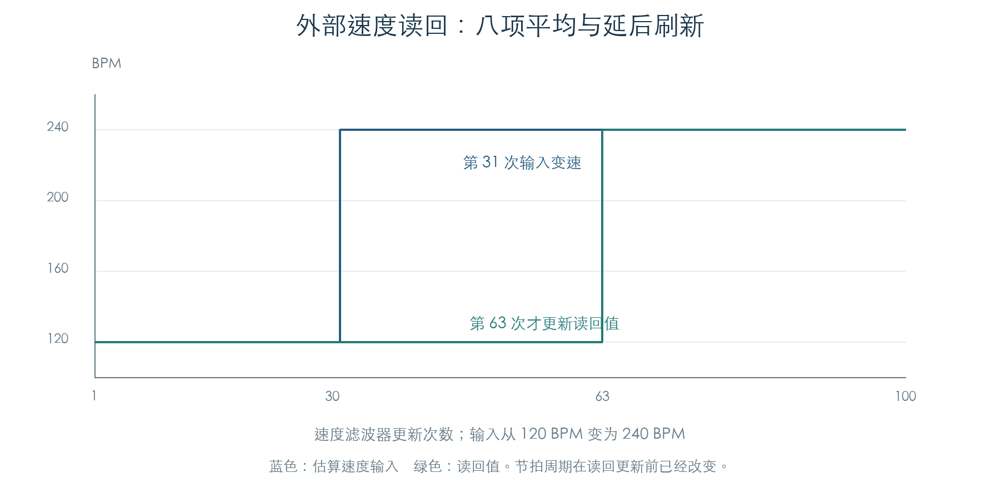

# 外部时钟的周期估算与速度读回

KROSS 2 v1.2.4 · 阶段 04 · 2026-11-01

F8 同时驱动两种节拍处理：共享音乐计数每次增加 20；细分时钟根据两次 F8 的间隔调整周期，在脉冲之间继续执行音乐回调。另一路速度读回采用平均和延后刷新，供参数与调制路径使用；它的变化可以明显晚于节拍周期变化。主速度栏在外部同步时显示 `EXT`。

## 1 每个 F8 怎样校准周期

外部时钟消费者 `0x23F6B8` 调用估算器 `0x265BAC`。估算器先暂停细分发生器，取得本次剩余时间，再与此前细分回调积累的时间相加：

```text
估算周期 = trunc((已完成细分的累计时间 + 当前余量) / 20)
```

时间单位沿用[内部时钟](MUSIC_CLOCK.md)：每次定时访问增加 `10⁹`。细分回调 `0x267304` 经 `0x265DBC` 将一个周期加入累计值。这样，即使两次 F8 之间已经执行过若干回调，估算器仍可还原整段间隔。

新周期写入控制对象和发生器。发生器此前处于运行状态时，原恢复函数立即采用新周期、清空余量，并将时间基准对齐到当前 F8。此前已暂停时，保持暂停状态。

有效周期对应 40–300 BPM。边界处理分两层：

| 原始估算周期 | 处理 |
| --- | --- |
| 小于 390,625,000，或大于 5,000,000,000 | 使用默认周期 1,041,666,667，约 120 BPM |
| 390,625,000 至 416,666,666 | 钳制到 416,666,667，约 300 BPM |
| 416,666,667 至 3,125,000,000 | 直接采用 |
| 大于 3,125,000,000 至 5,000,000,000 | 钳制到 3,125,000,000，40 BPM |

累计值超过 99,999,999,999 时停止继续增加，下次 F8 使用默认周期。计算周期后，累计值归零。

## 2 速度读回为什么较慢

估算器先由周期换算到 BPM 的百分之一，四舍五入后限制在 40.00–300.00。平滑函数 `0x265B08` 保存最近八项速度，取平均，再向下取整到整数 BPM。



读回候选值与当前值相同时，保持计数重新设为 32。平均值变化后，每次更新将保持计数减一；计数已经为零时才接受新的读回值。初始化重置使用 8 次保持，稳定后的更新使用 32 次。

图中前 30 次输入为 120 BPM，第 31 次变为 240 BPM，读回值到第 63 次才更新。周期更新已经在每个 F8 的估算路径中执行。平滑值由 `0x265E18` 读回：参数侧通过 `0x2C4DF8` 访问，调制侧通过 `0x2C4D64` 读取并减去 3000，随后进入音色调制换算。

主速度字段使用另一格式化入口 `0x2FE370`：外部状态输出带排版控制字节的 `EXT`，内部状态才输出两位小数速度。128 组读回组合及 8 组原格式化检查确认了这个区别。

## 3 原时钟回调的连续检查

本次将上一节截获的 F8 消费者换成原函数，连通：

```text
F8 → 周期估算 → 原发生器 → 细分回调 → 时间累计 → 下一次 F8
```

五段轨迹分别检查恒速、途中变速和输入抖动，共执行 10,000 次定时访问。每次均与独立模型核对发生器时间、余量、新旧周期、累计值、共享节拍计数及八项速度缓存。

| 输入轨迹 | 2,000 次访问中的 F8 数 | 共享计数增量 | 细分回调数 |
| --- | --- | --- | --- |
| 120 BPM 名义间隔 | 96 | 1920 | 1921 |
| 60 BPM 名义间隔 | 48 | 960 | 965 |
| 300 BPM 名义间隔 | 240 | 4800 | 5029 |
| 120 → 240 BPM 名义间隔 | 144 | 2880 | 2983 |
| 抖动间隔 | 96 | 1920 | 1984 |

共享计数始终按 F8 数量乘 20。细分回调数量还受提前判定、相位重置和周期钳制影响，两列数值具有不同用途。

这些输入按名义 1 ms 安排在整数访问边界上，快时钟的量化影响尤其明显。例如 300 BPM 夹具交替使用 8、8、9 次访问：8 次间隔的估算会触发上限钳制，9 次间隔则给出较慢速度。表格描述这组离散输入的原指令结果，不用于推断实机测得的同步精度。

## 4 证据与剩余工作

周期分支检查共 6,300 组，另有 16 组累计边界、12 组累计步进和 300 次平滑更新。连续轨迹执行原 F8 消费者、控制对象、整数除法、发生器与细分累计函数；其他音乐消费者和临界区边界被截获。序列器活动门控设为零，录放轨道遍历待下一步连通。

- [机器结果与五段轨迹](../../derived/firmware/KROSS2_V124/architecture/stage04/external-tempo-check.json)
- [周期估算与平滑汇编](../../derived/firmware/KROSS2_V124/architecture/stage04/external-period-estimator.arm.txt)
- [速度读回与调制入口](../../derived/firmware/KROSS2_V124/architecture/stage04/tempo-readback-routing.arm.txt) · [主速度字段格式化](../../derived/firmware/KROSS2_V124/architecture/stage04/tempo-main-field-format.arm.txt)
- [周期控制对象](../../derived/firmware/KROSS2_V124/architecture/stage04/external-period-controller.arm.txt) · [细分回调](../../derived/firmware/KROSS2_V124/architecture/stage04/interpolated-clock-consumer.arm.txt)
- [外部接收与 Auto 来源切换](EXTERNAL_CLOCK.md) · [传输命令与定位请求](MIDI_TRANSPORT.md)

```sh
python3 research/tools/firmware_external_tempo.py --verify-arm
python3 research/tools/firmware_runtime_verify.py
```
