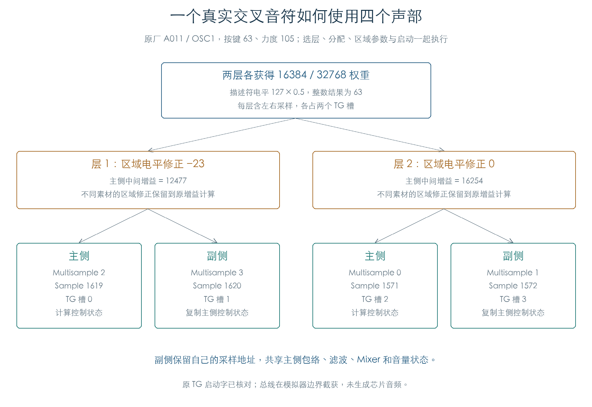
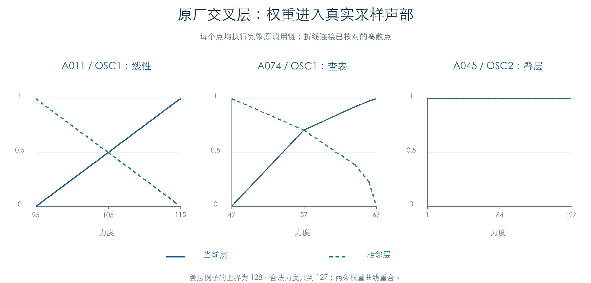

# 原厂音色从选样到声部启动

KROSS 2 v1.2.4 · 插件音源逻辑 · 2026-11-02

原厂 Program 的选层、采样区域、声部分配、控制初始化与 TG 启动已接成同一条原代码执行链。一个交叉层可以使用两对立体声采样，共占四个声部。每层的最终增益同时受描述符、交叉权重和区域电平修正影响；副侧沿用主侧的控制状态，独立保存右声道采样地址。

## 1 一个实际音符的装配结果

原厂 A011 的 OSC1 在按键 63、力度 105 时，选择两层，各取一半权重。描述符电平均为 127，整数缩放后各为 63。



| 层 | Multisample 左 / 右 | Sample 左 / 右 | 区域电平修正 | 主侧中间增益 |
| --- | --- | --- | --- | --- |
| 1 | 2 / 3 | 1619 / 1620 | −23 | 12477 |
| 2 | 0 / 1 | 1571 / 1572 | 0 | 16254 |

相同交叉权重对应不同增益，原因是两层的区域修正不同。重建音源时需要读取区域记录的有符号 `+8` 字节。

在本轮第二修正量为零的上下文中，原整数关系可写为：

```text
L = (描述符电平 × 交叉权重) >> 15
A = 32768 + 331 × 区域电平修正
G = clamp(signed32(signed32(A × L) × 129) >> 14, 0, 65535)
```

`G` 是后续音量初始化所用的中间量。力度响应、跟踪、调制与包络还会继续改变音量，不能把它直接当作最终音频振幅。

## 2 三种交叉方式都进入真实采样



线性交叉在中点给两层各 16384；查表交叉在中点给两层各 23170；叠层保留两层满权重 32768。检查分别使用 A011、A074、A045 的实际配置，在下界、区间内部与上界附近执行原选层、参数构造和启动。

A011 力度恰为 95 时，第一层权重为零，两个声部仍可被建立。插件若提前删除零权重层，需要另外核对它对后续状态继承和声部分配的影响。

## 3 立体声共享哪些状态

原分配器先按 TG 槽号排列一对声部。主侧计算 LFO、Mixer、包络、滤波与音量；副侧复制这些控制块，并把两路 LFO 的所属指针改回自身。两侧的采样与区域指针分别来自真实左右素材。

副侧不会在这条分支重新计算 `+200` 中间增益，也不会复制该字段。本轮从清零声部池开始，因此它保持零；已复制的音量控制块仍然有效。读取单个中间字段来判断副侧是否静音，会得到错误结论。

检查逐项比较了双方三类主包络、辅助包络、滤波、Mixer 与音量控制块，并核对配对指针互指、主侧 TG 槽号较小及两路 LFO 的所属关系。

## 4 反向播放受素材能力约束

原目录构造遍历每个 Multisample 引用的区域。只要某个采样元数据 `+7.bit0` 置位，该目录项就不允许反向。497 个目录项中，118 项通过能力判断，379 项未通过。

原厂活跃旋律 OSC 的有效描述符中，只有 A105 / OSC2 的第一层存储了反向位。它引用 Multisample 66；本轮保留该反向选择、不施加 Tone Adjust 覆盖，原能力查询仍将运行态反向位清零。对应有效区域的启动字采用正向配置。插件需要保留能力检查。

## 5 无区域、等待与槽位归还

参数构造失败时，分配器归还未使用的预留槽。立体声第一侧失败还会跳过该层第二侧的构造；本轮检查按原实际尝试顺序计数。

全目录检查建立了 1760 个声部，其中 1615 个当次进入 TG 启动函数，另 145 个保留等待或松键触发状态。启动数量与原厂音色数量、可闻采样数量分别统计。

A000 的高端区域空项在本轮原 PCM 入口上导致构造失败并归还槽。这里尚未连接完整 MIDI 输入预处理，不能直接据此判断原琴最高音符的最终表现。

## 6 覆盖与剩余工作

| 检查 | 结果 |
| --- | --- |
| 原厂旋律 Program | 726 个，全部纳入 |
| 活跃 OSC | 1315 个，每个取配置键区、力度区的一个中点上下文 |
| 全目录上下文建立的声部 | 1760 个；另有十个上下文没有成功建立声部 |
| 额外边界上下文 | 312 个，覆盖钢琴层门槛、三种真实交叉、全部非标准音高斜率 OSC 及反向描述符 |
| 额外建立 / 当次启动 | 323 / 275 个声部 |
| 素材目录能力 | 497 项与独立区域/采样标志遍历一致 |
| 原 TG 采样命令 | 对当次启动的声部，独立核对模式、起始、结束和循环地址 |

本轮原样执行目录构造、银行查找、OSC 刷新、选层、分配、参数构造/复制、立体声状态继承和完整 TG 启动。边界回调仅提供私有内存分配、异常框架登记和 TG 总线读写，另设固件断言陷阱；音源计算函数没有替换。

独立检查覆盖层与权重、处理后的选样音高、真实区域/采样地址、根音与调音、层电平、区域增益、键盘跟踪、反向能力、配对/所属指针及槽数。其余初始化计算继续由[主 EG](ENVELOPES.md)、[LFO](VOICE_LFO_INPUTS.md)、[Mixer](AMS_MIXERS.md)等专项证据支持。

每个上下文使用新的八声部池、固定时钟、零移调和关闭的外部控制器；反向与暂停的 Tone Adjust 覆盖保持未设置。TG 返回就绪/空闲状态，未执行芯片音频。当前结果覆盖旋律音色的上述上下文；鼓组、扩展银行、连续抢占和完整正常刷新仍需连接。原始数据、产品代码与旧验证基线保持原状。

后续[正常声部刷新](VOICE_REFRESH.md)已接入原推进、轮询、批次目标计算与正常 TG 提交，核对双游标、全声部状态、随机状态及实际目标/步长字。该后续实验明确记录两处受控附加参数绑定，本章保留启动检查的原边界。

[鼓组后续](DRUM_VOICE_CHAIN.md)已连接 42 套原厂鼓组的原目录、重映射、真实采样、完整初始化与启动，并核对两项电平修正、独占组和松键权限；鼓组持续刷新、GM 特殊映射及扩展银行继续单列。

[完整原指令结果](../../derived/firmware/KROSS2_V124/architecture/stage04/factory-voice-chain-check.json) · [声部参数 CSV](../../derived/firmware/KROSS2_V124/architecture/stage04/factory-voice-chain.csv) · [选层与尝试顺序 CSV](../../derived/firmware/KROSS2_V124/architecture/stage04/factory-voice-selection.csv) · [反向能力汇编](../../derived/firmware/KROSS2_V124/architecture/stage04/factory-reverse-capability.arm.txt)

```sh
python3 research/tools/firmware_factory_voice_chain.py --verify-arm
python3 research/tools/firmware_factory_voice_figures.py
python3 research/tools/firmware_runtime_verify.py
```
