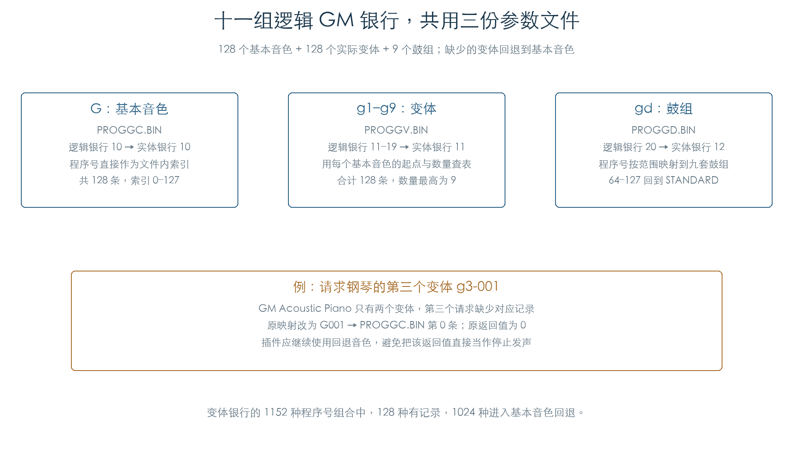
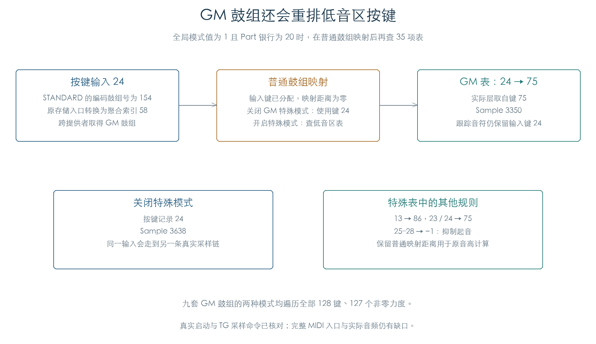

# GM 音色映射与真实采样

KROSS 2 v1.2.4 · 插件音源逻辑 · 2026-11-02

现有离线备份包含全部 265 条 GM Program 参数及 9 套 GM 鼓组。v1.2.4 原映射把基本音色、变体和鼓组接到三份参数文件，再使用板载采样发声。缺少指定变体时回到基本音色；GM 鼓组还会重排低音区按键。

## 1 变体缺省时，继续使用基本音色



| 文件 | 内容 | 原映射后的实体银行 |
| --- | --- | --- |
| PROGGC.BIN | 128 条基本音色 | 10 |
| PROGGV.BIN | 128 条实际变体 | 11 |
| PROGGD.BIN | 9 条鼓组 Program | 12 |
| DKITG.BIN | 9 套 GM 鼓组的逐键数据 | 鼓组聚合索引 58–66 |

逻辑银行 11–19 表示第一至第九变体。原函数按基本程序号读取变体数量和起点；数量足够时，文件内索引等于“起点 + 变体序号”。数量不足时改用银行 10，并保留基本程序号。

钢琴 G001 有两个变体。请求第三个变体 `g3-001` 时，原函数返回 0，同时把目标改成 `G001`。插件需要使用改写后的目标，直接将返回值零当作发声失败会丢掉这条回退路径。九个变体银行的 1152 种组合中，128 种有独立记录，1024 种回到基本音色。

GM 鼓组的零基程序号按范围选择：0–7 STANDARD、8–15 ROOM、16–23 POWER、24 ELECTRONIC、25–31 ANALOG、32–39 JAZZ、40–47 BRUSH、48–55 ORCHESTRA、56–63 SFX；64–127 回到 STANDARD。文件中的九条记录与这些索引一致。

## 2 GM 鼓组有额外的低音区映射



全局模式值为 1 且 Part 银行为 20 时，原选择器先完成普通鼓组重映射，再对结果 0–34 查一张 35 项有符号表。表中 13→86、23/24→75；25–28 对应 −1，抑制起音。选层和采样取自变换后的按键记录，音高仍保留普通映射距离，键盘跟踪保留输入音符。

STANDARD 鼓组的输入键 24、力度 64，在普通模式下取得 Sample 3638；开启上述条件后改用键 75，取得 Sample 3350。这两条路径都执行了原参数构造、完整控制初始化和 TG 采样启动。

Program 保存的 GM 鼓组编码为 154–162。原存储函数将其转换为聚合索引 58–66，再经过提供者计数和偏移取得 `DKITG.BIN` 的九套数据。检查以两个私有提供者承载前 58 条预载与九套 GM 数据，实际执行跨提供者查找；原系统中提供者的具体分组仍未据此确定。

## 3 实际参数与旧名录的差异

265 条记录均有 2140 字节完整参数，来源文件和字节偏移见 [GM 参数索引](../../derived/firmware/KROSS2_V124/architecture/stage04/gm-programs.csv)。每条检查 1042 个已索引字段，包括存储的两路 OSC 参数；独立效果算法的专属参数没有在本章逐项重新验证，其原始字节继续保留。

与既有名称目录比较，发现六处编号差异、一处名称差异和十处 OSC 模式差异。比如原映射和文件顺序将 Tubular Bells 定位为 G015，旧目录写为 G016；`g3-025` 的实际名称为 `GM Nylon Guitar 2`，旧目录少了末尾的 2。完整差异保留在机器结果中，旧目录未覆盖。

播放检查使用实际 Program 的模式字段。373 个按模式组织的旋律 OSC 配置中，372 个在受测上下文建立过声部；`g1-025` 的第二 OSC 在这些上下文没有有效描述符。全部 256 个旋律 Program 都建立过声部，不能用 OSC 模式字母直接推算可闻层数。

## 4 验证范围与剩余工作

| 检查 | 结果 |
| --- | --- |
| 原文件 | 四份 KSB0 文件逐字节匹配冻结镜像中的簇内容，长度与校验和通过 |
| 原银行转换 | 32 银行 × 128 程序号，共 4096 组，与独立映射一致 |
| 参数 getter | 276130 个字段位置；按描述符和原字节去重后执行 3106 组不同 ARM 输入 |
| GM 旋律启动 | 256 个 Program、373 个 OSC 配置、4191 组键区/力度边界上下文 |
| 旋律声部 / 当次启动 | 3619 / 3135；其余保留等待或松键触发状态 |
| GM 鼓组选层 | 九套、普通与特殊两种模式，共 292608 组 |
| GM 鼓组启动 | 6912 组上下文，建立并当次启动 3543 个声部 |

旋律检查使用配置键区两端与中点、力度区和存储层门槛；有 992 个边界上下文未建立声部。鼓组检查遍历全部 128 键与 127 个非零力度，另在每个键以力度 1、64、127 执行真实启动；3369 个启动上下文没有声部。空结果分别按原选择门槛、描述符和区域判断核对。

声部检查沿用[旋律](FACTORY_VOICE_CHAIN.md)与[鼓组](DRUM_VOICE_CHAIN.md)的独立期望，核对层权重、区域/Sample、调音、电平、配对、释放权限和 TG 模式/起始/结束/循环命令。银行转换和实际资源启动分别执行，[MIDI 银行后续](MIDI_BANKS.md)已恢复原银行编码转换与特殊鼓标志；完整前端接收、Program Change 到实际文件/Program 装载仍待连接。

本轮仅使用已存在的本机备份、预载与固件。测试采用私有资源副本和八声部池，边界回调提供分配、异常登记及 TG 总线读写。没有执行芯片音频。完整 GM 持续控制、效果组合、实际滤波/声像音频和扩展资源仍有缺口；插件尚未接入这 265 条预置。

[完整结果及名录差异](../../derived/firmware/KROSS2_V124/architecture/stage04/gm-programs-check.json) · [参数索引 CSV](../../derived/firmware/KROSS2_V124/architecture/stage04/gm-programs.csv) · [银行转换 CSV](../../derived/firmware/KROSS2_V124/architecture/stage04/gm-bank-mapping.csv) · [真实采样链 CSV](../../derived/firmware/KROSS2_V124/architecture/stage04/gm-sample-chain.csv) · [原银行转换汇编](../../derived/firmware/KROSS2_V124/architecture/stage04/GM-bank-resolve.arm.txt)

```sh
python3 research/tools/firmware_gm_programs.py --verify-arm
python3 research/tools/firmware_gm_figures.py
python3 research/tools/firmware_runtime_verify.py
```
