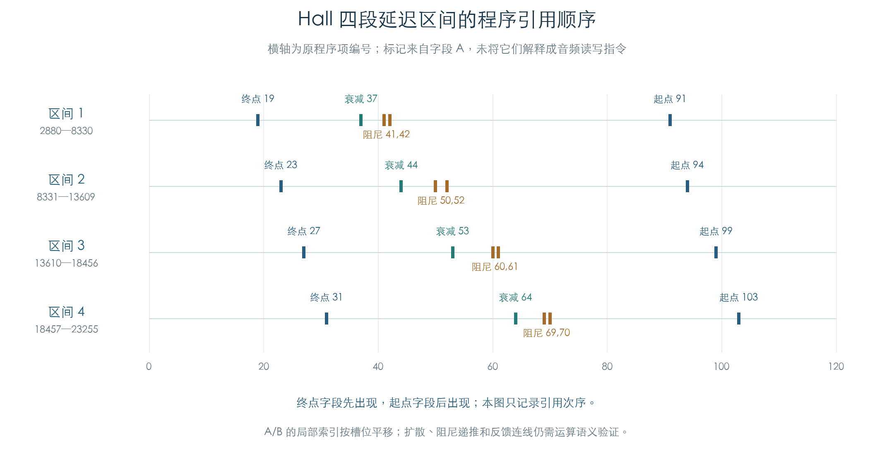

# Hall 局部字段与地址引用

KROSS 2 v1.2.4 · 效果 105 · 2026-11-02

Hall 的 121 条程序项已与原槽位重定位逐项核对，七个真实效果槽位均符合独立字段模型。新增结果确定了局部索引、接口编号及 MFX 的两处位修正，并把延迟地址与衰减/阻尼常数放到同一程序顺序中。具体音频运算仍待恢复。



## 1 有效位与局部索引

每项在文件中占八字节。[已有原上传检查](../FIRMWARE_MAP.md)确认只有低字的低十六位和高字的三十二位有效。为便于比较，本文采用：

```text
V = (容器低字的低16位 << 32) | 容器高字
A = (容器高字 >> 19) & 1023
B = (容器高字 >> 9) & 1023
C = 容器高字 & 511
```

A、B、C 是字段名称，尚未据此指定乘法源、目标寄存器或存储方向。原函数对 A/B 的不同格式分别处理，不能对每条程序项统一加偏移。

| 字段/条件 | 原重定位行为 |
| --- | --- |
| 普通局部 A/B 索引，符合格式条件且小于 640 | 加 `80×槽号`，保持其他位 |
| 格式 6/7 的专门 A 分支 | 加 `124×槽号`，对应原程序块跨度 |
| 符合条件的接口低四位 | 加 `2×槽号`，按字段宽度回绕 |
| 固定索引 768 | 受测普通局部分支保留它 |
| 槽位 0 | 不平移 |

格式取自有效高十六位的 `0x7000` 掩码，另一条件读取其位 2。完整条件见独立模型与原 ARM 摘录。本轮只围绕 Hall 使用的格式与字段变异检查，未建立完整 DSP 指令集。

## 2 MFX 有两项额外修正

原初始化先调用通用重定位，再对 MFX 槽位 5、6 的程序项 103、106 调用专门修正函数。按上述 V 编码，修正量为减去 `2^41`；受测项高十六位由 `0A00` 变为 `0800`。它没有改变这两项的 A/B 索引。

这两项变化说明，直接复制某个 IFX 槽位的程序并平移索引，仍会漏掉 MFX 初始化中的专门处理。其音频含义目前只保留为未解位修正。

## 3 地址、系数与程序顺序

原初始化对常数 1–25 加上效果槽位的延迟存储起点；常数 0 的预延迟选择由参数回调另行设置。25 个地址常数的字段 A 引用均已列出。

| 延迟区间 | 终点引用 | 衰减引用 | 阻尼引用 | 起点引用 |
| --- | --- | --- | --- | --- |
| 2880–8330 | 19 | 37 | 41、42 | 91 |
| 8331–13609 | 23 | 44 | 50、52 | 94 |
| 13610–18456 | 27 | 53 | 60、61 | 99 |
| 18457–23255 | 31 | 64 | 69、70 | 103 |

表中数字为从零开始的程序项编号。四个区间的内部地址也分别在程序项 35/51、38/55、43/59、46/62 出现。这里确定的是编码引用和先后次序，尚不能从表中直接画出反馈网络或确定采样端点。

程序还引用索引 62、63，初始常数表只有 61 项（0–60）。这两个位置的初始化、状态角色和写入来源尚未确定；将初始常数表当作全部运行数据会遗漏它们。固定索引 768 另行保留。

## 4 验证与后续约束

七个槽位的全部 121 项分别比较通用重定位与完整 Hall 初始化，两个 MFX 修正单独核对。另对十三种真实 Hall 格式逐一翻转 48 个有效位，再在六个非零槽位执行原函数，共 3744 个变异检查。全程无函数替代，没有连接硬件或执行 DSP 音频。

下一步恢复具体运算时，模型必须同时满足这组局部索引、25 个地址引用、四组原衰减/阻尼常数和 MFX 修正。累加器、乘加符号、读写时序、局部 62/63、扩散与耦合仍是缺口；本轮没有生成完整混响脉冲。

[机器结果与全部 121 项](../../derived/firmware/KROSS2_V124/architecture/stage04/hall-local-operands-check.json) · [原重定位/修正函数](../../derived/firmware/KROSS2_V124/architecture/stage04/hall-local-operands.arm.txt) · [图示 CSV](../../derived/firmware/KROSS2_V124/architecture/stage04/hall-reference-order.csv) · [图示核验](../../derived/firmware/KROSS2_V124/architecture/stage04/hall-reference-order-figure-check.json)

```sh
python3 research/tools/firmware_hall_operands.py --verify-arm
python3 research/tools/firmware_hall_operand_figures.py
```
