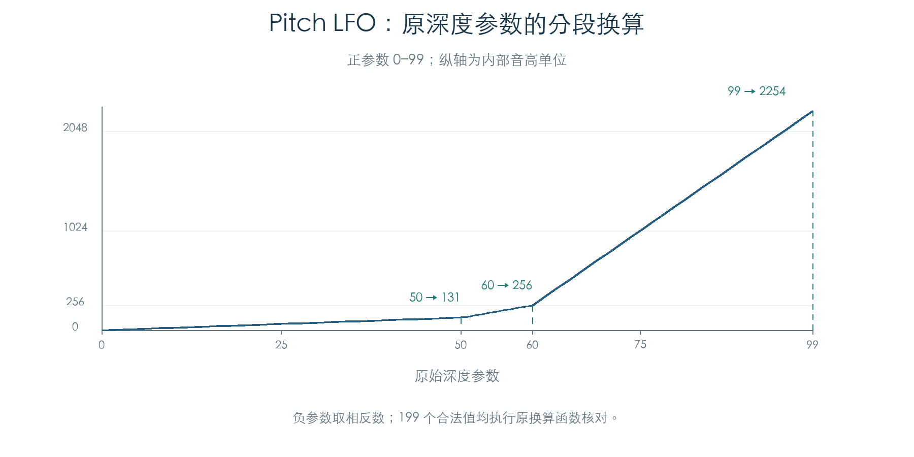
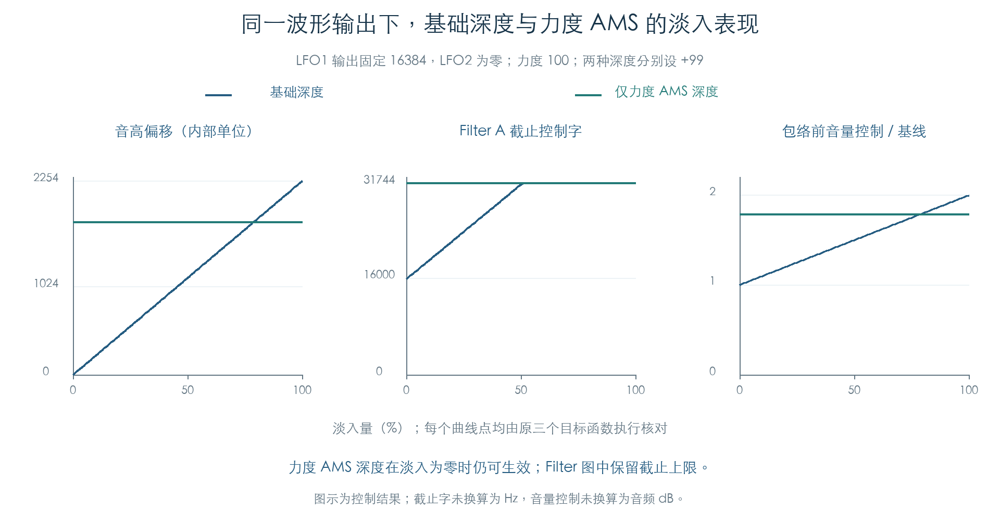

# LFO 怎样改变音高、滤波与音量

KROSS 2 v1.2.4 · 2026-11-02

音源 LFO 已从波形和频率调制接到三个原控制入口：音高与采样步进、Filter A/B、音量。独立整数模型与原 ARM 的目标值、缓存、两路 LFO 状态和更新标志逐项一致。

基础深度会乘淡入量，AMS 增加的深度单独计算。由力度等来源控制深度时，淡入量为零仍可产生调制。因此插件需要保留两条路径。原厂 1536 个存储 OSC 已逐个执行，另有覆盖十八种波形的连续检查；TG 内部音频尚未执行。

## 1 音高深度采用三段曲线

Pitch LFO 深度参数为 −99 至 +99。取绝对值 `a`，原函数先计算正幅度：

| 参数区间 | 换算为内部音高单位 |
| --- | --- |
| 0–50 | `floor(21a/8)` |
| 51–60 | `floor((1024+103(a−50))/8)` |
| 61–99 | `floor((2048+410(a−60))/8)` |

负参数取相反数，全部 199 个值已执行原换算函数。50、60、99 分别得到 131、256、2254；高段的增长明显加快。

对每一路 LFO，基础深度先乘 Fade 后右移 16 位，AMS 深度由自己的强度换算及来源值生成，两项相加后再乘原波形并右移 14 位。两路贡献进入原音高累加、查表和采样步进计算，保留各次取整。

例如基础深度 99 在 Fade 65535 时得到 2253，仍比换算幅度 2254 小一单位。把淡入直接换成浮点 1.0，会丢掉这个边界。

## 2 滤波与音量各自缩放

Filter A/B 分别计算两路声部 LFO 和公共 LFO 的贡献。声部基础深度乘 Fade 后右移 11 位；动态深度另由来源值和强度计算。贡献与原截止参数、Filter EG、键盘跟踪偏移及其他 AMS 合并，再生成截止控制字。共振和输出电平也保留原 AMS 运算与限幅。

路由值 3 还会复制 A/B 缓冲、将相关共振值乘 `115/256`，并强制部分输出量为 32767。1500 组矩阵覆盖了四个路由值、正负波形、深度和五种淡入组合，逐字节核对当前值与旧值缓存。这里记录原控制分支，具体音频连接仍需结合 TG 行为确认。

音量路径的基础深度先计算 `(原深度×Fade×330)>>19`，再叠加原 AMS 深度。两路贡献形成 `max(0,32768+调制和)` 的乘法控制量。原函数随后结合 Program 混音电平、Amp Level、已有力度因子、Part 音量、Amp AMS、包络及最大输出限制。模型保留了 32 位乘法截断和各次右移。

图中固定 LFO1 波形输出为 16384，力度为 100，分别启用基础深度 +99 或力度 AMS 深度 +99；其余输入保持一致。202 个曲线点全部执行原音高、滤波和音量函数。基础深度随 Fade 增长；力度 AMS 路径保持自己的作用量。Filter 图保留截止上限，音量图使用包络前控制量与未调制基线的比值。

截止字尚未换算为 Hz，音量控制量也未换算为音频 dB。图中的差别足以约束插件控制算法，尚不能替代实际声音比较。

## 3 原刷新顺序与连续行为

原批量刷新先缓存 LFO2、LFO1 的波形，再更新 Pitch EG、Filter EG、Amp EG 和两个 Mixer，随后计算音高、滤波及音量目标。因此，LFO 波形生成与目标计算所读到的调制状态可能来自刷新过程的不同位置。

本章执行 LFO 子链与三个目标入口，EG/Mixer 状态由实验指定。十八条代表轨迹覆盖全部存储波形类型，每条推进 512 次，共 9216 次逐项比较。第 128、384 次更新改变指定 EG 值，检查来源变化后的控制结果；这些改变用于隔离输入，未模拟真实包络阶段或 Note Off。

每次目标调用前清零测试用更新标志，再比较原函数设置的各位。这样能够分别核对波形跳变、动态深度和 EG 深度引起的更新请求。实际调度器消费标志和向 TG 提交的完整周期仍需连接。

## 4 原厂覆盖与边界

| 检查 | 数量 | 验证内容 |
| --- | ---: | --- |
| 音高深度 | 199 个 | 全合法范围、分段及正负取整 |
| 静态调制矩阵 | 1500 组 | 两路波形、深度、淡入与四种滤波路由 |
| 动态深度 | 27 组 | 力度 AMS 在不同淡入量下的作用 |
| 淡入曲线 | 202 组 | 两条深度路径、三个控制目标 |
| 原厂存储 OSC | 1536 个 | 768 个 Program，每个 OSC 八次目标更新，共 12288 次 |
| 原厂代表连续轨迹 | 18 条 × 512 次 | 原 LFO 推进、波形、目标控制和受控 EG 来源变化 |

每次原函数调用后比较音高、滤波、音量的完整控制块、两路 44 字节 LFO 状态、共享随机状态及声部更新标志。原参数 getter、AMS 来源及数学函数照常执行；只设置固件断言失败陷阱，本轮未触发。

原厂检查使用键位 60、力度 100、中性 Tone Adjust、关闭的外部控制器；滑音、弯音、键盘跟踪偏移和 Mixer 状态置零。常规轨迹的 Pitch/Filter EG 为零，Amp EG 为指定值。采样描述符、音高基准和初始控制块由实验固定，未从真实选层装配。模式 3 下保留 Program 的 OSC 静音位。所有存储 OSC 都参与检查，数量包含未启用的配置。

[Mixer 后续](AMS_MIXERS.md)已补齐七类独立模型，并与原 LFO、三个目标连接，保留平滑状态和 Gate 初始化判断。[主 EG 后续](ENVELOPES.md)进一步连接三类常规包络的连续更新与重触发。半踏板/辅助包络、实际声部参数装配、TG 目标提交及音频仍需继续；产品代码保持原状。

## 证据与复现

- [独立模型与原函数检查](../../tools/firmware_lfo_targets.py) · [完整结果、原厂来源与连续轨迹](../../derived/firmware/KROSS2_V124/architecture/stage04/lfo-targets-check.json)
- [音高深度原函数](../../derived/firmware/KROSS2_V124/architecture/stage04/lfo-target-pitch-depth.arm.txt) · [音高与采样步进](../../derived/firmware/KROSS2_V124/architecture/stage04/lfo-target-pitch.arm.txt)
- [Filter A/B 原控制](../../derived/firmware/KROSS2_V124/architecture/stage04/lfo-target-filter.arm.txt) · [音量原控制](../../derived/firmware/KROSS2_V124/architecture/stage04/lfo-target-amplitude.arm.txt) · [批量刷新顺序](../../derived/firmware/KROSS2_V124/architecture/stage04/lfo-target-batch-order.arm.txt)
- [配图脚本](../../tools/firmware_lfo_target_figures.py) · [音高深度 CSV](../../derived/firmware/KROSS2_V124/architecture/stage04/lfo-target-pitch-depth.csv) · [淡入对比 CSV](../../derived/firmware/KROSS2_V124/architecture/stage04/lfo-target-fade-paths.csv)
- 前置结果：[十八种波形与时间核心](VOICE_LFO.md) · [频率 AMS 与原声部包装器](VOICE_LFO_INPUTS.md)

复现：`python3 research/tools/firmware_lfo_targets.py --verify-arm`。配图使用 `python3 research/tools/firmware_lfo_target_figures.py`。全部输入与依赖记录 SHA-256，仅执行现有离线材料。
