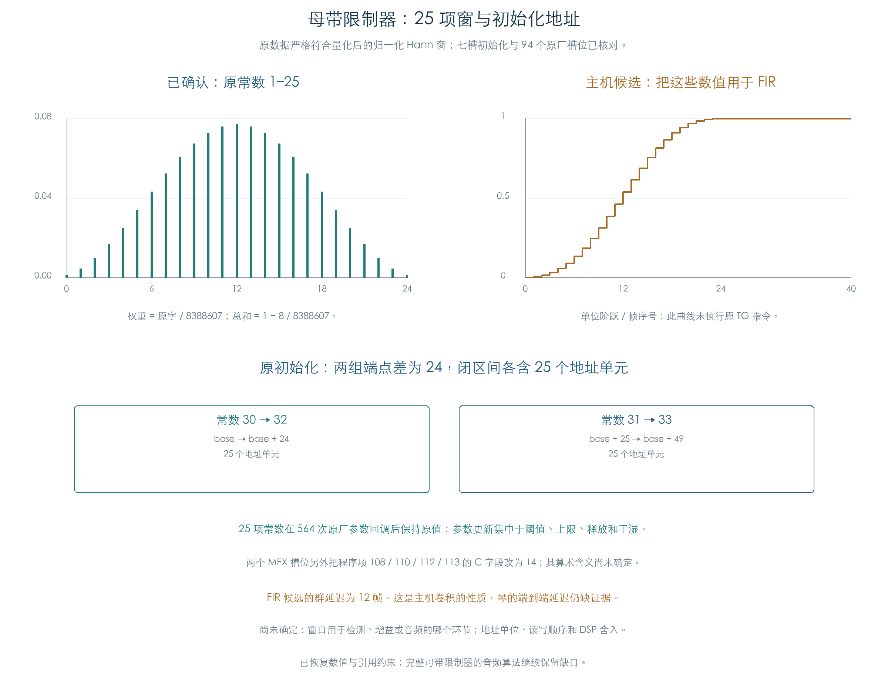

# 母带限制器：25 项窗与地址区间

KROSS 2 v1.2.4 · 效果 005 St.MasteringLimiter · 2026-11-02

母带限制器保存一组固定的 25 项对称常数，数值逐项等于量化后的归一化 Hann 窗。七个槽位的原初始化同时建立两个相邻的 25 地址单元区间。94 个原厂启用槽位完成 564 次参数回调后，这组窗保持原值。

这些结果定位了固定窗、相关程序引用和地址几何。窗口在检测、增益或音频路径中的具体作用，仍需进一步的运算语义证据。



## 1 原常数的精确公式

常数编号 1–25 对应下面的整数序列，令 `Q=8388607`，`i=0…24`：

```text
word[i] = floor(Q × (1 − cos(2π × (i+1) / 26)) / 26)
```

它对应 27 点 Hann 窗去掉两端的零值，再归一化、量化。全部 25 项与公式向下取整后的结果一致；最大量化差约为 0.929 个整数单位。

| 数值性质 | 原字结果 |
| --- | ---: |
| 首项 / 末项 | 9375 / 9375 |
| 中心项 | 645277 |
| 对称中心 | 下标 12 |
| 25 项之和 | 8388599，即 Q−8 |

原阈值、Ceiling、Release 和 Wet/Dry 更新保留这组常数。它们分属编号 28、27、26 和 29，已有[原参数检查](EFFECT_LIMITERS.md)；本轮进一步在实际槽号完成初始化后重跑全部原厂参数回调，比较完整 80 字缓冲和程序载荷。

## 2 原初始化设置的地址

入口 `0x80BC8` 先重定位局部程序，再为四项地址常数赋值。`base` 来自原槽位表，七个槽位均使用同一相对布局：

| 常数编号 | 初始化后 |
| --- | --- |
| 30 | base |
| 31 | base + 25 |
| 32 | base + 24 |
| 33 | base + 49 |

因此，30→32 与 31→33 的端点差都为 24，闭区间各包含 25 个地址单元，两个区间相邻。源常数 31、33 的 `0x20000 / 0x20018` 会被初始化覆盖，直接使用镜像初值会得到错误的运行地址。

地址单位、端点的读写方式及采样时序仍未知。当前证据不能单独确定预读帧数和插件延迟。

## 3 程序引用与 MFX 差别

完整程序含 123 项。A/B 字段的局部编号与格式门槛沿用[已核对的重定位规则](HALL_LOCAL_OPERANDS.md)，常数 1–25 的引用位置分别记录在机器结果中。引用分散在不同程序段与格式中，具体读写、乘加和状态更新顺序尚未确定。

两个 MFX 槽位另经原 `0x9BAC8` 修正程序项 108、110、112、113：在通用重定位结果上保留其他位，把低 9 位 C 字段设为 14。全部七槽的完整载荷与独立整数模型一致。这项差别需要保留到音频运算恢复阶段，暂不解释成电平变化或通道连接。

## 4 主机 FIR 候选能说明什么

为检查这组数值的滤波性质，主机参考将 `word/Q` 作为 25 点 FIR 权重。512 帧非对称双通道输入同时对照直接卷积；连续处理与不规则分块结果逐位一致，通道隔离、脉冲和阶跃检查通过。

在这个主机定义下，直流增益为 `1−8/Q`，阶跃单调收敛；对称性带来 12 帧群延迟，129 个频率点验证了中心化响应为实数。实际 DSP 的定点分母、累加器和舍入方式尚待确认。

上述性质约束了后续算法候选。原 TG 程序没有在本项中执行，限制器的端到端延迟也未测量；检测、非线性压缩曲线、窗口作用和增益递推继续保留缺口。插件暂不据此声明已还原完整母带限制器。

## 5 检查与复现

| 检查 | 数量 | 结论范围 |
| --- | ---: | --- |
| 原槽位初始化 | 7 | 123 项程序与完整 80 字缓冲 |
| 原厂启用槽位 | 94 | 原初始化、源参数与最终常数/程序 |
| 原厂参数回调 | 564 | 窗常数保持、参数写入与地址保留 |
| 存储窗 | 25 项 | 精确整数公式、对称与和 |
| 主机参考 | 512 帧 / 129 频率点 | 数值卷积性质，未计为 TG 音频恢复 |

原加载、初始化、通用重定位、MFX 修正和地址基值查询均执行 ARM 指令；仅在参数 getter 边界提供已解码的值。全程使用私有缓冲，不进行硬件 I/O，产品和冻结材料保持原值。

程序按原上传使用的 48 位载荷比较。8 字节容器中未传输的 16 位单独保留容器指纹，避免把填充位变化计成 DSP 程序差异。

```text
python3 research/tools/firmware_master_kernel.py --verify-arm
python3 research/tools/firmware_master_kernel_figures.py
python3 research/tools/firmware_runtime_verify.py --evidence-only
```

- [完整检查与来源指纹](../../derived/firmware/KROSS2_V124/architecture/stage04/master-kernel-check.json)
- [25 项原字与公式](../../derived/firmware/KROSS2_V124/architecture/stage04/master-window-weights.csv)、[候选响应](../../derived/firmware/KROSS2_V124/architecture/stage04/master-window-reference-response.csv)、[94 槽位及地址](../../derived/firmware/KROSS2_V124/architecture/stage04/master-window-factory.csv)
- [原初始化汇编](../../derived/firmware/KROSS2_V124/architecture/stage04/master-kernel-slot-init.arm.txt)、[MFX 修正汇编](../../derived/firmware/KROSS2_V124/architecture/stage04/master-kernel-MFX-fields.arm.txt)
- [检查脚本](../../tools/firmware_master_kernel.py)、[配图脚本](../../tools/firmware_master_kernel_figures.py)、[配图指纹](../../derived/firmware/KROSS2_V124/architecture/stage04/master-kernel-figure-check.json)
