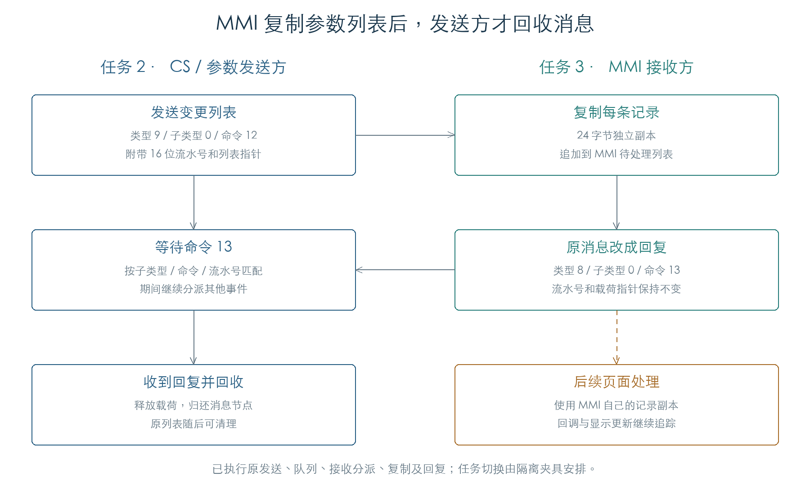

# 参数消息交接与同步回复

参数变更列表从任务 2 送往 MMI 任务 3。MMI 把记录逐条复制到自己的列表，再用原消息节点回复；发送方收到回复后释放载荷并归还消息节点。等待期间，发送方继续处理其他事件，也会暂存属于其他请求的回复。[E1]

本章已将原发送函数、RDAPI 队列、MMI 分派、记录复制、回复匹配和消息回收接成八组任务交接检查。另完成 240 组回复匹配、27 组等待轨迹和 32 组普通消息循环检查。任务切换由隔离夹具安排，内核调度和页面刷新仍待连通。

## 1. 请求和回复共用一个消息节点

发送函数 `205AC0` 从 `C0F55856` 读取 16 位流水号，写入消息 `+6`，然后将全局流水号加一。`65535` 之后回到零。目标任务由 `C04AEDB8` 决定，固件初值为 3；回复目标 `C04AEDBC` 的初值为 2，与静态任务表中的 MMI 和 CS 对应。[E1]

| 消息字段 | 请求 | 回复 |
| --- | --- | --- |
| `+4`：类型字节 | 9 | 8 |
| `+5`：子类型字节 | 0 | 0 |
| `+6`：16 位流水号 | 本次编号 | 保持原编号 |
| `+8`：16 位命令 | 12 | 13 |
| `+C`：载荷指针 | 载荷首字指向变更列表 | 保持原指针 |

发送经过 `2CD684 → 2CD608`，把原消息节点追加到目标 RDAPI 队列，并发送事件标志 `80000000`。此前的研究已核对消息池和队列结构；本章直接执行这些原函数。四组发送检查覆盖流水号 0、1、65534、65535。

## 2. MMI 收到列表后做什么

MMI 分派入口 `143994` 把类型 9 送入 `141CDC`；子类型 0 进入 `148588`；命令 12 最终调用 `14658C`。该函数遍历载荷中的变更列表，为每条记录分配 24 字节，复制参数编号、类型、新旧值和标志，再追加到 MMI 参数管理器的待处理列表。[E1]

复制完成后，函数把原消息改成类型 8、命令 13，发送到任务 2。流水号和载荷指针都不变。MMI 后续使用自己的记录副本，发送方可以在收到回复后清理原数据。

八组交接检查覆盖空列表、1/3/32 条记录及流水号 0/65535。检查执行原 MMI 三层分派和复制循环，逐字节比较记录；随后清零源记录，MMI 副本保持不变。发送和回复均执行原 RDAPI 队列插入、取出；两个任务的切换由测试夹具分阶段推进。

## 3. 等待回复时怎样处理其他消息

同步等待入口 `0312EC` 先登记目标，再循环查询缓存和接收事件。目标由三个字段组成：子类型、命令号、流水号。[E1]

收到类型 8 的消息时，函数检查子类型和目标字段：

- 当前目标的回复：清除等待记录，并返回消息指针；
- 其他已登记请求的回复：暂存在对应槽中，继续等当前目标；
- 无匹配请求或不属于回复分支的消息：交给对象虚表 `+10` 的处理函数。

事件返回值的最高位表示有消息。回复被当前等待或其他等待槽接收后，固件清除这一位；剩余事件位仍会送给处理函数，此时消息参数为零。27 组轨迹覆盖普通事件、普通消息、流水号不匹配、其他请求回复和多个事件位同时到达。

该等待入口没有独立超时分支。它持续调用接收器，直到直接收到或从缓存取到目标回复；接收器和更外层任务的超时、故障处置仍需追踪。

## 4. 32 个回复槽的结构与边界

等待表对象从 `+8` 开始保存 32 项，每项 12 字节：两个 16 位字段保存子类型和命令号，另一个 16 位字段保存流水号，`+8` 保存回复指针。构造函数将前两个字段置为 `FFFF`，回复指针清零。对象 `+4` 是递增的登记序号；取出或删除记录时不减一。[E1]

已验证的边界行为如下：

| 场景 | 原代码行为 |
| --- | --- |
| 32 项已占满，继续登记 | 登记序号继续增加，表中没有新增项 |
| 已存一条回复，又收到相同三字段的回复 | 返回匹配成功，保留先到的指针 |
| 取出已缓存回复 | 返回指针，并清空该槽 |
| 登记序号为 `FFFFFFFF` | 下一次加一回到零 |

240 组匹配检查逐项改变三个字段，并核对重复回复和取出后清空。当前尚未证明正常系统会出现超过 32 项同时等待，也未完成重复回复的消息所有权分析；这些边界行为保留为后续追踪点。

普通消息循环 `031250` 也使用同一张表暂存回复，但筛选条件略有差别：同步等待对“子类型 0、命令 5”跳过回复处理，普通循环仍允许它进入匹配。32 组检查确认了这个差异。

## 5. 回收时机

接收回复后，`205B38` 调用载荷释放函数，再将消息节点交还 `2CD694`。后者把节点接回消息池空闲链表。本章检查了释放调用的指针和归还后的链表头；堆分配、释放服务由受控实现提供。[E1]

因此，这次回复确认的是“MMI 已取得独立记录副本”。页面对象真正处理记录、调用参数回调和刷新显示发生在之后。后续[MMI 参数更新与延后处理](MMI_PARAMETERS.md)已执行 `1472D0 → 146F54`，核对记录保留和操作码 9/24 回调入口；实际页面绘制仍待验证。

## 证据与复现

**[E1]** KROSS 2 v1.2.4 原指令执行。[机器结果](../../derived/firmware/KROSS2_V124/architecture/stage04/message-replies-check.json)保存用例、任务交接轨迹、哈希及截获边界。

- [检查脚本](../../tools/firmware_message_replies.py) · [回复表](../../derived/firmware/KROSS2_V124/architecture/stage04/reply-table.arm.txt) · [同步等待](../../derived/firmware/KROSS2_V124/architecture/stage04/reply-wait-pump.arm.txt)。
- [普通消息循环](../../derived/firmware/KROSS2_V124/architecture/stage04/reply-normal-pump.arm.txt) · [发送与回收](../../derived/firmware/KROSS2_V124/architecture/stage04/parameter-message-handoff.arm.txt) · [MMI 复制与回复](../../derived/firmware/KROSS2_V124/architecture/stage04/parameter-mmi-copy-reply.arm.txt)。
- 运行：`python3 research/tools/firmware_message_replies.py --verify-arm`。全部执行限定在私有模拟内存，无设备访问。
