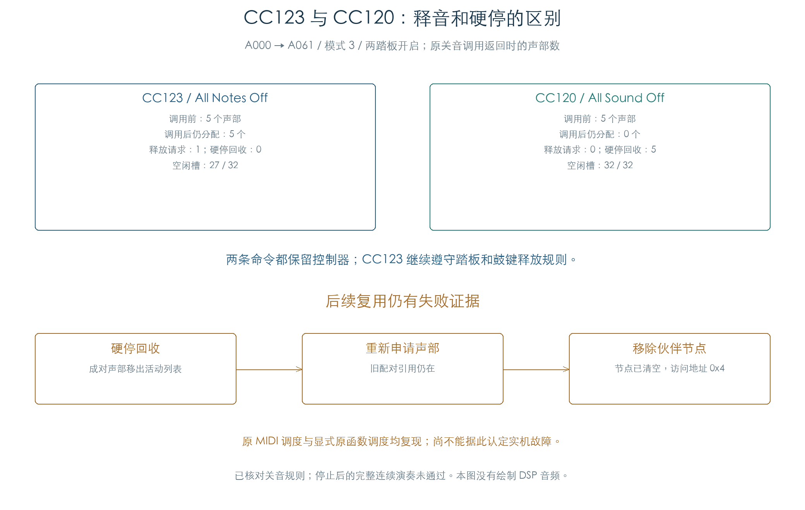

# CC120 / CC123：关音、回收与复用缺口

KROSS 2 v1.2.4 · All Sound Off / All Notes Off · 2026-11-02

后续：[主机适配的 96 条连续轨迹](MIDI_STOP_REUSE_LIVE.md)已全部跑完；本页保留原未映射零页环境的检查及中断现场。

CC123 释放仍按住的音符，继续遵守踏板和鼓键的释放设置；CC120 强制停止并回收声部。两条消息都保留控制器与调音状态。关音规则已接通原指令；硬停后再次分配成对声部，仍有私有环境中的空链表复现，连续演奏尚未全部通过。



[后续最小复现与主机适配](MIDI_STOP_REUSE.md)已定位原空节点摘除的 0/4 写入。可写模拟零页与主机空节点适配在 24 组状态/I/O 上一致；先前完成的 C001 → A061 轨迹追加第三个音符也复现。下文保留原夹具的 80 条失败，完整连续组合仍待核对。

## 1 两条消息的原路径

| 行为 | CC123：All Notes Off | CC120：All Sound Off |
| --- | --- | --- |
| 通道分发 | `26FCC4 → 273130` | `26FCFC → 2732A0` |
| 遍历范围 | 通道主音色及其已分配的 OSC | 同左 |
| OSC 消息 | 类别 3 | 类别 4 |
| 声部处理 | 仅对按键位 `0x80` 有效的声部调用 `1FD4F4 → 1F7CC8` | 对 OSC 列表全部声部调用 `1FD53C` |
| 踏板、鼓键释放许可 | 继续生效；已松键声部不重复送入此路径 | 直接停止，跳过普通 Note Off 的释放许可 |
| 音色按键池 | 调用 `270210`，清空活动链并重建十节点空闲链 | 保留池与节点内容 |
| 音色按键计数 | 原值非零时清零并通知显示 | 同左 |
| 控制器、压力、弯音、Part、鼓键编辑 | 保留 | 保留 |
| 通道按键与选择延音位图 | 保留；音色按键池单独清理 | 保留 |
| 次音色 | 本路径不遍历 | 本路径不遍历 |

注册表遍历使用 OSC 容量，换成单 OSC 的新 Program 后，旧第二 OSC 仍能收到关音。值字节 0–127 与来源 0/1/5/8 没有改变本项关音动作。原系统阻塞标志非零时，外层入口跳过消息。

这与 [CC121 重置](MIDI_RESET.md)的行为不同：CC120/123 不会重置音量、表情和踏板值。插件需要按消息分别处理释放、强停和控制器默认值。

## 2 踏板下的真实声部

代表轨迹先用 A000 发音符 48，打开延音和选择延音，再换为 A061、发音符 64，随后松开旧键。关音前保留五个声部：四个旧钢琴声部和一个新 Celesta 声部。

| 原调用返回时 | CC123 | CC120 |
| --- | ---: | ---: |
| 新增普通释放请求 | 1 | 0 |
| 硬停回收 | 0 | 5 |
| 仍分配的声部 | 5 | 0 |
| 空闲槽 | 27 / 32 | 32 / 32 |

CC123 将新声部的按键位清掉，原踏板条件使其继续保持；四个旧声部此前已松键，本次不重复调用普通释放入口。CC120 则把五个声部全部移出活动列表，TG 活动掩码归零。这里核对的是原控制状态和停止写入，未测量实际音频静音时间。

## 3 硬停后的成对声部复用尚未闭环

96 条轨迹中，16 条 C001 → A061 完成了全部 48 次更新和两轮重新起音。其余 80 条在 CC120 后的首次复用阶段触及相同的空节点；两套原调度都保留了该失败。

| 轨迹类别 | 数量 | 结果 |
| --- | ---: | --- |
| 首次命令为 CC120 | 40 | 更新 20 再起音时失败 |
| 首次命令为 CC123 | 40 | 更新 32 追加 CC120 清理；更新 36 再起音时失败 |
| C001 → A061，两条命令及全部踏板/模式组合 | 16 | 完成 48 次更新 |

第二类失败发生在后加的 CC120 之后，不能归因于 CC123 本身。所有 96 条轨迹的首次关音、更新 8 松踏板和更新 12 重复关音都已完成。

失败时，原成员节点的前后指针已为零，声部的配对类别和伙伴指针仍保留。代表轨迹复用槽 2 时沿配对引用处理槽 3：原 `1FC89C` 进入伙伴回收，再由 `1FC738 → 272414` 尝试移除该节点，最终在 `27242C` 写入地址 `0x4`。机器结果保存了节点地址、调用位置、剩余空闲数及全部残留配对字段。

检查未补写链表、清除配对指针或绕过原回收函数。当前可确认这个私有夹具中的失败路径；真实应用生命周期是否还有必要的前置或后置清理，仍需查明。没有实机故障证据，也未将这 80 条计为完整连续演奏成功。

## 4 检查范围与复现

| 检查 | 数量 |
| --- | ---: |
| 全部值字节 × 四种来源 × 两条命令 | 1024 |
| 16 通道 × 六个模式值 × 两种 Pad 配置 × 两种来源 × 两条命令 | 768 |
| 主音色计数的 0 / 1 / 32768 / 65535 组合 | 32 |
| 系统阻塞 | 64 |
| 持续轨迹 | 96 |
| 已完成并逐阶段比较的更新 | 3008 |
| 独立整数打包核对的 TG 提交 | 1340 |
| 保留的复用失败 | 80 |

1888 组状态矩阵比较完整 16 通道、三个音色/Part/控制缓冲、按键池和节点、1536 字节鼓键控制及四个 Pad 请求槽。状态矩阵的 OSC 容量为 0；真实声部另用六组换音、模式 0/3 和四种踏板组合检查，保留同一 32 槽池。来源 0/5 按延音场景分配，持续轨迹没有再做来源的全组合。

原 MIDI 调度与依次调用原主音色/Pad 函数的参考调度逐阶段比较；释放与硬停的槽位集合、字段保留、空闲数和按键链表另用独立模型核对。原 Pad 通道筛选与四槽停止请求也执行，但没有运行 Pad 音频任务。TG 读回、附加参数绑定、临时栈和通知边界沿用[持续刷新夹具](MIDI_VOICE_REFRESH.md)。负等待 KeyOff、全部抢占组合和实际音频仍未覆盖。

结果中的 `passed=true` 表示上述有界规则与失败复现已核对；`live_continuity_complete=false` 明确保留连续演奏未通过。

```text
python3 research/tools/firmware_midi_all_off.py --verify-arm
python3 research/tools/firmware_midi_all_off_figures.py
```

- [机器结果与失败现场](../../derived/firmware/KROSS2_V124/architecture/stage04/midi-all-off-check.json)
- [关音例子 CSV](../../derived/firmware/KROSS2_V124/architecture/stage04/midi-all-off-example.csv)、[80 条失败索引](../../derived/firmware/KROSS2_V124/architecture/stage04/midi-all-off-reuse-faults.csv)、[图形核验](../../derived/firmware/KROSS2_V124/architecture/stage04/midi-all-off-figure-check.json)
- 原指令：[通道分发](../../derived/firmware/KROSS2_V124/architecture/stage04/MIDI-all-off-dispatch.arm.txt)、[音色处理](../../derived/firmware/KROSS2_V124/architecture/stage04/MIDI-all-off-timbres.arm.txt)、[OSC 处理](../../derived/firmware/KROSS2_V124/architecture/stage04/MIDI-all-off-OSC.arm.txt)、[强停遍历](../../derived/firmware/KROSS2_V124/architecture/stage04/MIDI-all-off-voices.arm.txt)、[Pad 请求](../../derived/firmware/KROSS2_V124/architecture/stage04/MIDI-all-off-pads.arm.txt)
- [检查脚本](../../tools/firmware_midi_all_off.py)、[配图脚本](../../tools/firmware_midi_all_off_figures.py)
