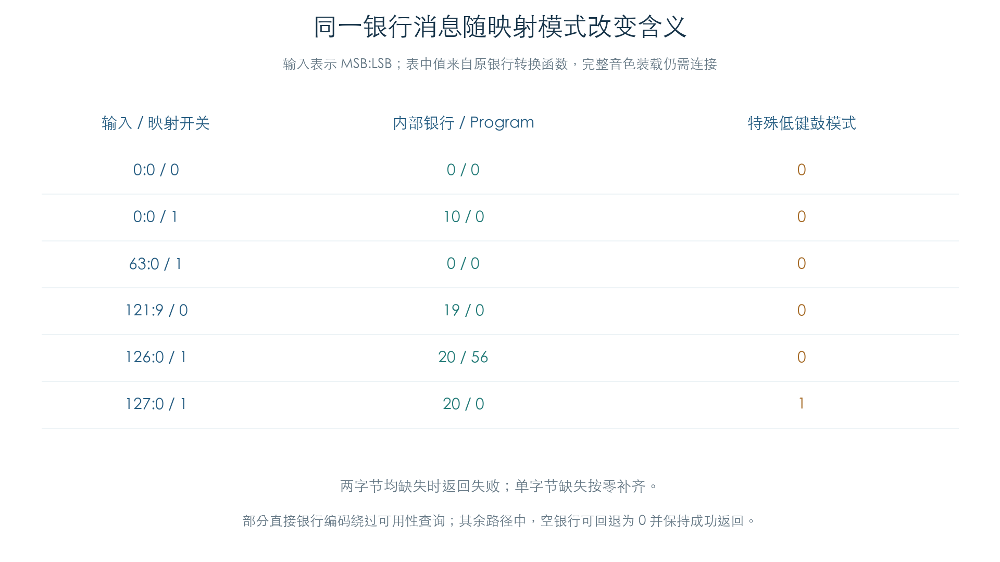

# MIDI 银行编码与音色转换

KROSS 2 v1.2.4 · 插件音色选择 · 2026-11-02

原银行转换会同时修改内部银行、Program 编号和特殊低键鼓模式。相同 MSB/LSB 在两种映射设置下可能得到不同结果，因此不能直接把 MIDI 银行号作为文件数组下标。全部合法银行字节组合已在两种设置、三个 Program 代表值下通过原函数比较。



## 1 缺字节、优先编码与映射模式

转换输入按 `MSB × 256 + LSB` 保存，缺失字节为 `FF`。两字节均缺失时返回失败并保留原值；只有一个缺失时，将它按零解释。字节到内部银行的转换先处理直接编码，再按全局 `+1352.bit4` 选择映射分支。

| 输入编码 | 结果 |
| --- | --- |
| `38:00` | 银行 10 |
| `3E:00`、`78:00` | 银行 20 |
| `79:00` 至 `79:09` | 银行 10–19 |
| 普通分支的 `00:00` 至 `00:09` | 银行 0–9 |
| 普通分支的 `00:0A` 至 `00:10` | 银行 0–6 的别名 |
| 另一映射分支的 `00:00` | 银行 10 |
| 另一映射分支的 `3F:00` 至 `3F:09` | 银行 0–9 |
| 另一映射分支的 `3F:0A` 至 `3F:10` | 银行 0–6 的别名 |

表中输入字节采用十六进制，内部银行采用十进制。另一分支还会按 Program 查询原变体列表，处理 MSB 不大于 55 的兼容映射，以及 `40:00` 的原转换表。各列表从冻结镜像独立解析，并与原搜索函数的结果比较。

部分直接编码绕过银行可用性查询；其他已接受路径中，如果目标银行查询为空，结果可回退为银行 0，同时保留成功返回。因此“返回成功”和“使用原目标银行”需要分开记录。这里的空/非空条件为私有受控存储状态。

## 2 特殊鼓模式会改变 Program

另一映射分支收到 MSB 126 时选择银行 20，并将 Program 改为 56。收到 MSB 127 时也选择银行 20；原 Program 大于 55 时改为 0，并设置特殊低键鼓标志。该标志正是[GM 鼓键映射](GM_PROGRAMS.md)的一个上游条件。

转换函数在普通输入时不会统一清除该全局标志。本轮分别从旧值 0/1 检查缺字节输入；完整模式切换、清除来源和跨通道连续行为仍需核对，插件实现不得自行假设它是每条消息的临时局部值。

## 3 验证与插件用途

| 检查 | 数量 |
| --- | --- |
| 合法银行组合 | 128 × 128 × 两种映射 × 三个 Program，共 98304 组 |
| 缺失字节与旧标志 | 272 组 |
| 特殊银行覆盖所有 Program | 3584 组 |
| 空银行回退 | 420 组 |

本模块执行原银行转换、变体列表搜索和特殊表；唯一替代入口为银行可用性查询。独立模型比较返回值、银行、Program、特殊标志和查询路径。后续[换音装载检查](MIDI_PROGRAM_LOAD.md)已执行原可用性、真实源记录查询与 OSC 绑定，完整前端过滤、应用换音队列及换音后的发声继续保留缺口。

插件需要先组合 CC0/32 的保存状态，再按当前映射设置转换，最后执行 GM 变体回退与真实 Program 查询。完整工作站文件系统和硬件上传不属于这条音色选择逻辑。

[完整结果与原变体列表](../../derived/firmware/KROSS2_V124/architecture/stage04/midi-banks-check.json) · [转换实例 CSV](../../derived/firmware/KROSS2_V124/architecture/stage04/midi-bank-examples.csv) · [原银行转换](../../derived/firmware/KROSS2_V124/architecture/stage04/MIDI-bank-conversion.arm.txt) · [Program Change 调用者](../../derived/firmware/KROSS2_V124/architecture/stage04/MIDI-program-change-input.arm.txt)

```sh
python3 research/tools/firmware_midi_banks.py --verify-arm
python3 research/tools/firmware_midi_parameter_figures.py
```
