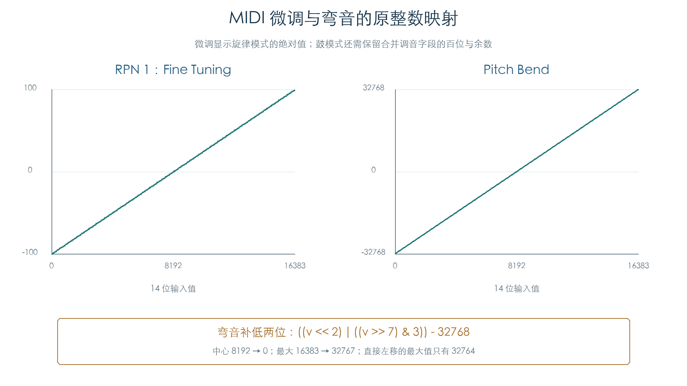

# MIDI 调音、弯音与 RPN/NRPN

KROSS 2 v1.2.4 · 插件演奏控制 · 2026-11-02

原通道分发已接到 RPN/NRPN 选择、Data Entry、增减、压力和弯音。每条消息后比较完整通道、Part、音色控制缓冲和鼓键控制区。旋律微调与弯音分别覆盖全部 16384 个输入值；鼓组模式的合并调音、接收门槛和消息来源另行检查。

## 1 选择状态决定 Data Entry 的含义

CC101/100 选择 RPN 的高/低字节，CC99/98 选择 NRPN。通道 `+114` 同时保存已收到的字节、当前选择族和 Data Entry 标记。两个字节都具备时才接受参数数据；切换选择族后仍需遵守其状态位。

RPN 的高字节必须为零，本轮受支持的低字节为 0、1、2。CC6 是 Data Entry MSB，CC38 是 LSB；CC96/97 固定增减一步，不使用消息数值作为步长。Null 选择 `127:127` 不进入这三个调音分支。

| RPN | 旋律模式 | 鼓组模式 |
| --- | --- | --- |
| 0 弯音范围 | 写 Part `+6`，限制 0–24 | 同左 |
| 1 微调 | 写 Part `+8` 的有符号音分值 | 保留当前 Tune 的整数百位，再加新微调 |
| 2 粗调 | 写 Part `+7`，限制 −24 至 +24 | 保留当前 Tune 的除百余数，再加新粗调 × 100；结果限制 ±1200 |

Fine Tuning 的 14 位值为 `v = 128 × MSB + LSB`，输出为 `((v − 8192) × 25) >> 11`，范围 −100 至 +99 音分。负数采用有符号向下移位，因此 8191 得到 −1，8192 得到 0。CC6 和 CC38 各自立即触发计算，后到达的字节会使用已保存的另一字节。

鼓组的整数百位采用向零除法，余数也保留原符号。每条消息都读取当前合并 Tune，因此负音分跨整百边界时会产生顺序依赖；不能把整条消息序列简化为两个独立字段的最终赋值。检查中的两个主要音色分别为旋律和鼓组，次列表音色只参与控制缓冲与弯音复制。

弯音范围的接收还受当前模式与 Part 标志约束：模式值 1/2 直接允许该分支，其余受测模式要求 Part `+1B.bit4`，并保留当前范围为 −25 的特殊值。微调、粗调始终要求该 Part 接收位。

## 2 弯音与压力



原弯音映射为：

```text
v = 128 × MSB + LSB
bend = ((v << 2) | ((v >> 7) & 3)) − 32768
```

补入的低两位来自 MSB 的最低两位。最大输入得到 32767；普通左移会得到 32764。原路由写入通道 `+FA`，再复制到主要和次要两组音色的 `+94`。这里验证控制值，最终音高幅度还取决于弯音范围和声部消费。

复音压力保存在 `通道 +2+音符`，通道压力保存在 `+1`。本轮核对 128 键的四种压力值和全部 128 个通道压力值，尚未连接这些来源的所有 AMS 消费者。

## 3 NRPN 的两条路径

NRPN 高字节为 1 时，低字节映射为音色控制器；高字节为 20–30 时，低字节选取鼓键，字段映射沿用[逐键鼓组控制](DRUM_CONTROLS.md)。Data Entry 绝对写入与增减分别执行原路径。

| NRPN 低字节（高字节为 1） | 目标 CC |
| --- | --- |
| 8 / 9 / 10 | 76 / 77 / 78 |
| 32 / 33 | 74 / 71 |
| 99 / 100 / 102 | 73 / 75 / 72 |

目标 CC77 的高半区按三分之四缩放，CC78 围绕 64 按十分之十六缩放，CC71 按二分之一缩放再加 32。增减路径直接改变已映射的控制值，不再次应用绝对值曲线。逐键鼓组的未设置字节按有符号值 −1 参与增减，再限制到 0–127。

消息来源值 5 更新活动控制器，但不覆盖通道的影子副本；其他受测来源更新两者。NRPN 转换后的音色控制值另通过其原写入路径同步。插件不能只保存最终控制值，还需保留来源和选择状态。

## 4 检查结果与边界

| 项目 | 覆盖 |
| --- | --- |
| 选择标志 | 3072 组，遍历全部 256 个旧标志、四个选择控制器和三个值 |
| Fine Tuning / Pitch Bend | 各 16384 个输入 |
| RPN 上下文 | 12800 组模式、接收位、参数号、数据、增减；另有 1536 组高/低字节门槛 |
| NRPN | 4608 组音色/逐键选择、绝对写入、增减与 LSB 消息 |
| 压力 | 512 组复音压力、128 组通道压力 |

原事件路由、通道分发、调音算术、控制器复制和弯音复制均执行。每条消息后比较 436 字节通道、三份 64 字节 Part、三份 128 字节控制器、音色弯音字段、1536 字节逐键控制区及通知顺序。应用刷新通知和调制通知在边界接管。[逐键 NRPN 后续](DRUM_NRPN_LIVE.md)已连接真实鼓组包络；完整输入过滤、其他参数副作用及音频仍需连接。

[完整原指令结果](../../derived/firmware/KROSS2_V124/architecture/stage04/midi-parameters-check.json) · [16384 行微调/弯音 CSV](../../derived/firmware/KROSS2_V124/architecture/stage04/midi-tuning-bend.csv) · [RPN 调音汇编](../../derived/firmware/KROSS2_V124/architecture/stage04/MIDI-RPN-tuning.arm.txt)

```sh
python3 research/tools/firmware_midi_parameters.py --verify-arm
python3 research/tools/firmware_midi_parameter_figures.py
```
