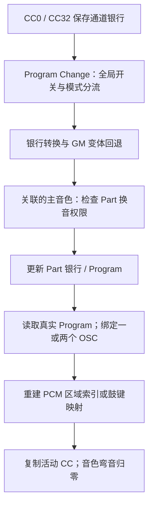

# MIDI 换音与 OSC 装载

KROSS 2 v1.2.4 · 插件音色选择 · 2026-11-02

CC0/32 保存银行字节，Program Change 经过银行转换、GM 变体回退和资源查询，再把实际 Program 绑定到音色与 OSC。原厂双 OSC 会绑定两块参数；鼓组模式会装入套件指针、逐键重映射及鼓控制初值。本轮已将这些步骤接入同一原 ARM 调用链。



## 1 模式与换音权限

原分发表的四个目标依次为 `26FEE8 / 26FEB8 / 26FEB8 / 26FF58`。此前静态追踪中的模式对应已由此纠正，后续按原数值记录。

| 条件 | 原路径中的行为 |
| --- | --- |
| 全局 `+1353.bit0` 关闭 | 不执行 Program Change |
| 模式 0、全局通道的 Combi 选项关闭 | 遍历关联主音色 |
| 模式 3 | 遍历关联主音色 |
| 模式 1、2 | 匹配全局通道后交给应用换音队列；本轮只验证非匹配通道的忽略 |
| Part `+19.bit0` 关闭 | 该音色跳过换音与其后的控制器复制 |
| Part `+2` 高三位为 1 或 2 | 允许装载内部音色参数 |
| 音色 `+29.bit1` 置位 | 保留 Part 银行，仍可更新 Program |

主链只遍历通道的主音色列表。测试中另有一个次音色：CC 与弯音会传播到它，Program Change 未重新装载它。音色 15 的歌曲特殊处理未纳入本轮。

## 2 装载后使用哪些资源

银行转换先处理输入编码；资源查询再进行[GM 物理银行转换](GM_PROGRAMS.md)。因此逻辑银行、物理银行与最终 Program 下标应分别保存。目标银行为空时，受测查询路径回退到银行 0。源记录由只读存储提供者返回，其余查询、回退、装载和绑定均执行原指令。

装载器保存 Program 指针与 `Program+0x520` 公共参数指针。模式字低三位为 1 时绑定两个 OSC，其余受测 PCM/鼓组模式绑定一个。PCM 参数起点为 `Program+0x564+380×OSC`，每块 380 字节；每个启用 OSC 的四层素材描述符继续生成实际区域索引。鼓组则重建 128 键距离表，并初始化逐键控制缓冲。

本模块逐项核对实际源记录 SHA-256、参数指针、绑定次序、活动 OSC 链表、所有活跃 PCM 区域映射或鼓键重映射，覆盖参数与素材绑定。后续[连续声部检查](MIDI_VOICE_HANDOFF.md)已接到换音前后的原 Note On/Off；[正常刷新](MIDI_VOICE_REFRESH.md)与 [CC121 重置](MIDI_RESET.md)已有后续检查，实际音频继续保留缺口。

## 3 控制器保留与弯音清零

换音后，原 `2742A0` 将通道当前 120 字节 CC 复制到音色控制器缓冲，再把该音色的弯音字段设为零。通道自身的弯音值继续保留；未换音的次音色也保留原弯音。

例如，通道弯音为 32767，音量 CC7 为 99。两个主音色换音后保留 CC7=99，音色弯音变为 0；次音色弯音仍为 32767。随后收到新的弯音消息时，可再次向关联音色传播。插件若只保存一个共享弯音字段，会遗漏这个换音边界。

Part 内部类型禁止装载时，外层换音处理仍可能复制 CC 并清零弯音；Part 换音权限关闭时则整条音色处理跳过。测试比较完整 Part、CC 和通道状态，保留了这两个门槛的差异。

## 4 验证与剩余边界

| 检查 | 数量 |
| --- | --- |
| A–F 真实原厂 Program | 768 个，连续切换两个主音色 |
| GM 逻辑银行与 Program | 11 × 128，共 1408 组 |
| 另一银行映射 | 8 种编码 × 128 Program，共 1024 组 |
| 空银行回退 | 12 组 |
| 模式、开关、Part 权限/类型、银行锁与 CC 来源 | 384 组 |

私有内存提供三个音色、原 PCM/鼓目录和真实源记录。替代边界为存储提供者的虚拟读取、界面/鼓模式通知，以及既有隔离环境的分配、异常登记和 TG 总线接口。原调制初始化、银行可用性、GM 转换、Program 装载、OSC 绑定、区域与鼓键生成、控制器复制均未替换。

以下行为继续保留缺口：模式 1/2 的全局通道应用队列、模式 0 的全局 Combi 选项、音色 15 特殊分支、未指定银行 `-1` 的真实存储布局、换音后更广泛的组合演奏和实际音频。旧声部延续已有上述后续检查。

未指定银行的早期私有夹具在可用性查询中访问了 `provider[-1]`；当前只读提供者数组未构造这个入口。这里记录夹具边界，不据此判断实机故障，也未补写假定的回退结果。完整工作站存储系统继续归档，仅追查插件换音所需布局。

[机器结果](../../derived/firmware/KROSS2_V124/architecture/stage04/midi-program-load-check.json) · [原换音处理](../../derived/firmware/KROSS2_V124/architecture/stage04/MIDI-timbre-change.arm.txt) · [原装载入口](../../derived/firmware/KROSS2_V124/architecture/stage04/MIDI-Program-loader.arm.txt) · [原 OSC 绑定](../../derived/firmware/KROSS2_V124/architecture/stage04/MIDI-timbre-binding.arm.txt)

```sh
python3 research/tools/firmware_midi_program_load.py --verify-arm
```
