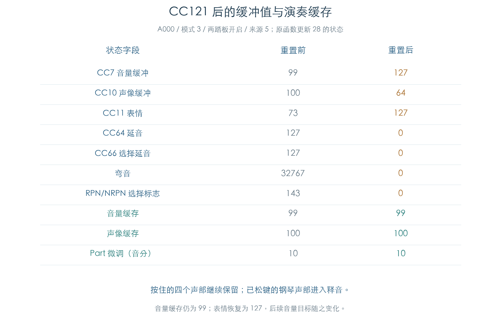

# CC121：控制器重置与发声延续

KROSS 2 v1.2.4 · MIDI Reset All Controllers · 2026-11-02

CC121 清零弯音、压力和参数选择状态，关闭两种踏板，并重新复制控制器缓冲。仍按住的音符继续发声。音量与声像有两份状态：CC 缓冲恢复默认值，音色的演奏缓存保留旧值。插件实现需要保留这一区别。



## 1 原重置顺序

原 MIDI 入口 `271500` 经 `26EC34` 分发到 `270078`。CC121 的值字节不参与重置计算；受测全部 0–127 值得到相同规则。

1. 保存旧 CC66，调用 `26DDC8` 重置通道字段。
2. 内部发送 CC64=0，消息来源为 0。
3. 若旧 CC66 大于 63，恢复该旧字节，再内部发送 CC66=0，来源仍为 0。恢复旧值使原踏板处理能识别关闭边沿。
4. 无条件复制活动 CC 到影子缓冲。外层消息来源为 5 时也执行。
5. `26E97C` 遍历主、次音色，复制 120 字节 CC，并经 `27427C` 将各音色弯音归零。踏板释放消息只遍历主音色。

原系统阻塞字段 `system+2C` 非零时，外层 MIDI 入口跳过本次消息。

## 2 哪些值改变，哪些保留

| 字段 | CC121 后的结果 |
| --- | --- |
| 银行 CC0、CC32 | 保留原值 |
| CC7、CC11 | 缓冲设为 127 |
| CC8、CC10、CC16、CC70–79、CC118、CC119 | 缓冲设为 64 |
| CC5、CC17、CC19、CC20、CC21、CC65 | 缓冲设为内部哨兵 255 |
| 其余 CC1–119，除 CC32 | 缓冲设为 0，包含 CC64/66 与四个参数选择字节 |
| 通道压力、128 键复音压力、通道弯音 | 清零 |
| RPN/NRPN 选择标志、通道按键/选择延音位图 | 清零 |
| 影子 CC、主/次音色 CC | 从活动 120 字节 CC 完整复制 |
| 音色弯音 | 清零 |
| 音色缓存音量 `+2D`、声像 `+2A` | 保留原值 |
| Part 微调、粗调、弯音范围；逐键鼓组控制 | 保留原值 |

255 是内部未设置值；这里记录缓冲内容，不将其作为合法 MIDI 数值发送。选择标志清零后，选择字节也为 0；原代码没有写入 127:127 的 Null 选择对。

代表轨迹先将音量设为 99、声像设为 100、表情设为 73，再发送 CC121。结果为 CC7=127、CC10=64、CC11=127；缓存音量仍为 99，缓存声像仍为 100。Part 微调保留 10 音分，预先编辑的鼓键缓冲也逐字节保留。

## 3 对旧声部的影响

A000 轨迹在更新 12 打开延音和选择延音，更新 16 按下新键 64，更新 20 松开旧键 48，更新 28 发送 CC121。旧键对应的四个钢琴声部进入原释音交接阶段 9；仍按住的新键四个声部保存按键标志和原 Program、OSC、Sample 来源。更新 32 正常松开新键后，这些声部也进入释音。

原选择延音的声部标志位在受测轨迹中仍可保留，不能仅凭该位判断是否已交接释音。F042 与 GM 鼓键保留原来的 Note Off 接收规则，重置没有将所有鼓声强制送入同一释放段。

表情恢复 127 后，仍按住的 A000 声部 4 的音量目标由更新 27 的 4257 变为更新 28 的 12895；同时弯音归零，其采样步进由 6510 变为 5800。目标值还受包络和 Part 微调影响。已释音声部按原管理器的更新批次继续变化，不能要求每个槽位在同一批全部写入新目标。

以上是原控制目标与状态。检查没有运行 TG 音频，也未把 CC121 当作硬停所有声部的命令。

## 4 验证与边界

| 检查 | 数量与内容 |
| --- | --- |
| 值矩阵 | 4096 组，全部 128 个 CC121 值、踏板门槛与四种来源 |
| 选择延音 | 1536 组，全部 128 个旧 CC66 值 |
| 选择标志 | 512 组，全部 256 个标志字节 |
| 通道与模式 | 640 组，16 通道、五个模式值、四种来源 |
| 系统阻塞 | 64 组，入口跳过并完整保留状态 |
| 持续发声 | 五种预置 × 模式 0/3 × CC66 关/开 × 来源 0/5，共 40 条 |
| 正常刷新 | 每条 64 次，共 2560 次更新、1728 次 TG 控制提交 |

6848 组状态矩阵将全部 436 字节通道、三个 64 字节 Part、三个 128 字节控制器缓冲、音色缓存/弯音及 1536 字节逐键鼓组缓冲与独立模型比较。底层字节包含非 MIDI 值的扰动，用于检查覆盖和保留范围；不据此声称这些状态都能由实机演奏产生。该矩阵未分配 OSC，踏板释放迭代容量为 0。

持续发声另使用真实 A000、A061、F042、GM 旋律和 GM 鼓组，保留同一 32 槽声部池。原 CC121 与显式依序调用原重置/踏板/复制函数逐阶段比较，再比较原推进、轮询与已解码的原内核调度。每次重置还核对独立通道模型及保留字段；每次 TG 音量、音高和滤波步长提交沿用独立整数方程检查。

私有 TG 活动/读回、两个附加参数绑定、临时栈、界面通知和 OS 边界沿用[换音持续刷新](MIDI_VOICE_REFRESH.md)的夹具。[All Notes Off / All Sound Off](MIDI_ALL_OFF.md)已有后续检查，硬停后的配对声部复用仍有失败复现。完整前端过滤、耗尽回收与实际声音继续保留缺口。本项结果只计入已验证的重置路径。

## 5 复现与证据

```text
python3 research/tools/firmware_midi_reset.py --verify-arm
python3 research/tools/firmware_midi_reset_figures.py
```

- [状态与持续发声结果](../../derived/firmware/KROSS2_V124/architecture/stage04/midi-reset-check.json)
- [状态图 CSV](../../derived/firmware/KROSS2_V124/architecture/stage04/midi-reset-state.csv)、[图形核验](../../derived/firmware/KROSS2_V124/architecture/stage04/midi-reset-state-figure-check.json)
- 原指令：[重置顺序](../../derived/firmware/KROSS2_V124/architecture/stage04/MIDI-reset-controllers.arm.txt)、[通道默认值](../../derived/firmware/KROSS2_V124/architecture/stage04/MIDI-reset-channel-state.arm.txt)、[音色复制](../../derived/firmware/KROSS2_V124/architecture/stage04/MIDI-reset-timbre-copy.arm.txt)
- [检查脚本](../../tools/firmware_midi_reset.py)、[图形脚本](../../tools/firmware_midi_reset_figures.py)
