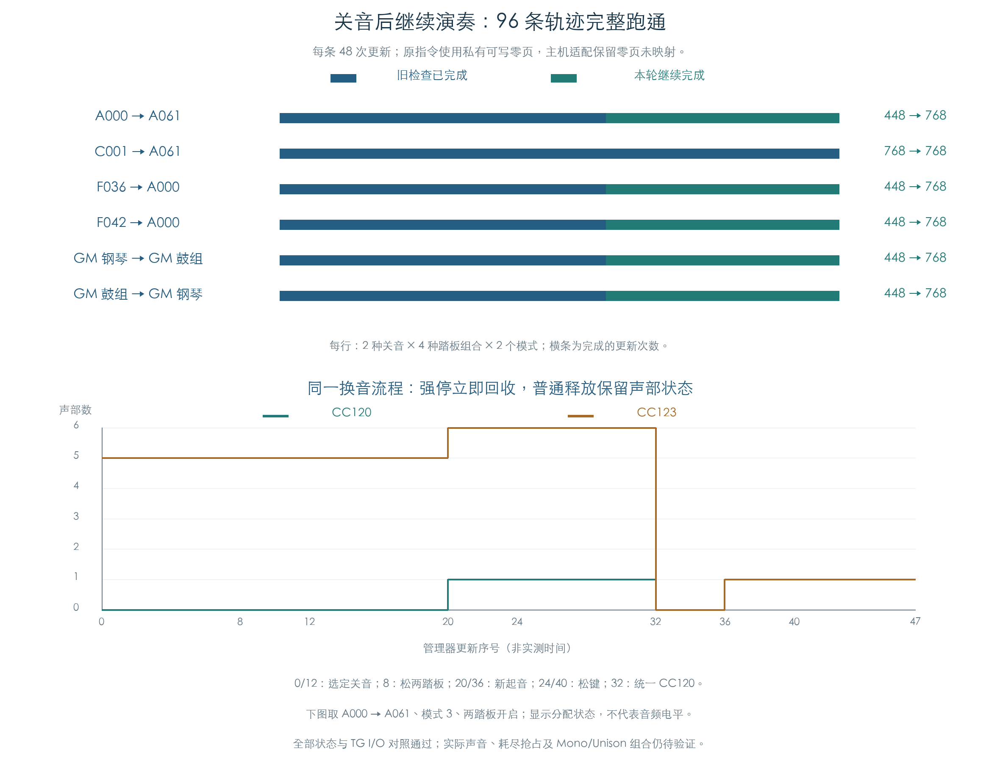

# 关音后继续演奏：主机适配的连续验证

KROSS 2 v1.2.4 · 换音、踏板、重复停止与再次起音 · 2026-11-02

空节点摘除适配已接回原 MIDI、换音和正常声部刷新。96 条轨迹全部走完 48 次更新，共 4608 次更新、1652 次 TG 控制提交。此前中断的 80 条轨迹也完成了后续起音和关音；旧检查已完成的 3008 次更新，其状态与提交记录保持一致。

这给软件音源提供了可用的复用规则：节点的前后指针同时为空时，重复摘除无需改写内存。原配对字段、声部池和其余运算仍按原路径执行。当前结果覆盖下列连续流程，实际声音和更多演奏组合仍待验证。



## 1 覆盖了哪些演奏流程

六种换音分别覆盖双 OSC、立体声配对、旋律、原厂鼓组和 GM。每种换音执行 CC120/123、模式 0/3、四种 CC64/66 开关组合，共 16 条。来源按延音踏板条件取 0 或 5，未穷举全部来源交叉。

| 换音 | 轨迹 | 旧检查完成更新 | 本轮完成更新 | TG 提交 |
| --- | ---: | ---: | ---: | ---: |
| A000 → A061 | 16 | 448 | 768 | 266 |
| C001 → A061 | 16 | 768 | 768 | 174 |
| F036 → A000 | 16 | 448 | 768 | 420 |
| F042 → A000 | 16 | 448 | 768 | 364 |
| GM 钢琴 → GM 鼓组 | 16 | 448 | 768 | 216 |
| GM 鼓组 → GM 钢琴 | 16 | 448 | 768 | 212 |

每条流程先发旧音符 48，设置音量、表情、弯音和踏板，换 Program，再发音符 64 并松开旧音符。随后连续推进同一个 32 槽池：

| 更新序号 | 操作 |
| --- | --- |
| 0、12 | 执行选定的 CC120 或 CC123 |
| 8 | 关闭 CC64 与 CC66 |
| 20 | 起音 67，力度 100 |
| 24 | 松键 67 |
| 32 | 统一执行 CC120 清理 |
| 36 | 起音 72，力度 100 |
| 40 | 松键 72 |
| 其余更新 | 继续原管理器推进与轮询，直到序号 47 |

共处理 288 次停止和 192 次新起音请求。每步先比较 MIDI 事件后的状态，再分别比较管理器推进、轮询后的状态与 I/O。更新序号表示调用顺序，不能直接换算成实机毫秒。

## 2 旧阻断点已通过主机规则接通

[原关音检查](MIDI_ALL_OFF.md)中，40 条 CC120 流程停在序号 20；另 40 条 CC123 流程在序号 32 的统一 CC120 后，停在序号 36。直接原因均为已空成员节点再次摘除，原函数写到 `0x4`、`0x0`。[最小复现](MIDI_STOP_REUSE.md)已记录字段保留、原指令及独立因果探针。

本轮保留两套独立内存：

- 原指令一侧允许私有零页写入，页内容初始取应用镜像前 4096 字节。
- 主机模型一侧保持零页未映射，仅将空节点的重复摘除处理为空操作；有效节点继续按原顺序连接。

96 条中共省略 152 次空摘除。原指令对应执行 304 次四字节零写入，地址严格交替为 `4、0`，程序位置为 `27242C/272430`。有写入的模拟页仅前八字节改变，其余字节与种子相同；16 条 C001 轨迹未触及该条件。

所有受测软件状态与 TG I/O 在两侧一致。比较包括完整声部池、候选/成员/等待节点、六个 OSC、三个音色/Part/控制缓冲、16 通道、逐键鼓组控制、相关工作区、PRNG 和 Pad 请求。每个阶段另核对全部 32 个候选节点、成员有效性及空闲计数；提交值继续用独立整数方程检查。

这确认了适配在受测连续路径中的容器行为。真实设备的零页映射与应用生命周期仍未知，私有实验不能据此判断实机是否崩溃。

## 3 复用后仍使用原来源和保留字段

四个新 Program、两种模式、两个新音符先建立 16 组独立冷启动参照。再次起音比较实际构造成功的声部，核对旋律区域或鼓键描述、样本、权重、主侧增益、配对及 TG 起始/循环寄存器。失败的选层候选不计作已构造声部。

立体声副侧 `+200` 保持该槽复用前的值，按原共享控制复制分支核对；主侧增益仍与独立参照一致。副侧字段没有为迎合冷启动参照而清零。已分配两侧的伙伴引用与共享控制块也分别检查。

外层 Note On 前只规范化私有栈的临时区，未重置声部、列表或控制缓冲。全部原有 3008 次更新按旧 JSON 逐条核对，状态和提交记录均相同；旧中断结果保留原文件。

## 4 剩余边界

本项完成的是上述 96 条软件轨迹。TG 振幅、就绪和评分读回继续使用受控输入，两个附加参数指针沿用私有绑定。比较能证明控制状态及提交一致，尚未产生原 TG 音频。

池耗尽抢占、Mono/Unison、发生器与踏板的更多组合、长时演奏、真实控制时基及声音尾音继续保留缺口。适配仅存在于研究模型，产品源码与固件字节未修改。

## 复现与证据

```text
python3 research/tools/firmware_stop_reuse_live.py --verify-arm
python3 research/tools/firmware_stop_reuse_live_figures.py
python3 research/tools/firmware_runtime_verify.py --evidence-only
```

- [完整 96 条轨迹、原零页写入及逐步对照](../../derived/firmware/KROSS2_V124/architecture/stage04/stop-reuse-live-check.json)
- [4608 行更新 CSV](../../derived/firmware/KROSS2_V124/architecture/stage04/stop-reuse-live.csv)、[配图指纹](../../derived/firmware/KROSS2_V124/architecture/stage04/stop-reuse-live-figure-check.json)
- [连续检查脚本](../../tools/firmware_stop_reuse_live.py)、[主机摘除规则](../../tools/firmware_stop_reuse_port.py)、[配图脚本](../../tools/firmware_stop_reuse_live_figures.py)
- 前序：[关音原轨迹](MIDI_ALL_OFF.md)、[最小复现与适配](MIDI_STOP_REUSE.md)、[正常刷新夹具](MIDI_VOICE_REFRESH.md)
