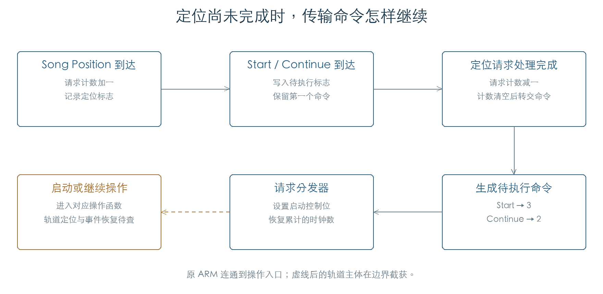

# MIDI 传输命令与定位请求

KROSS 2 v1.2.4 · 阶段 04 · 2026-11-01

Start、Continue 和 Stop 进入序列器后，先改变请求状态，再由后续处理执行。定位尚未完成时，Start/Continue 被暂存；请求计数清空后，分发器把它们交给对应操作函数。这个过程使定位与启动能够按顺序处理。



## 1 启动与继续的共同门槛

接收端口和 Receive Ext. RT Cmd 的筛选见[外部时钟](EXTERNAL_CLOCK.md)。序列器内部还有一层检查：当前功能门控必须开启，时钟来源必须为外部，且禁止处理标志未置位。

`0x23F7E0` 处理 Start，`0x23F93C` 处理 Continue。没有待完成请求时，二者要求当前操作阶段为 0 或 7，忙计数为零，且启动请求位未设置。通过后，它们将忙计数置为 1，并在控制字中写入 `0xAC` 所含的请求位。

Start 将时钟积压计数清零。Continue 根据定位标志，从 0 或 1 开始积累。两者都清除已经消费的定位标志。这个差别已经由原指令确认；最终播放位置还要结合启动操作主体解释。

## 2 定位与命令怎样排队

Song Position Pointer（F2）的两字节按下式合并：

```text
位置值 = (低字节 & 127) | ((高字节 & 127) << 7)
```

接收确认函数 `0x23FB4C` 将一字节请求计数加一，并设置定位标志。处理函数 `0x23FBD8` 将位置值保存到 `C17163C2`，设置待定位标志，再调用请求调度器。全部 16,384 个位置值均已核对，实际轨道查找尚未在这组检查中执行。

请求计数大于零时，Start 设置待启动位 `0x08`，Continue 设置待继续位 `0x10`。已有其中一位时，后续传输命令不覆盖它。因此，定位未完成期间先收到 Start、再收到 Continue，最终保留 Start；反过来则保留 Continue。

完成入口 `0x23F5F4` 减少请求计数。计数清空后，它将暂存命令转成分发码：Start 为 3，Continue 为 2。分发器 `0x24A3AC` 消费该码，恢复已积累的时钟数，进入启动函数 `0x24A290` 或继续函数 `0x24D4CC`。四条连续命令序列已执行到这两个函数的入口。

请求计数的递增按无符号字节回绕，判断“仍有请求”时却使用有符号字节。128–255 会进入非正数分支。检查已覆盖全部字节值；真实请求队列能否达到这个范围，尚未证明。

## 3 Stop 的请求写入

Stop 入口 `0x23FAC0` 检查同一外部来源门槛。允许处理且停止位尚未设置时，它调用原函数 `0x2650B4`：清除相关录放标志，写入停止请求位，增加停止请求计数，并标记待处理状态。

入口最终固定返回 1，包括门槛未通过或停止位已存在的情况。因此，上游把 FC 继续发送出去，并不能单凭返回值证明序列器刚刚执行了一次停止操作。判断时必须同时检查控制字与请求计数的变化。

## 4 验证范围

本次原 ARM 执行覆盖 8,192 组 Start/Continue 状态、96 组 Stop、10,240 组请求完成状态、16,384 个定位值和 320 组定位接收门槛。还连通了定位等待、传输命令暂存、请求完成和分发入口。

时钟来源判断、请求标志、计数递增/递减和分发器均执行原代码。实际定位调度、界面通知、外层锁主体和启动/继续操作主体在边界截获。后续已核对[位置转换与速度轨事件](SEQUENCE_TIME.md)。继续普通轨道事件到发声的完整连通，以及停止后的资源处理。

- [机器结果与连续序列](../../derived/firmware/KROSS2_V124/architecture/stage04/transport-check.json)
- [传输请求与定位汇编](../../derived/firmware/KROSS2_V124/architecture/stage04/transport-requests.arm.txt)
- [完成处理](../../derived/firmware/KROSS2_V124/architecture/stage04/transport-deferred-completion.arm.txt) · [请求分发](../../derived/firmware/KROSS2_V124/architecture/stage04/transport-deferred-dispatch.arm.txt) · [停止请求](../../derived/firmware/KROSS2_V124/architecture/stage04/transport-stop-request.arm.txt)

```sh
python3 research/tools/firmware_transport.py --verify-arm
```
