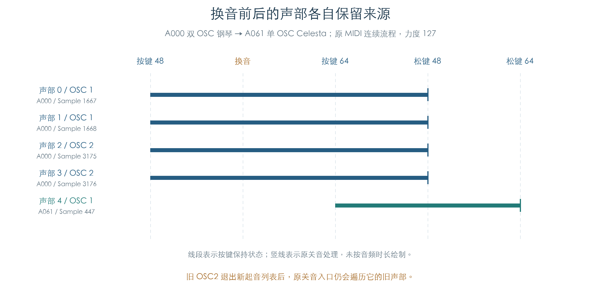

# 换音前后的连续声部

KROSS 2 v1.2.4 · MIDI 演奏与音色交接 · 2026-11-02

受测 PCM 路径中，Program Change 更新音色与 OSC 的新起音参数，旧声部继续保存各自的 Program、公共参数、OSC 参数和 Sample 指针。双 OSC 切到单 OSC 后，旧第二 OSC 的声部仍能收到 Note Off。这个区别直接影响插件换音时的旧音保持与关音。



## 1 一条完整的输入流程

每条轨迹使用同一个 32 槽私有声部池，依次发送：

1. CC0/32 与 Program Change 选择旧音色。
2. Note On 48，原通道、音色、OSC、选层与声部分配连续执行。
3. CC7=99、弯音=16384，然后发送新银行和 Program Change。
4. Note On 64，使用新音色的参数和真实采样。
5. Note Off 48，再发送 Note Off 64。

两次起音之间保留通道、音色、OSC、控制器和声部池。换音前后的全部 32×588 字节声部内存逐字节相同；活动声部列表也保持不变。音色侧弯音归零，通道和未换音次音色的弯音继续保留。该状态规则与[装载检查](MIDI_PROGRAM_LOAD.md)一致。

这组比较覆盖换音调用当下的状态。后续正常刷新仍会读取公共控制和新 Part 状态，不能据此认定旧声音的后续音频完全不变。

## 2 双 OSC 变为单 OSC

以 A000 → A061 为例，音符 48、力度 127 的钢琴建立四个声部，分别对应两对立体声。换成 Celesta 后，新的 Note On 64 只使用 OSC1，建立一个声部。四个旧声部仍保存钢琴来源，新声部保存 Celesta 来源。

新起音通过音色当前的 OSC 链表分发；Note Off 则遍历该类音源预留的 OSC 容量。因此，旧 OSC2 即使已退出新起音列表，也继续处理自己持有的旧声部。插件若按新 Program 的 OSC 数量裁掉旧 OSC，会漏掉这批关音。

本轮两类入口均由原 MIDI 通道路由调用。测试单独检查实际 Sample、区域/鼓键、选层权重、增益、立体声共享块，以及起点、结束、循环和模式启动字；各声部的来源指针在后续起音和松键后再次核对。

## 3 鼓组与延迟层

鼓组每个声部保存自己的逐键释放权限。收到 Note Off 后，允许释放的键进入释音；忽略 Note Off 的键保持其 Amp 包络状态。换音后的旧鼓声仍按起音时保存的权限处理，不能统一套用新音色的按键规则。

尚未起音的正等待层，在允许释放时取消等待，清零延迟与配对信息。已起音层进入正常释放；[原释放规则](PEDAL_RELEASE_FLOW.md)还支持负等待的松键触发。本轮矩阵中的实际等待状态按独立分支模型核对，未将所有 Note Off 都当作同一种包络动作。

鼓组装载还会重置共享逐键控制缓冲。旧声部保留来源指针与声部内存，并不保证指针指向的共享控制数据不变；持续刷新中的影响继续单列。

## 4 验证范围

十二个代表音色包含 A000、A011、A061、B097、C001、F036、F042、三个 GM 旋律选择和两个 GM 鼓组选择。全部有序音色对分别在模式 0/3、力度 1/64/127 下执行，共 864 条轨迹、1728 次起音、1728 次关音和 1728 次 Program Change。

实际初始化 3600 个声部，其中 3024 次立即提交采样启动。关音逐声部覆盖 2376 次正常释放、576 次取消等待和 648 次忽略释放；本矩阵未触发负等待或独占组截音，相关专项证据另见释放与鼓组章节。

原 Program、Mono/Unison 配置和 OSC 选择保留。Part 使用完整键区与力度区，全局调律设为受控十二平均律；通道 7 的起音掩码仅启用主音色 0。两个主音色接收换音，另一个次音色保留 CC 与弯音。各轨迹重新初始化私有环境，轨迹内部保持连续。

存储读取、TG 总线、分配与异常登记沿用原隔离边界；另截获五个按键显示回调和 OS 优先级读写。原输入门槛、调音、控制器、选层、分配、初始化、启动及关音运算均执行。

本模块覆盖原事件链与状态交接。[后续持续刷新检查](MIDI_VOICE_REFRESH.md)已接通控制器、包络/目标和正常 TG 提交。声部耗尽/回收、全局通道的应用换音队列及芯片音频继续保留缺口。

[完整机器结果](../../derived/firmware/KROSS2_V124/architecture/stage04/midi-voice-handoff-check.json) · [图示数据 CSV](../../derived/firmware/KROSS2_V124/architecture/stage04/midi-voice-handoff-example.csv) · [图示来源核验](../../derived/firmware/KROSS2_V124/architecture/stage04/midi-voice-handoff-figure-check.json) · [原 MIDI 起音到音色](../../derived/firmware/KROSS2_V124/architecture/stage04/MIDI-note-to-timbre.arm.txt) · [原音色到 OSC](../../derived/firmware/KROSS2_V124/architecture/stage04/MIDI-timbre-to-OSC.arm.txt)

```sh
python3 research/tools/firmware_midi_voice_handoff.py --verify-arm
python3 research/tools/firmware_midi_handoff_figures.py
```
