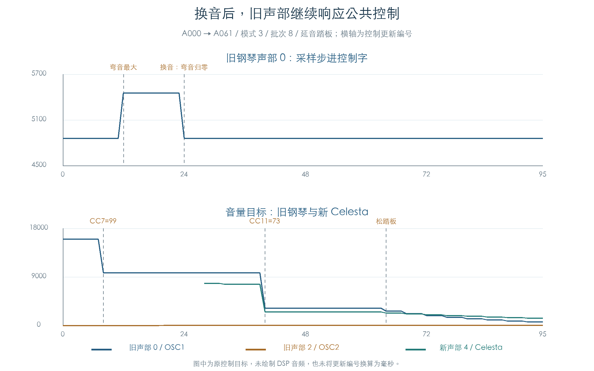

# 换音后的持续控制与 TG 提交

KROSS 2 v1.2.4 · MIDI、声部刷新与控制目标 · 2026-11-02

旧声部在换音后继续保存原采样和 Program 参数，同时读取共享音色的弯音、音量、表情与踏板状态。A000 → A061 的原指令轨迹中，旧钢琴声部先响应最大弯音；换音将音色弯音清零，下一批刷新又把旧声部的采样步进恢复到原值。插件需要同时保留旧音色来源与公共演奏控制。



## 1 从 MIDI 到正常刷新

本轮把[连续起音与换音](MIDI_VOICE_HANDOFF.md)接入原推进入口 `1FD3CC` 和轮询/批次入口 `1FE404`。同一 32 槽池持续运行，先发旧音符，再改变音量、弯音与踏板，随后换音、发新音符、松键和松踏板。

| 更新编号 | 输入 |
| --- | --- |
| 起始 | 选择旧 Program，Note On 48，力度 100 |
| 8 / 12 | CC7=99；最大弯音 |
| 16 | 踏板场景发送 CC64=127 |
| 24 / 28 | Program Change；新音色 Note On 64 |
| 40 | CC74=96、CC11=73 |
| 48 / 56 | Note Off 48、Note Off 64 |
| 64 / 80 | 松踏板；弯音回中 |

每条轨迹推进 96 次。编号表示测试中的控制更新顺序；模拟时钟和 elapsed 输入固定，未把这些编号标成实机毫秒。

控制器初始化也由原代码完成：`2736F8` 绑定 Part 与通道，`27338C` 根据 Part 权限和四个可分配控制查询生成掩码。受测设置允许普通 CC，弯音范围为 2，踏板权限按场景打开或关闭；四个可分配控制设为未分配。完整 128 位掩码与独立位模型比较，CC7、CC11、CC74 和 CC64 的可用性再经原查询核对。

## 2 旧声部如何继续变化

代表轨迹为模式 3、批次 8、踏板开启的 A000 → A061。旧声部 0 在更新 11 的采样步进为 4859，最大弯音后变为 5454；更新 24 换音后回到 4859。此时通道弯音仍为 32767，音色弯音已为零，旧声部仍引用 A000。

CC7 从 127 改为 99 后，旧声部的音量目标从约 16020 降到约 9764。更新 40 的表情 CC11=73 又使其降到约 3224；具体值同时受原包络推进影响。这些值是整数控制目标，图中没有合成或比较 DSP 音频。

踏板保持期间，受保持声部在 Note Off 后继续推进；更新 64 松踏板，原请求被交接到释放段。旧第二 OSC 的声部也继续参与正常刷新。各步均核对活动声部保存的原 Program/OSC 参数指针，未将它们重新解释成新 Program 的声音。

## 3 验证内容

六组双向换音覆盖 A000 ↔ A061、A011 ↔ F042、GM 旋律 ↔ GM 鼓组。每组分别使用批次 1/3/8、模式 0/3、踏板关/开，共 72 条轨迹、6912 次连续更新。

全部轨迹完成 3380 次正常 TG 控制提交，每项音量、音高与滤波步长均通过独立整数打包方程。

原管理器与手动按已解码顺序调度原函数的两套私有环境逐阶段比较：每条 MIDI 事件、推进阶段和轮询阶段后，都检查全部声部及链表、六个 OSC、三个音色/Part/控制器、十六通道、鼓键控制、随机状态，以及函数顺序、TG 读写和等待请求。批次 3 从游标 31 开始，包含跨池尾回绕。

这项比较验证原管理器的调度与连通。各 EG/LFO/Mixer 的独立运算模型继续由既有章节提供；本轮另以整数方程核对每次音量、音高和滤波目标/步长的 TG 打包，以及模式与分数缓存。

## 4 隔离边界与剩余工作

TG 活动位、忙闲与读回音量 16384、评分 `0x1234` 为受控输入。它们用于检查原控制路径，没有运行采样插值、TG 内部滤波或效果音频。

两个附加控制块的真实参数绑定仍未明确；测试显式绑定私有零参数。[后续省略验证](VOICE_AUXILIARY.md)已在同一 72 条轨迹中去掉计算与绑定，保持其余状态和 TG I/O 一致。每次外层 Note On 前只清零临时测试栈，避免两种调度留下的未使用字段不同；声部、OSC 和控制器状态继续保留。界面参数通知未注册，既有存储、分配、异常登记和 OS 优先级边界保持不变。

当前结果支持受测换音、控制器与踏板的持续控制链。全部预置组合、更多 Mono/Unison 状态、耗尽抢占、全局应用换音队列和真实音频尾音仍需验证。

[机器结果](../../derived/firmware/KROSS2_V124/architecture/stage04/midi-voice-refresh-check.json) · [代表轨迹 CSV](../../derived/firmware/KROSS2_V124/architecture/stage04/midi-voice-refresh-example.csv) · [图示与来源核验](../../derived/firmware/KROSS2_V124/architecture/stage04/midi-voice-refresh-figure-check.json)

```sh
python3 research/tools/firmware_midi_voice_refresh.py --verify-arm
python3 research/tools/firmware_midi_refresh_figures.py
```

后续：[CC121 重置](MIDI_RESET.md)已接通上述正常刷新，补齐踏板关闭、控制缓冲默认值及音色缓存/调音保留的检查。
