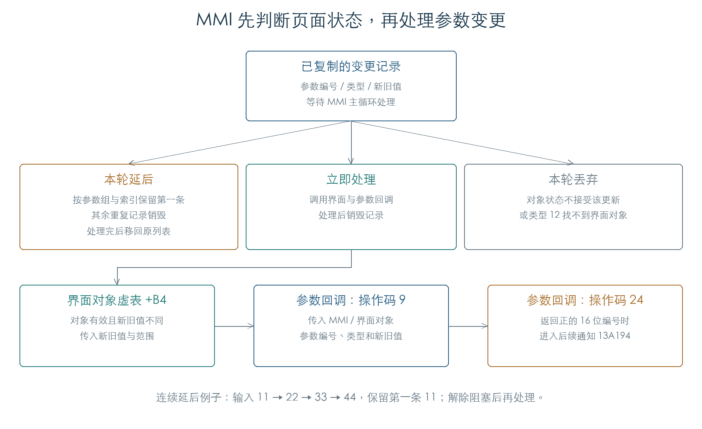

# MMI 参数更新与延后处理

MMI 收到参数列表后，先保存副本，再在主循环中处理。每条记录有三种结果：立即调用界面相关回调、留到下一次处理，或直接丢弃。延后期间，同一参数只保留最早的一条；可以处理时再调用参数的操作码 9 和相关界面对象。[E1]

本章完成 192 组批次筛选、24 组就绪判断、80 组回调上下文和三组接收至处理的连续检查。已执行原 MMI 分派、复制和批次处理；页面对象查找、容器服务和最终绘制接收者使用受控边界。

## 1. MMI 在何处处理参数记录

MMI 主循环 `143B30` 调用参数管理器 `1472D0`。管理器的 `+10` 是重入标志：非零时直接返回；否则设为一，处理辅助列表和参数记录，结束时清零。参数记录的主体在 `146F54`。[E1]

每轮处理会建立临时列表和查找表。需要延后的记录先进入临时列表；旧列表读完后，再把这些记录移回原列表。这保证同一轮不会重复读取刚刚延后的记录。

## 2. 立即处理、延后和丢弃

`146F54` 读取 MMI 对象 `+7C`，并按参数组和索引查找界面对象。下表中的字段与虚函数来自已验证的判断，完整页面模式名称仍待对应。[E1]

| 条件 | 本轮行为 |
| --- | --- |
| MMI `+7C` 非零 | 延后 |
| 找到对象，虚函数 `+88` 返回非零，对象 `+68` 非零 | 丢弃 |
| 找到对象，虚函数 `+88` 返回非零，`+68` 为零，`145F84` 返回零 | 延后 |
| 没找到对象，事件类型为 12 | 丢弃 |
| 其他已检查组合 | 调用后续处理，再销毁记录 |

192 组矩阵覆盖上述条件、类型 12/14，以及源记录标志 0、1、`FFFFFFFF`。进入回调时，MMI 把标志参数固定为零；复制保留下来的源标志没有沿这条调用继续传递。

## 3. 延后时保留最早的记录

临时查找表以“参数组 + 索引”为键。第一次遇到某个键时保留记录，后续相同键的记录被销毁，原记录的值没有被覆盖。[E1]

连续检查在处理受阻时依次加入 `11、22、33、44`。每轮结束，列表都只留下第一条值为 `11` 的记录；解除阻塞后，回调收到这条记录中的新值 `11`、旧值 `10`。

这与发送侧普通参数入队时保留最后一个值的行为不同。两处承担不同阶段的工作：发送侧合并待写入请求，MMI 处理已经产生的变更通知。具体页面是否重新读取当前值，要继续看各参数的回调和界面对象实现。

## 4. 参数怎样通知界面对象

单项函数 `146D30` 接收参数组、索引、界面对象、事件类型、范围和新旧值。执行顺序如下：[E1]

1. 新旧值不同、界面对象存在，且对象 `+A` 不为 `FFFF` 时，调用该对象虚表 `+B4`，传入新旧值、范围及类型。
2. 以操作码 9 调用参数描述符中的回调，传入同一组上下文。
3. 再以操作码 24 查询参数回调的返回值；将返回值转为有符号 16 位数，大于零时调用 `13A194`，继续发送参数组、索引和事件类型。

80 组检查覆盖对象缺失、无效对象编号、值相同/改变，以及操作码 24 返回 0、1、32767、32768、65535 的边界。`32768` 和 `65535` 经有符号转换后不会进入后续调用。

操作码 9 的上下文为：

| 偏移 | 内容 |
| --- | --- |
| `+00 / +02` | 16 位参数组、索引 |
| `+04` | MMI 对象 |
| `+08` | 查找到的界面对象，可为零 |
| `+0C / +10` | 事件类型、标志 |
| `+14 / +18` | 最小值、最大值 |
| `+1C / +20` | 新值、旧值 |

## 5. 就绪判断中的关联对象调用

`145F84` 先调用 MMI 状态查询 `141014`。状态非零时返回零。状态允许时，函数把全局字段 `C10042B0` 设为一；若对象 `+68` 为零且 `+6C` 有关联对象，就调用关联对象的虚表 `+A0`。[E1]

原全局值为零时，退出前恢复零；原值非零时，退出值为一。24 组检查包含原值 0、1、7，确认了这项布尔化行为。该状态对页面切换、编辑中参数和嵌套调用的完整作用仍待追踪。

## 6. 从接收副本到界面回调

三组连续检查从 `143994` 的 MMI 消息分派开始，分别输入 0、3、6 条参数记录。原代码完成副本创建和命令 13 回复，然后通过 `1472D0 → 146F54 → 146D30` 处理记录。[E1]

输入记录来自命名空间 100 的前三项，组合类型 12、14、16。结果逐项核对了副本内容、操作码 9 上下文、对象 `+B4` 调用、操作码 24 的后续调用以及记录销毁。描述符中的范围由原固件读取，分别为 0–26、0–11、0–7。

后续[控件树检查](UI_TREE.md)已恢复编号查找、重复绑定顺序及节点回收；[刷新检查](UI_REFRESH.md)进一步核对矩形裁剪、待刷新状态和绘制分派。具体页面、专用回调与像素绘制仍需恢复，当前检查没有生成或验收真实页面画面。

## 证据与复现

**[E1]** KROSS 2 v1.2.4 原指令执行。[机器结果](../../derived/firmware/KROSS2_V124/architecture/stage04/mmi-parameters-check.json)保存批次矩阵、延后轨迹和连续接收结果。

- [检查脚本](../../tools/firmware_mmi_parameters.py) · [批次处理](../../derived/firmware/KROSS2_V124/architecture/stage04/mmi-parameter-batch.arm.txt)。
- [回调上下文](../../derived/firmware/KROSS2_V124/architecture/stage04/mmi-parameter-callback.arm.txt) · [就绪判断](../../derived/firmware/KROSS2_V124/architecture/stage04/mmi-parameter-ready.arm.txt)。
- 运行：`python3 research/tools/firmware_mmi_parameters.py --verify-arm`。执行仅限私有模拟内存，无设备访问。
