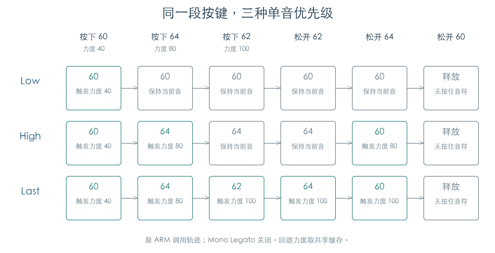

# 单音优先级与松键回退

KROSS 2 v1.2.4 · 阶段 03 · 2026-11-01

每个音色保留 10 个按键记录。Low 按音高升序排列，High 按降序排列，Last 把新按键放到最前。表头决定当前音；松开表头后，后一个记录接替。回退力度来自一份共享缓存。



## 1 按键记录与排序

音色构造函数在 `0x272560` 指定容量 10，随后调用 `0x2703C0`。原构造分配 120 字节节点和 40 字节音符数据。活动链与空闲链各有一个哨兵节点；每个活动节点包含前后指针和数据指针。

| 输入 | Low | High | Last |
| --- | --- | --- | --- |
| 第一个按键 | 成为当前音 | 成为当前音 | 成为当前音 |
| 比当前音更低 | 成为当前音 | 插入等待位置 | 成为当前音 |
| 比当前音更高 | 插入等待位置 | 成为当前音 | 成为当前音 |
| 再次按下同音高 | 保留为另一条记录，当前音不变 | 同左 | 新记录成为当前音 |

排序入口为 `0x270658`。重复同音高不会合并；Note Off 只删除按当前排列找到的第一条匹配记录。

10 个记录全部占用后，下一次 Note On 会取走尾项，再插入新音。Low 淘汰最高的等待音，High 淘汰最低的等待音，Last 淘汰最早按下的音。被淘汰的记录无法再参与松键回退。

## 2 回退力度只存一份

`0x2705E8` 在新按键成为当前音时，把力度写入按键对象 `+1D`。等待音插入和 Note Off 都不修改这一字节。

例如依次按下 60/40、64/80、62/100，斜线后为力度：

| 优先级 | 松开 62 | 再松开 64 |
| --- | --- | --- |
| Low | 保持 60 | 保持 60 |
| High | 保持 64 | 回到 60，触发力度 80 |
| Last | 回到 64，触发力度 100 | 回到 60，触发力度仍为 100 |

图和表采用 Mono Legato 关闭的设置。普通连奏复用已有声部时，声部保留最初的力度、包络和采样；按键缓存与声部内的力度字段有各自的用途，见[声部复用](VOICE_REUSE.md)。

## 3 Note On / Note Off 怎样调用音源

音色 Note On 入口 `0x273D4C` 先更新按键链。输入改变当前音时，继续调用音源；等待音只更新记录。

| 路径 | 普通单音 | Mono Legato / Normal |
| --- | --- | --- |
| 新的当前音 | 调用 OSC 重置入口，再派发 Note On | 首音调用重置；后续音复用已有声部 |
| 松开等待音 | 派发该音的 Note Off，删除记录 | 删除记录 |
| 松开当前音，仍有按键 | 派发 Note Off、重置，再触发后继音 | 把后继音交给复用路径 |
| 最后一个记录被松开 | 派发 Note Off | 派发 Note Off |

回退入口 `0x2743E4` 改写事件中的音符和力度，再直接调用 OSC Note On 分发函数。事件最低字节仍为 `0x80`；内部调用目标已经决定其用途。它不重新经过 MIDI 状态分类。

## 4 检查结果与范围

15,228 次链表操作覆盖三种优先级、连奏开关、4/10/16 三种夹具容量、重复按键、缺失 Note Off 和 6,952 次满表插入。每次操作都对照独立列表模型，并检查活动链与空闲链互不重叠、节点总数不变。实际音色容量为 10，另外两种容量用于检查链表边界。

4,884 次音色 Note On/Off 调用检查了分发顺序、后继音、力度缓存、首次按键标志和按键计数。优先级、模式判断、键区淡化和等音律处理执行原 ARM；OSC 重置、音源分发及界面通知在函数边界记录。踏板保持和实际发声另有独立检查，本页未把它们合并为整机演奏测试。

- [机器结果](../../derived/firmware/KROSS2_V124/architecture/stage03/mono-keys-check.json)
- [按键链表汇编](../../derived/firmware/KROSS2_V124/architecture/stage03/mono-key-list.arm.txt) · [Note Off 汇编](../../derived/firmware/KROSS2_V124/architecture/stage03/mono-note-off.arm.txt)
- [KROSS 2 Parameter Guide](../../downloads/KROSS2_Parameter_Guide.pdf)，印刷页 7，Priority 与 Mono Legato。

```sh
python3 research/tools/firmware_mono_keys.py --verify-arm
python3 research/tools/firmware_runtime_verify.py
```
