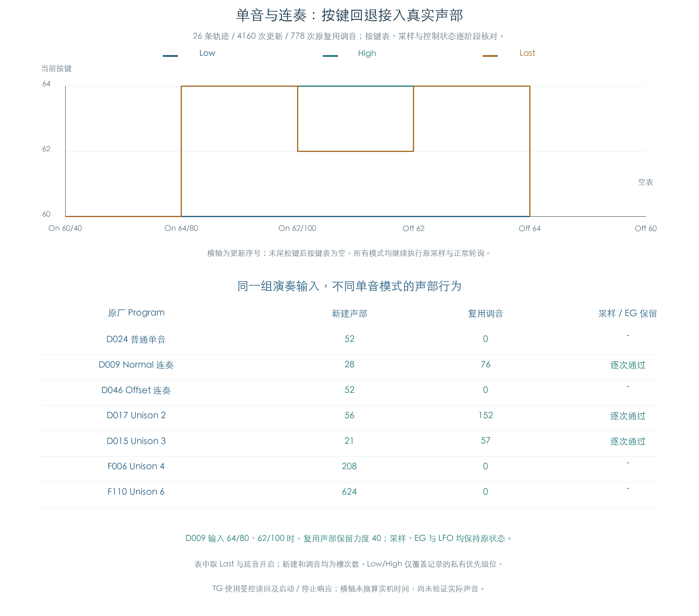

# 单音、连奏、Unison 与滑音选样

KROSS 2 v1.2.4 · 连续 MIDI 与真实采样声部 · 2026-11-02

Normal 连奏会修改已有声部的音符和键盘跟踪，保留最初的力度、采样、包络与 LFO。Offset 连奏关闭这条普通复用分支，按原路径重新构造声部。松键回退使用按键表中的当前音和一份共享力度缓存，声部自己的起始力度另行保留。

本轮把这些分支接到原 MIDI 输入、真实原厂采样、120 槽池和正常控制刷新，并加入真实的 2/3/4/6 声 Unison。26 条轨迹完成 4160 次更新，核对 2514 次新建、778 次复用调音和 3292 次滑音初始化；52 次按键表满后的插入均与独立模型一致。正常提交另有 42 次，控制字逐项核对。



## 1 按键顺序与回退

音色按键表容量为 10。Low 以最低音为表头，High 以最高音为表头，Last 以最近按下的音为表头。同音高重复按下会占用多个记录；表满后先取走尾项，再插入新按键。

依次输入 `60/40 → 64/80 → 62/100`，斜线后为力度：

| 优先级 | 第三个按键后的当前音 | 松开 62 | 再松开 64 |
| --- | ---: | ---: | ---: |
| Low | 60 | 60 | 60 |
| High | 64 | 64 | 60 |
| Last | 62 | 64 | 60 |

原厂代表记录使用 Last；Low/High 在私有运行参数中只覆盖 Program `+509` 的两位优先级，并记录修改前后值和完整指纹。源文件始终保持原值。

当前音改变时，按键表更新共享力度；等待音插入和 Note Off 保留该缓存。Normal 连奏复用声部时，声部原力度继续保留。例如 D009 先以 `60/40` 起音，再输入 `64/80、62/100`，原声部的力度仍为 40，采样、三类 EG 和两路 LFO 状态逐字节不变。后续声调按新音符和键盘跟踪更新。

## 2 三种单音方式与 Unison

| 代表音色 | 原参数路径 | 本轮核对内容 |
| --- | --- | --- |
| D024 InfinityLead | 普通单音 | 当前音切换、重建、等待音及松键回退 |
| D009 Memory Lead | Normal 连奏 | 原声部调音、力度与采样/EG/LFO 保留 |
| D046 Fat Sync Lead | Offset 连奏 | 原 Reset、选层和控制初始化，不走普通复用 |
| D017 Lucky Man Lead | Unison 2 | 多份原声部、连奏与滑音 |
| D015 PWM Lead | Unison 3 | 多份原声部及连续回退 |
| F006 Greasy Synth Bass | Unison 4 | 普通单音重建与多份分配 |
| F110 Ring Mod Riser | Unison 6 | 六声分发、重建与停止后再次起音 |

这里的 Unison 数量指分发份数。每份还会受 OSC 数量、选层和立体声配对影响，实际占用槽数可能更多。每次新建均核对原层权重、真实区域/采样地址、电平、控制初始化与存储的 Unison 编号。

## 3 滑音会改变新建声部的区域查询

原路径 `1F6958 → 1F82C0 → 1F5B24` 先计算滑音，再以返回的**基准音高**查询采样区域。这个基准还需加上滑音偏移，才得到当前播放音高。

设前音为 (P)、目标为 (T)，每半音为 256 个单位，基础系数为 (k)。有效滑音满足系数非零且前音存在：

```text
T >= P：基准 = T，偏移 = (P-T) × 256，终点 = 0，步长为正
T <  P：基准 = P，偏移 = 0，终点 = (T-P) × 256，步长为负

固定模式：步长绝对值 = k
音程缩放模式：步长绝对值 = max(1, floor(k × abs(T-P) / 3072))

区域查询音符 = 基准 >> 8
```

因此，有效滑音的区域查询使用两端较高的基准。系数为零或没有前音时，返回目标，偏移、步长与终点清零。结果 JSON 的 `initial_pitch` 字段记录该函数返回的基准；它与含偏移的即时播放音高有各自的含义。

D017 的一条实际流程在输入 48、力度 55 时，OSC2 的移调后目标为 36，缓存前音为 48。第二采样层的 Multisample 325 用基准 48 查询，选中区域 3522 / Sample 1193；直接按目标 36 查询会得到区域 3520 / Sample 1192。原新建声部与基准查询相符。这个差异会改变源波形，插件需要保留调用顺序；当前检查尚未比较实际声音。

全部轨迹中有 48 次新建的基准与目标不同，其中 20 次对应不同区域；其余情况虽有音高差异，仍落在同一区域。

部分计算先在原临时声部中执行，再把结果用于正式槽。检查分别标记临时对象与池内槽，避免把栈内工作对象误计为已分配声部。

## 4 连续矩阵与验证边界

三种单音代表各覆盖 Low/High/Last 和两种延音条件，共 18 条；四种 Unison 原厂音色各覆盖两种延音条件，共 8 条。每条持续 160 次更新，使用同一个 120 槽池与通道 7 / 模式 3。

输入包含三个不同力度的重叠音符、松键回退、跨音域断奏、踏板保持与释放、12 键使容量 10 的按键表溢出、重复同音高、CC123、CC120 和强停后再次起音。最后清空池，核对可用数恢复为 120。

每次 MIDI 事件后用独立按键模型检查键序、缓存力度、计数和原 Reset/Note On/Off 分发。原复用函数逐次比较采样、力度、LFO、EG、配对字段；四项键盘跟踪另用独立公式核对。每次滑音初始化核对原系数、返回基准、偏移/步长/终点，区域查询分别按基准与假设的目标查询保存。

随后执行原管理器推进和轮询，与显式原函数调度逐阶段比较全部 120 个声部、列表、六个 OSC、三个音色/Part/控制缓冲、16 通道、逐键控制和工作区，以及实际按键载荷、TG I/O、调用与提交顺序。所有正常提交继续核对独立整数控制字方程。

TG 活动位、忙闲、振幅和评分仍为明确的受控输入；启动/停止使用已有即时响应。原按键节点和四字节载荷放在私有内存，辅助参数、临时栈与空节点摘除适配沿用已记录边界。这里验证连续的软件控制行为，未测量实机时长和 TG 音频。多音色共享、发生器组合、完整预置集与宿主音频仍待完成。

## 证据与复现

```text
python3 research/tools/firmware_mono_live.py --verify-arm
python3 research/tools/firmware_mono_live_figures.py
python3 research/tools/firmware_runtime_verify.py --evidence-only
```

- [连续检查脚本](../../tools/firmware_mono_live.py)、[配图脚本](../../tools/firmware_mono_live_figures.py)
- [完整结果与输入指纹](../../derived/firmware/KROSS2_V124/architecture/stage04/mono-live-check.json)、[4160 行更新 CSV](../../derived/firmware/KROSS2_V124/architecture/stage04/mono-live-updates.csv)、[配图指纹](../../derived/firmware/KROSS2_V124/architecture/stage04/mono-live-figure-check.json)
- 前序：[单音按键](MONO_KEYS.md)、[声部复用与滑音](VOICE_REUSE.md)、[Unison 音高](UNISON.md)、[120 槽密集演奏](VOICE_PRESSURE.md)
