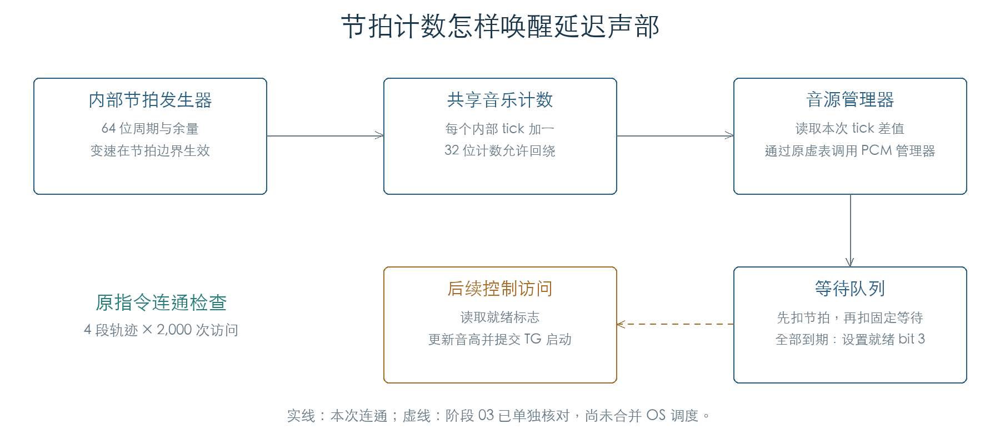
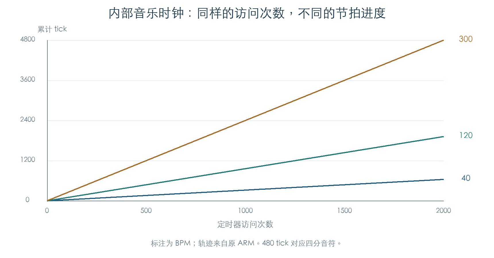

# 音乐时钟与节拍同步延迟

KROSS 2 v1.2.4 · 阶段 04 · 2026-11-01

内部音乐时钟用 64 位整数累计节拍。音源管理器读取新增 tick 数，将它交给等待中的声部。同步延迟按拍长倒计时，因此演奏途中改变速度会改变剩余等待的实际时长；OSC 的固定延迟在拍长等待结束后继续执行。



## 1 速度与节拍发生器

定时器入口 `0x117064` 调用 `0x2C832C`。每次访问，后者把 64 位时间累计值增加 `10⁹`，再检查是否需要产生一个或多个内部 tick。

速度以 BPM 的百分之一保存。设置入口 `0x2C80D0` 接受 `4000…30000`，即 40.00–300.00 BPM，其余值保持原状态。周期计算为：

```text
新周期 = floor(12,500,000,000,000 / 速度原值)
累计进度 = 本次累计值 − 上次累计值 + 上次余量
产生 tick 的条件：累计进度 + 1,000,000,000 > 当前周期
产生后：余量 = 累计进度 − 当前周期
```

余量可以为负，这是提前一个访问步长判定的结果。保留余量减少了按访问周期取整造成的节拍误差。单次访问最多产生 11 个 tick，防止积压导致无限补发。



| 速度 | 2,000 次访问产生的 tick | 480 tick 等待首次就绪的访问序号 |
| --- | --- | --- |
| 40 BPM | 639 | 1501 |
| 120 BPM | 1920 | 500 |
| 300 BPM | 4800 | 200 |

480 tick 对应四分音符，见后面的音符时值表。这个比例与名义 1 ms 定时访问相符。定时器设置函数写入计数值 24,000；当前实验没有运行真实定时器，也没有测量它的墙钟周期，图表统一使用访问次数。

## 2 启动、变速与暂停

时钟对象把“待生效周期”和“当前周期”分别保存。设置速度只改前者；下一次产生 tick 时，才更新当前周期与当前速度。计算余量时仍扣除刚刚结束的旧周期。

首次访问建立时间基准，产生零个 tick。暂停期间累计时间继续增加，节拍输出停止。恢复入口 `0x2C819C` 重新对齐时间基准：参数为 0 时保留余量，为 1 时清空余量并立即采用待生效周期。

26,001 个合法速度值均与独立整数除法比较。六档速度各执行 2,000 次访问；另用 1,200 次访问检查途中变速和两种恢复方式。40 次跨边界访问核对了 64 位累计值及共享 32 位 tick 计数的回绕。

## 3 tick 怎样进入音源

内部 tick 分发函数 `0x2C82C0` 根据时钟来源选择音乐处理入口。内部来源分支把全局时钟对象 `+4` 加一，随后调用其他音乐消费者。外部来源分支不会在此增加计数；有效 F8 在接收入口将共享计数增加 20，见[外部 MIDI 时钟](EXTERNAL_CLOCK.md)。

音源管理器 `0x271324` 读取共享计数，与上次保存值做 32 位减法，再把差值传给各音源管理器的虚表首项。PCM 虚表首项指向 `0x1FD3CC`，后者调用等待链表 `0x1FCECC`。

本次连通检查执行上述原函数与真实虚表。时钟推进和音源服务由夹具依次调用；其他音乐消费者、音色控制访问在边界截获。四种速度轨迹共推进 8,000 次，每次检查五个声部的剩余等待和就绪位。

管理器忙标志 `+E0` 会跳过整个 PCM 访问，而上层共享计数快照已更新。夹具确认了这个分支的效果；实际调度何时允许遇到该组合，还需要结合临界区与中断优先级检查。

## 4 拍长与固定等待

原函数 `0x2C4DE0` 将下表时值乘以 Times。手册允许 Times 为 1–32。[C1]

| Base Note | tick | Base Note | tick |
| --- | --- | --- | --- |
| 三十二分音符 | 60 | 四分三连音 | 320 |
| 十六分三连音 | 80 | 四分音符 | 480 |
| 十六分音符 | 120 | 二分三连音 | 640 |
| 八分三连音 | 160 | 二分音符 | 960 |
| 八分音符 | 240 | 全音符 | 1920 |

完整声部初始化 `0x1F7278` 生成两个等待字段：

| 设置 | 声部 `+234`：节拍等待 | 声部 `+208`：固定等待 |
| --- | --- | --- |
| 同步关闭 | 0 | OSC 延迟 + 音色固定延迟 |
| 同步开启 | Base Note × Times | OSC 延迟 |
| OSC 设为 KeyOff | 0 | −1，等待松键 |

279 组完整初始化检查了这些写入，以及等待均为零时才直接调用 TG 启动的条件。同步关闭时，音色固定延迟的 KeyOff 也会使等待变为 −1；同步开启后，这个固定字段被忽略。Times 为 0 的夹具用于检查原始字节边界，正常界面从 1 起。

队列每次先处理 `+234`。节拍等待尚未结束时，固定等待不变；本次刚把节拍扣到零时，也要等下一次访问才开始扣固定等待。固定等待为 −1 时保持不变，由 Note Off 路径转换。两个等待都结束后，设置声部标志 bit 3，后续控制访问才启动声音。

| 连续轨迹 | 480 tick | 480 tick 后再等 3 次固定访问 |
| --- | --- | --- |
| 120 BPM 保持不变 | 第 500 次就绪 | 第 503 次就绪 |
| 第 200 次从 120 改为 240 BPM | 第 350 次就绪 | 第 353 次就绪 |

这与手册所述“变速后仍保持指定拍长”的行为一致。[C1] 就绪后的原音高更新与 TG 启动已在[阶段 03](VOICE_TG.md)单独验证；完整 OS 调度与实际音频输出仍待连通。

## 5 证据与下一步

当前检查还包括 2,560 组时值乘法、80 组等待边界、16 组时钟来源状态和 8 组管理器忙标志/计数回绕。后续已核对 [MIDI Clock 接收与 Auto 切换](EXTERNAL_CLOCK.md)。接下来恢复 Start/Continue/Stop 的完整消费者，以及琶音和序列器的事件推进。

- [机器结果与完整轨迹](../../derived/firmware/KROSS2_V124/architecture/stage04/music-clock-check.json)
- [节拍发生器汇编](../../derived/firmware/KROSS2_V124/architecture/stage04/internal-tick-generator.arm.txt) · [音源分发汇编](../../derived/firmware/KROSS2_V124/architecture/stage04/sound-manager-clock-dispatch.arm.txt) · [等待队列汇编](../../derived/firmware/KROSS2_V124/architecture/stage04/voice-wait-countdown.arm.txt)
- [C1：KROSS 2 Parameter Guide](../../downloads/KROSS2_Parameter_Guide.pdf)，印刷页 81、120，MIDI/Tempo Sync、Base Note 与 Times。

```sh
python3 research/tools/firmware_music_clock.py --verify-arm
python3 research/tools/firmware_runtime_verify.py
```
